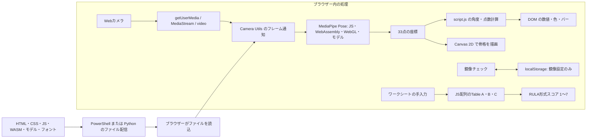
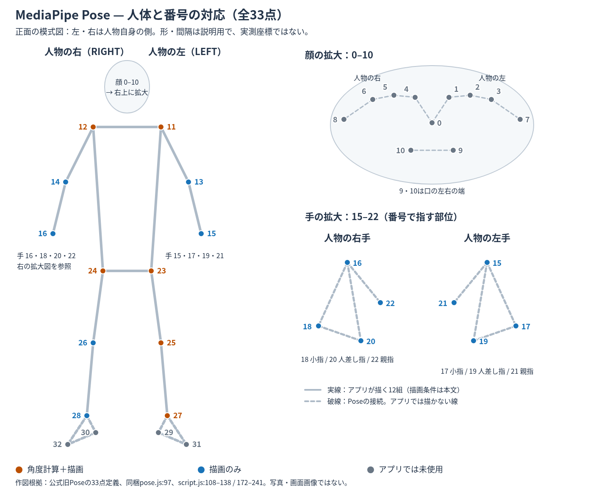
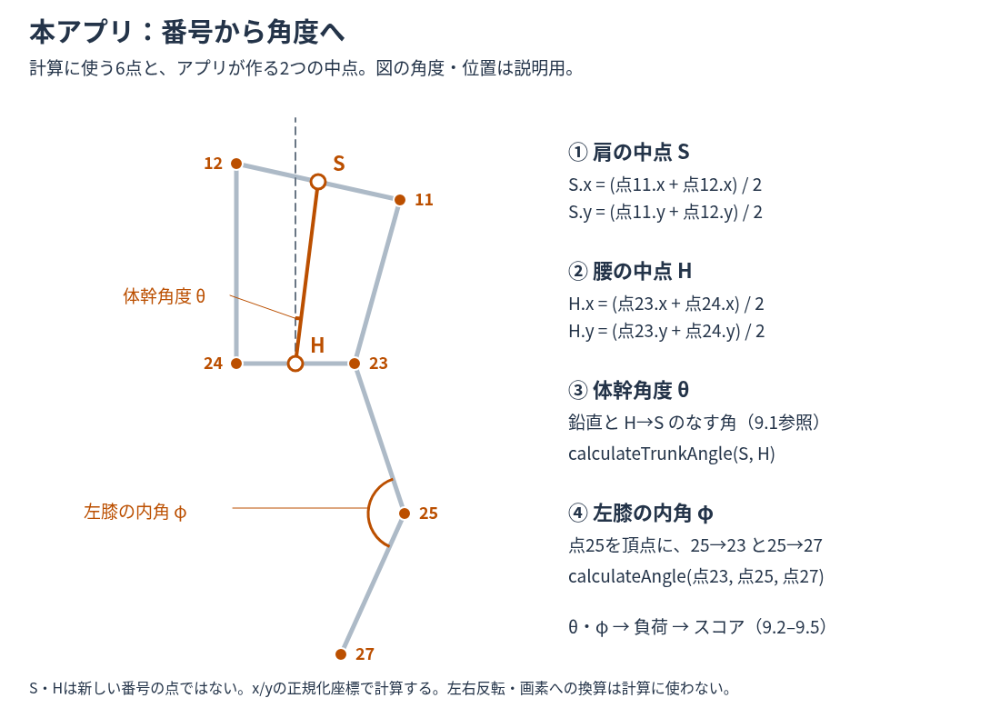
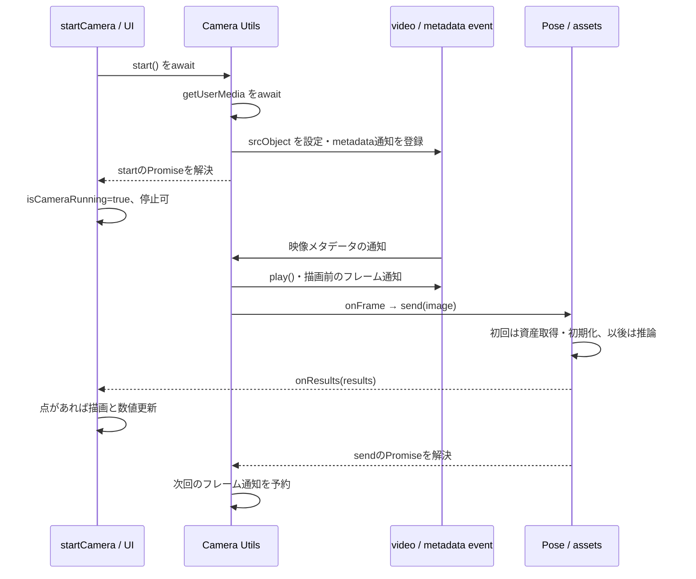

# ErgoMonitor AR 仕様説明書

対象読者は、このシステムを初めて引き継ぐエンジニア。関数や配列等のプログラミングの基礎は読めるが、MediaPipe・映像処理・RULAを知らない読者を想定する。本書では技術の名前から、入力、処理、出力、アプリ固有の計算、障害と変更判断までを対応付ける。

対象コミット：`1214b9bf67b1b18fe3e33e7a3b4eeab3981ef880`。2026-10-13（日本時間）に `evidence-doc` で全面再調査・改訂。以前の調査日と今回の再確認を区別し、今回実行した範囲は13章と[改訂・検証記録](docs/reviews/evidence-doc_spec_20261013.md)に残す。ソースの行番号は対象コミット、追加した検証コードは本書と一緒に保存した版に対応する。

## 最初に理解すること

このアプリは、**Webカメラの映像から身体の点を推定し、その点から体幹と左膝の角度を計算して、独自の点数を表示する静的Webアプリ**である。「静的」は配信サーバーが既存のファイルを返すという意味で、画面が動かないという意味ではない。計算と映像処理はブラウザー内で動く。PythonやPowerShellのサーバーへ映像を送って採点する構成ではない。

独立した二つの計算がある。どちらを変更するかを先に決める。

| 系統 | 入力 | 処理 | 結果の読み方 |
| --- | --- | --- | --- |
| 主画面 | カメラ画像から推定した身体の点 | 左右肩・腰の中点による体幹角度と左膝の内角を段階点数へ変換 | 0～100点。高いほどこの独自式上の負担が小さい。正式RULA点数ではない |
| 手入力ワークシート | 観察者が選んだ姿勢・筋使用・荷重の分類 | Table A/Bで部位の組合せを照合し、加算後の値からTable Cを参照 | 1～7点。高いほど強い対応を促す画面の判定。原典との完全一致は未確認 |

主画面の点数はMediaPipeが返すものではない。MediaPipeが返すのは身体の位置等であり、`script.js` が独自の点数へ変換する。ワークシートにはカメラの値を渡さない。この区別が、ライブラリ更新と採点変更を切り分ける出発点になる。

## 読む順序と目次

1. 動かしてみる：7章で対象版と必要ツールを確認し、起動する。
2. 仕組みを知る：3章のブラウザー・MediaPipe・RULAの説明を読み、5章のデータと非同期処理を追う。
3. 計算を確認する：9章の座標・式・境界・具体例を実関数へ対応付ける。
4. 開発を続ける：12章で障害の経路、14章で変更の依存箇所を確認する。
5. 個別の識別子を調べる：付録A/B。全件を初めから暗記する必要はない。

| 章 | 内容 |
| --- | --- |
| [1](#1-目的対象範囲)・[2](#2-機能と制約) | 目的、対象、実装済み機能、制約 |
| [3](#3-構成技術依存関係) | 技術の仕組み、依存、根拠、用語 |
| [4](#4-ファイル構成)・[5](#5-起動終了とデータの流れ) | ファイル、実行順、データ、非同期の境界 |
| [6](#6-画面と状態)・[7](#7-開発準備起動変更テスト) | 画面、状態、準備、起動、検証 |
| [8](#8-設定値環境変数)・[9](#9-計算方法) | 設定と変更の影響、計算の詳細 |
| [10](#10-保存取得削除)・[11](#11-権限認証個人情報) | 保存、権限、データの扱い |
| [12](#12-エラーログ復旧)・[13](#13-検証方法と今回の結果) | 調査と復旧、確認方法と結果 |
| [14](#14-既知の不具合未解決事項変更注意) | 未解決事項、変更判断と依存 |
| [付録A](#付録a-変数定数一覧)・[付録B](#付録b-関数メソッド一覧) | 定義位置・スコープ別の変数と関数 |

利用者向け操作は[使用マニュアル](使用マニュアル.md)。実装状態、確認状態、改善提案は別に扱う。「実装済み」はコードがあること、「実行確認」は記載した条件で試したこと、「未確認」は根拠や検証が不足すること。背景ぼかしの問題はユーザー提供情報であり、実機検証済みとは扱わない。

## 1. 目的・対象・範囲

作業姿勢の傾向を、その場の映像・骨格・数値として見るα版デモである。作業姿勢を観察する利用者と、デモを保守するエンジニアを対象とする。説明画面は「姿勢の傾向を直感的に理解すること」を目的と記す（[rula.html:25](rula.html#L25)）。医療診断、実際に腰へ作用する力・圧力の測定、正式なRULAとしての妥当性検証は確認できない。

主画面は画像から得た2Dの点を使い、体幹と左膝だけで計算する。作業の重量・継続時間・反復回数・首腕手首の姿勢はこの式に入らない。一方、別の `RULAworkseet.html` は人がそれらの分類を入力するフォームである。二つの点数を同じ尺度として比較したり、一方の値を他方へ自動入力したりする実装はない。

本書の対象はアプリ画面、計算、同梱依存の利用方法、ローカル配信、開発と文書検証である。学習データ作成、モデルの再学習、外部ライブラリの全内部コード監査、インターネット公開サービスの運用は対象外。録画、履歴、認証等は対象外と隠すのではなく、2章で未実装として示す。

目的と採用理由を区別する。姿勢デモの目的とオフライン化等の意図は記録にあるが、MediaPipeやRULAを他方式と比較して選んだ理由、点数や閾値の研究上の根拠は未確認。14章で確認できた履歴と変更判断を分ける。

## 2. 機能と制約

| 区分 | 内容・根拠 |
| --- | --- |
| 実装済み（コード・実行確認） | カメラ開始・停止、MediaPipe推論、骨格重畳、角度・スコア・色表示、鏡像切替と保存、RULA簡易説明画面、手入力ワークシートと表のハイライト |
| 実装済み（コード確認のみ） | Windows PowerShellローカルサーバ・既定ブラウザー起動・8000～8010の順次試行（`serve.ps1:26–52`） |
| 未実装 | 録画、画像・CSV・PDF出力、測定履歴、時刻表示、測定結果保存、ログイン、カメラ選択UI、姿勢のキャリブレーション、主画面とワークシートの値の連携 |
| 制約 | 数値計算にz座標・world座標・関節visibilityを使わない。左右肩・腰は平均、膝は左側のみ。複数人の選択機能なし。実カメラ精度・OS別動作・最低性能要件は未確認 |
| 既知の問題 | 人体検出がなくなると前回の数値が残る。骨格色と判定色は別基準。停止後にWASM例外が発生した（詳細14章）。背景ぼかし時の精度低下はユーザー提供情報 |

## 3. 構成・技術・依存関係

### 3.1 全体構成と技術の担当範囲

**実装はビルド不要の静的Webアプリである。** HTML・CSS・JavaScriptとモデルをHTTPでブラウザーに渡し、カメラ取得・姿勢推定・計算・画面更新をブラウザーで実行する。WindowsのPowerShellも、開発時のPythonも、姿勢を計算するサーバーではない。



| 使用技術 | 何をする技術か | この実装での担当・参照先 |
| --- | --- | --- |
| HTML | ブラウザーに表示する要素と文書構造を定義する | 映像、描画面、数値枠、ボタンを [index.html:15](index.html#L15) 以降で定義。手入力フォームは [RULAworkseet.html:49](RULAworkseet.html#L49) 以降 |
| CSS | 要素の配置・色・文字・表示変換を指定する | [style.css:24](style.css#L24) の色変数、[style.css:126](style.css#L126) の画面幅対応、[style.css:143](style.css#L143) の鏡像。ワークシートは自身の [RULAworkseet.html:7](RULAworkseet.html#L7) にCSSを内包 |
| JavaScript | ブラウザー上でイベント処理や数値計算を実行する | [script.js:51](script.js#L51) の角度計算、[script.js:278](script.js#L278) の開始処理、[RULAworkseet.html:316](RULAworkseet.html#L316) の表参照計算 |
| DOM API | HTML要素を取得し、内容や属性をプログラムから変える | [script.js:2](script.js#L2) の `getElementById`、[script.js:150](script.js#L150) 以降の `textContent`・`className` 等による結果表示 |
| getUserMedia / MediaStream / video | 許可されたカメラから映像トラックを取得し、video要素で再生する | [camera_utils.js:21](vendor/mediapipe/camera_utils/camera_utils.js#L21) で取得、[同:22](vendor/mediapipe/camera_utils/camera_utils.js#L22) で `video.srcObject` に設定 |
| MediaPipe Camera Utils | カメラ取得・再生・フレーム通知をまとめた外部JSライブラリ | [script.js:289](script.js#L289) の `new Camera`。本アプリの `onFrame` を呼ぶ。姿勢推定と点数計算は担当しない |
| MediaPipe Pose | 画像から人の身体の33点を推定する外部ライブラリ | [script.js:260](script.js#L260) の `new Pose`、[script.js:291](script.js#L291) の `pose.send`。旧Solution APIを使用。点数計算は本アプリ側 |
| WebAssembly（WASM） | コンパイル済みバイナリーをブラウザーで実行する仕組み | 同梱 `.wasm` がMediaPipeの実行基盤。JSからロードされる。PythonやNodeへ映像を渡す仕組みではない |
| WebGL | ブラウザーでグラフィックス処理を行うAPI | Pose内部の映像テクスチャ処理等。[pose.js:72](vendor/mediapipe/pose/pose.js#L72) でWebGL2→WebGLの順にコンテキスト取得を試みる |
| Canvas 2D | canvas要素に線や円を描くAPI | [script.js:4](script.js#L4) の `getContext('2d')`、[script.js:165](script.js#L165) の骨格描画。Pose内部のWebGLとは別の描画面 |
| localStorage | 同じオリジンのブラウザー内に文字列を保持するAPI | [script.js:20](script.js#L20) のキーで鏡像ON/OFFのみ保存。映像・姿勢・点数は保存しない |
| Windowsバッチ / PowerShell / .NET HttpListener | プロセス起動とHTTP要求の受付・応答を行う | [start-offline.bat:4](start-offline.bat#L4) → [serve.ps1:29](serve.ps1#L29)。Windows利用者向け静的ファイル配信 |
| Python標準 `http.server` | ディレクトリ内のファイルをHTTPで配信する開発用サーバー | [README-offline.md](README-offline.md) の代替起動。今回Linuxで使用。アプリ内にPythonコードはない |
| WOFF2 / IBM Plex Mono | ブラウザー用の圧縮フォント形式 / 等幅フォント | [style.css:8](style.css#L8) の `@font-face` で同梱ファイルを読込。数字等の書体に使用 |

フレームワーク、バックエンドAPI、DB、ビルド処理、アプリ用パッケージマネージャー、環境変数、認証情報は該当なし。対象コミットのアプリ本体には `package.json`、lockfile、CI設定、自動テストはない。今回追加した `docs/verification/` は文書の根拠を再実行するための別の検証パッケージで、アプリ起動の依存ではない。MediaPipeはnpmで配布されるライブラリだが、本リポジトリでは必要ファイルを `vendor/` に置いて直接読むため、起動時の `npm install` は不要である。Nodeは今回の検証用ツールであり、配信にもブラウザーでの計測にも必須ではない。

### 3.2 HTML・CSS・JavaScriptの実行方式

#### HTMLの要素とDOM参照

HTMLはブラウザーが表示する文書構造である。`<video>` は映像、`<canvas>` は描画面、`<button>` は操作、`<span>` 等は数値の表示場所を作る。ブラウザーがHTMLを読み込むと、これらをプログラムから参照できるオブジェクトとして扱う。この実行中の文書構造がDOM（Document Object Model）である。

例えば [index.html:43](index.html#L43) の `id="score"` を [script.js:40](script.js#L40) の `getElementById('score')` で取得する。`scoreEl` は点数ではなくHTML要素への参照で、`scoreEl.textContent = score` がその中の表示文字を変える。DOMのIDを変えるなら、HTMLだけでなくJSの取得先も変える必要がある。参照がnullのままプロパティを触ると例外になる。`ctx` はCanvasの描画に使うオブジェクトであり、DOM表示値とは別である。

[index.html:121](index.html#L121) はbody末尾で、通常のscriptタグを **Camera Utils → Pose → script.js** の順に読む。`type="module"`・`async`・`defer` はない。この位置までに作られたDOMと、先のライブラリが公開する `Camera`・`Pose` をアプリが使う。JSをheadへ移す、読込順を変える、module化する場合は、DOMの準備とライブラリ名の可視範囲が変わるため、単にタグを移して同じ挙動になると扱わない。

`script.js` のトップレベルの `let`/`const` と関数は同じページの実行環境に属する。トップレベルのletは必ずしも `window.pose` のようなプロパティになるわけではない。ページを開き直せば別の実行状態になる。ワークシートは自分のHTMLにCSSとJSを内包し、カメラ側のJSは読まない（[RULAworkseet.html:217](RULAworkseet.html#L217)）。

#### CSSと画面表示の役割

CSSはDOM要素の配置、サイズ、書体、色、変換を指定する。値の計算はJS、数値に対応する色の見た目はCSSである。例えばJSが `status-warning` を付け、[style.css:303](style.css#L303) 周辺の規則が文字や背景の色を指定する。クラス名を変更するときは、JSが出す名前とCSSが受け取る名前をそろえる。

videoは元映像、Canvasは骨格だけを描く透明な重ね合わせ面である。Canvasを絶対配置で同じ位置に置き（[style.css:148](style.css#L148)）、両方を同じ表示サイズにする。描画の座標系はCanvasの `width`/`height` 属性、画面上のサイズはCSSで決まる。CSSだけを変更しても点数の式は変わらないが、表示の見え方や身体の収まり方は変わる。

鏡像は `transform: scaleX(-1)` による左右の表示反転で、videoとCanvasへ同時に適用する（[style.css:143](style.css#L143)）。これは推論へ渡す元画像やLEFT/RIGHT番号を交換する処理ではない。したがって鏡像チェックを変えても計算値は変わらない。身体の左膝を右膝に変えるにはJSのランドマーク番号を変更する必要がある。

レイアウトはFlexbox（要素を並べ、空き幅と折返しを配分するCSSの仕組み）で、720px以下と868px以上に別の規則がある。幅868pxの条件は映像・パネル・間隔・余白が横並びになる幅を意図した記録に対応する。固定の640pxだけを見て「映像は常に640px」と判断しない。レスポンシブは表示幅の対応であり、計算の画像尺度補正を行うことではない。

#### イベントと非同期処理をどう読むか

起動・停止はイベントで動く。イベントとはクリックや映像準備等の通知で、あらかじめ登録した関数（コールバック）が通知時に呼ばれる。`addEventListener('click', startCamera)` はその場でカメラを開始せず、クリック時の呼出先を登録する。

Promiseは、後で成功または失敗が決まる処理の完了を表すJavaScriptのオブジェクト。`async` 関数はPromiseを返し、`await` はその処理の完了を待ってから後続を進める。処理全体を自動で別スレッドへ移す構文ではない。本アプリ独自のWeb Workerはない。

ここには二つの待機がある。`await camera.start()` はカメラの取得・videoへのストリーム設定を待つ。一方 `await pose.send({image: video})` は各フレームの推論経路を待つ。カメラ取得Promiseの成功が、モデル読込や全推論の成功を意味するわけではない。どの関数がどのPromiseを待ち、どこで失敗を捕捉するかは5.1・12章で区別する。

この実装で確認できるAR（映像等へ情報を重ねる表示）の処理は、元映像への骨格線・腰の円の重畳である。WebXR、空間アンカー、AR機器との連携は未実装で、3D世界座標を採点に使っていない。

### 3.3 カメラAPI・フレーム通知・描画・設定保存

#### 映像取得からvideoへ

カメラを利用する入口はブラウザーの `navigator.mediaDevices.getUserMedia`。利用者が許可した機器からMediaStream（映像等のトラックをまとめた流れ）を得る。トラックはカメラ等の入力源を表し、`track.stop()` がそのトラックの利用を停止する。映像取得と画面再生と姿勢推定は別段階である。

本アプリはCamera Utilsへvideo要素と要求寸法640×480を渡す。同梱ライブラリは映像のみを要求し、音声の取得を指定しない。`facingMode` はアプリで渡さないためライブラリ既定値 `"user"` が使われる（[camera_utils.js:20](vendor/mediapipe/camera_utils/camera_utils.js#L20)）。アプリ内の機器一覧や切替はない。要求寸法は実サイズの保証ではなく、結果受信時の `video.videoWidth`/`video.videoHeight` がCanvas寸法に使われる。

取得したストリームは `video.srcObject` へ設定される。メタデータ（映像の寸法等）が読めるようになったイベントで `video.play()` とフレーム通知が始まる。同梱Cameraの `start()` Promiseが待つのは取得とストリーム設定であり、映像の再生や初回推論の終了ではない。`video.play()` 自体もPromiseを返すが、同梱ライブラリはその完了を待たず、失敗をcatchしない。カメラ取得が成功しても映像が再生されない場合は、videoの状態と再生例外を調べる。ここを混同すると「開始ボタンが起動中になったのに点がない」原因をカメラ権限だけに限定してしまう。

カメラAPIには利用者の許可と安全なコンテキストが必要である。安全なコンテキストはブラウザーがこのAPIを使えると判断するページの実行条件で、通常HTTPSやlocalhost等が対象となる。今回 `http://127.0.0.1` でAPIを利用した。他PCへの単純なHTTP配信に同じ条件は保証しない。また、`file://` が安全と判断される場合でも、その後のモデル取得が成立するとは限らない。3.8と7章のHTTP起動を使う。

#### 1枚ずつ処理するフレーム通知

フレームは動画の1枚の画像。Camera Utilsは `requestAnimationFrame`（ブラウザーの次の描画前に処理を予約するAPI）で通知を繰り返す。映像が一時停止しているときや `video.currentTime` が前回と同じときは、本アプリの `onFrame` を呼ばない。固定の30FPS等を指定しているわけではない。

`onFrame` は `await pose.send` を含むasync関数。Camera UtilsはそのPromiseの解決後に次回通知を予約するため、単純に毎描画で無制限の同時推論を積む構造ではない。ただしPromiseがreject（失敗）した場合のcatchと次回予約は同梱Camera Utilsにもアプリにもない（[camera_utils.js:22](vendor/mediapipe/camera_utils/camera_utils.js#L22)）。映像が動いていても推論だけが継続しない場合がある。背景タブでは描画通知自体が止まることがあるため、常時一定の計測頻度も保証しない。

#### 身体の点を線へ変換する

Poseの出力を受けたアプリは、点の `x/y` にCanvas寸法を掛けて画素へ変換し、`moveTo`/`lineTo`/`arc` で線と円を描く。これは位置の描画で、人物や関節の推定を行うAPIではない。Pose内部のWebGL用Canvasと、画面の `id="canvas"` を持つCanvas 2Dは別の描画面である。

Canvasはピクセルの絵なので、幅や高さを代入すると内容と描画状態がリセットされる。[onResults](script.js#L248) は未検出時もvideo寸法を代入する。その結果、点がないフレームでは骨格が消えるが、DOMに残した前回の数値は更新されず残る。残留値は正常な最新推定を意味しない。

#### 設定保存の範囲

localStorageはブラウザー内に文字列を保存するAPIで、オリジン（方式・ホスト・ポート）ごとに保存先が異なる。`http://localhost:8000`、`http://127.0.0.1:8000`、ポート8001は別の保存先になる。

保存するのは `ergomonitor-mirror` の文字列 `"1"`/`"0"` だけで、未保存ならHTMLのchecked=trueを使う。保存が拒否された際の例外は捕捉して、表示の切替は続ける（[script.js:26](script.js#L26)）。値の有効期限はアプリで設定しない。映像、位置、測定値、ワークシート結果の保存とは関係がない。

### 3.4 MediaPipeの基礎と本アプリでの使い方

#### 3.4.1 MediaPipeとは何か

**MediaPipe（メディアパイプ）は、Googleが公開する、機械学習を使った情報の検出・推定をアプリに組み込むためのソフトウェア群である。** 画像から物体を検出する、人の姿勢を推定する、音声や文章を分類する、といった処理を提供する。開発者は公開されたライブラリを呼び出し、入力に対する推定結果を受け取って自分のアプリの処理に使う。ここで「ライブラリ」とは、アプリから呼び出して利用する、用意済みのプログラムを指す（公式概要T15）。

このアプリはMediaPipeのうち **Pose（ポーズ：人の姿勢の推定）** を使う。カメラの1枚の画像を渡して人体を検出できれば、Poseは「画像のどこに肩・腰・膝などがあると考えられるか」を座標で返す。アプリはその座標から角度と点数を計算し、映像に線を重ねる。入力は画像、Poseの出力は身体の点、画面の点数はアプリの独自計算、という三つの段階を分けて読む。

肩などの位置を求める処理には、事前の学習によって作られたモデルを使う。新しい画像をモデルで処理し、身体の各点の位置を自動で推定する。モデルとその実行プログラムの役割は3.4.2・3.5で説明する。返された点が実際の関節位置と一致する精度は撮影条件等に左右され、このリポジトリでは実カメラでの精度を検証していない。

本アプリでは必要なライブラリ・実行コード・モデルを `vendor/mediapipe/` に同梱し、**利用者のブラウザー内でPoseを動かす**。具体的には [index.html:121–122](index.html#L121) がライブラリを読み、[script.js:260](script.js#L260) がPoseを生成する。一般的なMediaPipe全体の説明と、この同梱版の動作は区別する。

公式資料の原文は [docs/references/mediapipe/](docs/references/mediapipe/README.md) に保存した。以下で処理と出力を説明し、原文は根拠や詳細を確認するときに参照できるようにしている。

#### 3.4.2 この説明で使う用語

| 用語 | 意味 | このアプリでの具体例 |
| --- | --- | --- |
| フレーム | 動画を構成する1枚の画像 | 再生中のvideo要素の、その時点の映像をPoseへ渡す |
| 学習済みモデル | 入力から出力を求める計算の構造と、事前の学習で得られた数値を持つデータ | `pose_landmark_full.tflite`。実行時に読み込み、身体の点を求めるために使う |
| 推論 | 学習済みモデルに新しい入力を与え、結果を計算すること | カメラの画像から身体の点を推定する。モデルの学習コードは本リポジトリにない |
| ランドマーク | 身体の特定の位置を表す、番号が決まった点 | 配列の11番は左肩、25番は左膝。点は座標を持つ |
| 検出 | 画像から対象を見つける処理 | 画像のどこに人がいるか、人体を処理する領域を求める |
| ROI（Region of Interest） | 次の処理で注目する画像の領域 | 人体がある領域を切り出して、点の推定に使う |
| 追跡 | 連続する画像で対象の位置を更新していく処理 | 前回の点を利用し、次のフレームの人体領域を求める |
| セグメンテーション | 画像の各部分を人物・背景等に分ける処理 | 旧Poseは人物/背景のマスクも返せるが、本アプリはこの出力を要求しない |
| 処理グラフ | 処理要素と、その間を流れるデータの接続を定義したもの | `pose_web.binarypb`。MediaPipe内部の処理の組合せを読み込むためのファイル |

この表のPoseに関する説明は旧Poseの公式資料T7、処理グラフはT10に基づく。アプリ側の計算式や実装位置は以下で対応付ける。

#### 3.4.3 映像から身体の点が得られるまで

旧Poseの公式資料は、検出器と追跡器を組み合わせる処理を説明する（[保存した原文のML Pipeline](docs/references/mediapipe/legacy-pose.md#ml-pipeline)）。この説明を本アプリへ対応付けると次のようになる。

```text
Camera Utilsがカメラ映像をvideo要素で再生
  ↓ 新しいフレームが利用可能になり、onFrameを呼ぶ
script.jsが pose.send({ image: video }) で画像を渡す
  ↓
Poseが人体の処理対象領域を求める
  ・最初や追跡を失ったとき：画像から人を検出する
  ・追跡が続いているとき：前回の点から次の領域を求める
  ↓
対象領域を切り出した入力から、身体の33点を推定する
  ↓ 本アプリはsmoothLandmarks=trueで、フレーム間の点の揺れを抑える
Poseが登録済みのonResultsへ結果オブジェクトを渡す
  ↓
script.jsが点を線で結び、角度と点数を計算して表示する
```

カメラ取得の担当はCamera Utils、人体検出・点の推定の担当はPoseである。`script.js` は画像を渡して結果を受け取る。[script.js:291](script.js#L291) に独自の画像切出し、明るさ補正、背景ぼかし除去はない。図の内部処理は公式資料で確認した仕組みの要約で、グラフ内部の全前処理の数式を調査したという意味ではない。

点の配列が渡されない場合、[script.js:252](script.js#L252) の分岐で描画・数値更新を呼ばない。このアプリはそこで数値を初期化しないため、前回の値が残る。人体が見つからないときの表示は、推定器の出力とアプリの未検出処理の両方を調べる必要がある（14章D1）。

#### 3.4.4 33点の配列と座標の読み方

結果の `poseLandmarks` は点の配列である。JavaScriptの配列は0番から始まるため、33点の番号は **0～32**。点の番号と身体の部位の対応は固定されている。ここでいう左・右は**画像に写る人物自身の左・右**であり、画面の左・右だけを見て判断しない。鏡像チェックによる表示反転は座標の計算を変えない（3.2）。

**図3-1：人体・顔・手と33点の番号対応。** 正面から人物を見る模式図なので、図の右側が人物の左、図の左側が人物の右になる。顔と手は番号の重なりを避けて拡大した。橙は角度計算と描画、青は描画のみ、灰はこのアプリでは使わない点を表す。実線はアプリが描く12組の接続、破線は公式Poseにあるがアプリでは描かない接続を表す。点の色と線の種類は別の情報で、青い指の点を破線が結んでいても指の線は画面に描かれない。番号そのものは色や鏡像表示で変わらない。



[拡大可能なSVG](docs/images/mediapipe_pose_33_landmarks.svg)。**この図は本書用に作成した模式図**で、公式画像の転載でも実際の推定結果・画面画像でもない。点の間隔、人体の形、手の向きは位置・角度の基準に使わない。番号と部位は保存した [公式旧Poseの `PoseLandmark` 定義:56–90](docs/references/mediapipe/upstream-pose-landmarks.py.txt#L56)、採用版の [pose.js:97](vendor/mediapipe/pose/pose.js#L97) と照合した。顔・手・足の接続は [pose.js:96](vendor/mediapipe/pose/pose.js#L96) に対応する。公式Pythonソースは番号確認の資料であり、本アプリにPythonのMediaPipeを導入したという意味ではない。

**全33点の対応表。** 英字は公式定義の識別名。左右の列は人物自身の側を表す。図の番号から部位を知り、表の「アプリの利用」から変更時の影響を調べる。

| 部位 | 人物の左：番号 / 公式名 | 人物の右：番号 / 公式名 | アプリの利用 |
| --- | --- | --- | --- |
| 鼻（中央） | 0 / `NOSE`（左右なし） | — | 使用しない |
| 目の内側 | 1 / `LEFT_EYE_INNER` | 4 / `RIGHT_EYE_INNER` | 使用しない |
| 目 | 2 / `LEFT_EYE` | 5 / `RIGHT_EYE` | 使用しない |
| 目の外側 | 3 / `LEFT_EYE_OUTER` | 6 / `RIGHT_EYE_OUTER` | 使用しない |
| 耳 | 7 / `LEFT_EAR` | 8 / `RIGHT_EAR` | 使用しない |
| 口の端 | 9 / `MOUTH_LEFT` | 10 / `MOUTH_RIGHT` | 使用しない。採用JSの名称の違いは下記参照 |
| 肩 | 11 / `LEFT_SHOULDER` | 12 / `RIGHT_SHOULDER` | 左右の中点を体幹角度に使用。左右とも点・線を描画 |
| 肘 | 13 / `LEFT_ELBOW` | 14 / `RIGHT_ELBOW` | 点・線を描画。計算には使用しない |
| 手首 | 15 / `LEFT_WRIST` | 16 / `RIGHT_WRIST` | 点・線を描画。計算には使用しない |
| 小指の点 | 17 / `LEFT_PINKY` | 18 / `RIGHT_PINKY` | 点だけ描画。指の線・計算には使用しない |
| 人差し指の点 | 19 / `LEFT_INDEX` | 20 / `RIGHT_INDEX` | 点だけ描画。指の線・計算には使用しない |
| 親指の点 | 21 / `LEFT_THUMB` | 22 / `RIGHT_THUMB` | 点だけ描画。指の線・計算には使用しない |
| 腰 | 23 / `LEFT_HIP` | 24 / `RIGHT_HIP` | 左右の中点を体幹角度・腰の強調描画に使用。23は左膝角度にも使用。左右とも点・線を描画 |
| 膝 | 25 / `LEFT_KNEE` | 26 / `RIGHT_KNEE` | 25だけ角度計算に使用。26は定数宣言があるが計算では参照しない。左右とも点・線を描画 |
| 足首 | 27 / `LEFT_ANKLE` | 28 / `RIGHT_ANKLE` | 27だけ角度計算に使用。28は定数宣言があるが計算では参照しない。左右とも点・線を描画 |
| かかと | 29 / `LEFT_HEEL` | 30 / `RIGHT_HEEL` | 使用しない |
| 足先の点 | 31 / `LEFT_FOOT_INDEX` | 32 / `RIGHT_FOOT_INDEX` | 使用しない |

**採用版の名称に注意：** 公式Python定義で9・10は `MOUTH_LEFT`・`MOUTH_RIGHT` だが、同梱JSの `POSE_LANDMARKS` は9を `LEFT_RIGHT`、10を `RIGHT_LEFT` と公開している（[pose.js:97](vendor/mediapipe/pose/pose.js#L97)）。本書の表は身体との対応を公式名で示しており、その名前で同梱JSのプロパティを読めると保証するものではない。既存アプリは9・10を使わない。この名前の相違はコードで確認したが、相違の原因は未確認。顔の点を使う拡張では採用版の実物を確認する。

アプリの角度入力は **11・12・23・24・25・27の6点**。点は [script.js:223–233](script.js#L223) で11～28を `visibility > 0.5` の場合に描く。線は [script.js:172–180](script.js#L172) の12組だけを、両端の `visibility > 0.5` の場合に描く。したがって図3-1の公式Pose接続すべてが画面に描かれるわけではない。**顔、かかと、足先が描かれなくても、このアプリの描画仕様に沿う。** 描画の条件と計算の条件は別で、見えない点の数値を計算に使う問題は9.4・14章で扱う。

**図3-2：番号から体幹角度・左膝角度へ。** 肩11/12の中点Sと腰23/24の中点Hをアプリが作る。S・Hは新たなランドマーク番号ではない。体幹角度はHとSを結ぶ方向と鉛直の角度、左膝角度は25を頂点に23–25–27が作る内角。26・28で右膝角度を計算しているわけではない。



[拡大可能なSVG](docs/images/mediapipe_app_angle_points.svg)。模式図の位置・角度は測定例ではない。中点の式と3点の選択は [script.js:118–138](script.js#L118)、角度関数は [script.js:51–64](script.js#L51)、計算式・正規化座標の制約・数値例は9.1～9.5に対応する。公式図の取得試行、出典の固定コミット、作図の照合結果は [図の根拠記録](docs/references/mediapipe/landmark-map-source.json) に保存した。

**変更例：右膝の角度を追加する場合**は、左脚の23・25・27に対応する右脚の24・26・28を用いる。入口は [updateUI:104–138](script.js#L104) の角度呼出で、結果を表示するならDOM要素・表示処理、負荷評価へ組み込むなら `estimateLoadLevel` の入力と式も変更範囲になる。既存スコアの意味が変わるため、左右の統合ルールは別途設計する。これは改善時の変更範囲の例で、右膝評価が現在実装されているという意味ではない（14.3の変更依存箇所も参照）。

例えば `results.poseLandmarks[11].x` は左肩の横方向の位置、`.y` は縦方向の位置である。公式資料はx/yを画像の幅/高さで正規化した座標として説明する。**正規化とは、幅・高さに対する割合で位置を表すこと**で、x/yの単位はmやcmではない。

描画の説明例として、点が `x=0.25, y=0.75`、Canvasが640×480画素の場合、アプリは `0.25×640=160`、`0.75×480=360` を使い、左上から横160・縦360画素の位置に描く（[script.js:214–215](script.js#L214)）。この例は座標の意味を説明するための計算で、実カメラの測定結果ではない。角度計算ではx/yをそのまま使い、画素への変換はしない。この縦横の尺度の違いが角度へ与える制約は9.1に記載する。

`visibility` はその点が画像中で見えている可能性を表す値であり、点数でも角度でもない。公式範囲は0～1で、指定版の型定義では省略可能。[script.js:212](script.js#L212) は線の両端が0.5を超えるときに描くが、角度と点数の計算にはこの条件を使わない。見えにくい点を使った数値も表示され得る。

z座標やm単位のworld座標もライブラリに定義されているが、このアプリの計算はx/yのみを使う。詳細な出力の定義は3.4.7にまとめる。

#### 3.4.5 コードのどこでMediaPipeを呼ぶか

| 順序 | 本アプリの呼出・位置 | 呼出が担うこと |
| --- | --- | --- |
| 1 | `new Pose({ locateFile: … })` — [script.js:260–264](script.js#L260) | 推定器のインスタンスを作り、必要なファイルをどこから読むか指定する |
| 2 | `pose.setOptions(…)` — [script.js:266–272](script.js#L266) | fullモデル、平滑化、検出/追跡の閾値等を設定する |
| 3 | `pose.onResults(onResults)` — [script.js:274](script.js#L274) | 推定結果を受け取ったときに実行する関数を登録する。この時点では画像を渡していない |
| 4 | `new Camera(video, { onFrame: … })` と `camera.start()` — [script.js:289–297](script.js#L289) | カメラを取得してvideoへ渡し、フレームごとに処理する関数を登録する |
| 5 | `await pose.send({ image: video })` — [script.js:290–292](script.js#L290) | 現在の画像の処理を要求し、その処理の完了を待つ。初回にはモデル等の初期化も行われる |
| 6 | `onResults(results)` — [script.js:248–255](script.js#L248) | 点の配列があれば、骨格描画と角度・点数の表示更新へ渡す |
| 7 | `camera.stop()` / `pose.close()` — [script.js:318–337](script.js#L318) | カメラのトラックを停止し、Poseの内部資源を解放する。非同期終了の問題は5.3・14章 |

`pose.send` の戻り値は `Promise<void>` であり、座標配列を戻り値として受け取る呼出ではない。結果は登録した `onResults` の引数 `results` から取り出す。モデル/WASMのファイルが欠けている場合は、この推論の経路で失敗し得る。読み込むファイルの役割は3.5を参照する。

#### 3.4.6 MediaPipeの結果からアプリの点数になるまで

Poseから得た肩・腰・左膝・左足首の点を使って、アプリの [calculateTrunkAngle](script.js#L59) と [calculateAngle](script.js#L51) が角度を求める。その角度を [estimateLoadLevel](script.js#L70) が段階的な負荷点数へ変換し、[updateUI](script.js#L104) が `100 − 負荷点数` をスコアにする。

例えば体幹角度30°、左膝の内角120°が得られたとすると、このアプリの式では体幹点数60から膝の軽減10を引き、負荷50、スコア50、判定「注意」となる。この例は実装と照合済みの9.5の計算例で、撮影結果ではない。**MediaPipeを更新すると推定座標が変わる可能性がある一方、点数の式そのものは `script.js` の実装で決まる。** 引継ぎ時は推定器の変更と評価式の変更を別々に確認する。

#### 3.4.7 使用しているAPIの世代・版・詳しい出力と設定

**使用しているのは旧MediaPipe Solutionsの `@mediapipe/pose` である。** 現行の `@mediapipe/tasks-vision` / `PoseLandmarker` のAPIをこの実装の説明に流用しない。実物は `new Pose` → `setOptions` → `onResults` → `send` というAPIを公開する（[pose.js:90–95](vendor/mediapipe/pose/pose.js#L90)、アプリ側 [script.js:259–274](script.js#L259)）。

バージョンはREADMEの記述だけに頼らず、2026-10-10にnpmレジストリーの指定バージョンのメタデータと配布tarballを取得して確認した（T1・T2）。2026-10-13にも再取得し、今回の [取得記録](docs/references/runtime/sources.json) と `npm-*-verification.json` に再照合結果を保存した。tarballの `dist.integrity` と `dist.shasum` が一致することを確認してから、その中の同名ファイルとリポジトリのファイルをバイト単位で比較した。

| 同梱依存 | 配布元との照合結果 | バージョンの根拠・ライセンス情報 |
| --- | --- | --- |
| `vendor/mediapipe/pose/` | 同梱10ファイルすべて一致（JS・WASM・data・モデル・graph） | `@mediapipe/pose` **0.5.1675469404**。配布 `package.json` とブラウザーの `VERSION` も一致。配布メタデータはApache-2.0 |
| `vendor/mediapipe/camera_utils/camera_utils.js` | 同梱1ファイルが一致 | `@mediapipe/camera_utils` **0.3.1675466862**。配布 `package.json`。配布メタデータはApache-2.0 |

照合をやり直す場合はT1・T2のメタデータの `dist.tarball` を取得し、そこに記載された完全性情報を検証して、アーカイブの `package/<ファイル名>` とローカルの同名ファイルを比較する。パッケージ全体を起動時にインストールする必要はない。今回照合した `pose.js` のSHA-256は `fcb703afcce65d0a1c540f6a70c3bb45fc84521498c21a9d4160265dde648ab4`、`camera_utils.js` は `ee14cd241f693504a9ea55fa2f2ed3b24da1f7cf804926716069d0d232434d8e`。

モデル名の **BlazePose** はGoogleの身体姿勢推定に関する技術名。旧Poseの公式資料はランドマークモデルを **BlazePose GHUM 3D** と呼ぶ（T7）。**GHUM** は人の身体形状と関節を含む姿勢を表す3Dモデルの名称である（Google Researchの解説T16）。本アプリは同梱された推定器を使い、人体の3D形状モデルを独自に構築・学習する処理は持たない。モデルの内部構造・学習データの全内容をこの調査で検証したわけではない。

| 入出力 | ライブラリの定義・公式資料 | 本アプリの利用 |
| --- | --- | --- |
| 入力 `send({image})` | 指定版 `index.d.ts` の `InputImage` はvideo・image・canvas要素 | [script.js:291](script.js#L291) でHTMLVideoElementを渡す。画像ファイル入力UIは未実装 |
| `poseLandmarks` | 33点。x/yは画像の幅/高さで正規化した座標（公式説明上0～1）。zは腰中点基準の奥行きで、おおむねxと同じ尺度。visibilityは可視性を示す0～1の値 | x/yを角度計算と描画に使用。zは未使用。visibilityは線・点の描画のみで参照 |
| `poseWorldLandmarks` | 腰の中心を原点とする3D座標。単位はm | 未使用。実際の3D関節角を計算しているわけではない |
| `segmentationMask` | 人物と背景を分けるマスク。`enableSegmentation=true` 時の出力 | `false` のため生成を要求しない。背景ぼかし機能も実装しない |
| `image` | ライブラリが返す画像出力 | 未使用。画面の映像は元のvideo要素で表示 |

型定義の `visibility` は省略可能な `number` であり、同梱 [pose.js:61](vendor/mediapipe/pose/pose.js#L61) も未設定時にundefinedを返す。アプリで `undefined > 0.5` はfalseになるが、数値計算を止める条件にはならない。公式資料の正規化範囲は出力の意味であり、本アプリが範囲外・NaN・欠損を検証または補正する保証ではない（9.4）。

| アプリが渡すPose設定 | 実際の値 | 旧Pose資料・同梱コードから確認した意味 |
| --- | --- | --- |
| `modelComplexity` | 1 | 0=lite、1=full、2=heavy。[pose.js:89](vendor/mediapipe/pose/pose.js#L89) がファイル名を選択。公式には複雑度に伴い精度・遅延が一般に増すとあるが、このアプリでの比較測定は未実施 |
| `smoothLandmarks` | true | 複数フレーム間の点をフィルター処理して揺れを抑える。アプリ独自の移動平均ではない |
| `enableSegmentation` | false | 人物/背景のマスク出力を要求しない |
| `minDetectionConfidence` | 0.5 | 人物検出の成功とみなす最低信頼度（設定範囲0～1） |
| `minTrackingConfidence` | 0.5 | 点の追跡成功の最低信頼度（設定範囲0～1）。追跡に失敗した場合は次の画像で人物検出を行う、と公式資料にある |

これらの信頼度は個々の点の `visibility > 0.5` とは別の設定である。「0.5を指定したので全点の精度が50%以上」という意味ではない。値と変更箇所は [script.js:267–271](script.js#L267) と8章を参照。`selfieMode` はアプリでは指定せず、鏡像はCSSで行っている。

#### 3.4.8 このリポジトリで確認できる範囲

実装と配布物から、採用版・入力経路・設定・使用する座標・独自計算式は確認できる。旧Poseの公式説明から、検出と追跡の仕組み・出力の意味も確認できる。実行確認は模擬カメラによるモデル読込と処理、合成座標からの描画・点数計算までである（13章）。実カメラ精度、背景ぼかし時の精度低下量、最低性能、MediaPipeを選んだ開発者の判断理由は未確認。公式資料の他端末でのベンチマークを、本アプリの性能や精度の実証として扱わない。

### 3.5 WebAssembly・WebGL・モデル資産の読込

Poseを動かすには、呼出用のJS、実行コード、モデル、処理の接続情報が必要である。学習済みモデルは入力から身体の位置を求める計算の構造・学習済み数値を持つデータで、それ単体がカメラを取得したり画面へ点数を出したりするプログラムではない。

WebAssembly（WASM）はコンパイル済みバイナリーをブラウザーで実行する仕組み。PoseのJSが `.wasm` を読み、その実行基盤へ画像と設定を渡す。WebGLはブラウザーのグラフィックスAPIで、同梱Poseは入力映像をテクスチャ（処理に用いる画像資源）へ渡す等の内部処理に使う。モデルの推論実装と外部出力変換を含むパッケージを同梱しており、アプリ独自のWASMソースやモデル学習コードはない。

WASMとWebGLは別の役割で、このPoseには両方が必要。[pose.js:72](vendor/mediapipe/pose/pose.js#L72) はWebGL2を試し、次にWebGLを試す。アプリがCanvas 2Dに線を描けるだけでは、この内部処理が動く証拠にならない。WebGLの取得成功も特定GPUや推論速度の実証ではない。

`initPose()` はインスタンスと設定とコールバックを作る。`await pose.initialize()` は明示的に呼ばず、**最初の `pose.send` で初期化と必要資産の読込が進む**。開始ボタンの表示とモデル読込完了を区別する。

| 同梱ファイル（`vendor/mediapipe/pose/`） | 役割と接続 | 確認・変更時の注意 |
| --- | --- | --- |
| `pose.js` | アプリが呼ぶAPI、設定、資産選択、出力変換、WebGL処理の入口 | HTMLで読む。単独で推定を完結できるわけではない |
| `pose_landmark_full.tflite` | 身体の点を求めるfull版の学習済みモデル。TensorFlow Lite形式 | `modelComplexity=1`。0用の`pose_landmark_lite.tflite`、2用の`pose_landmark_heavy.tflite`は同梱しない。PythonのTensorFlow導入は不要 |
| `pose_web.binarypb` | 計算要素とデータ経路を接続する処理グラフ | `loadGraph` へ渡す。採点式ではない。graph自体の開発用ソースは対象外 |
| `pose_solution_packed_assets_loader.js` と `.data` | loaderがdataを取得し、内部ファイルシステムへ `pose_detection.tflite` 等を配置 | 人物を見つけるモデルと身体の点を求めるfullモデルは別の役割。両方必要 |
| `pose_solution_simd_wasm_bin.js` と `.wasm` | SIMD対応版の実行コード | SIMDは一命令で複数データを処理する方式。対応をライブラリが判定して選ぶ |
| `pose_solution_wasm_bin.js` と `.wasm` | SIMD判定に失敗した場合の実行コード | JS/WASMを同じパッケージ版で組にする |
| `pose_solution_simd_wasm_bin.data` | 配布物と同じ0バイトのファイル | サイズだけで破損と判断しない |

`locateFile(file)` が必要ファイル名を `./vendor/mediapipe/pose/${file}` へ解決する。この関数の戻り値は場所を指定するだけで、取得成功や中身の正しさを保証しない。同梱 [pose.js:78](vendor/mediapipe/pose/pose.js#L78) の資産fetch経路には `response.ok` の確認がなく、404で返ったHTML等が後段の初期化エラーになる可能性がある。最終エラーだけで原因を推測せず、Networkで要求URL・状態コード・応答を確認する。

WASMローダーは条件に応じて `instantiateStreaming`（HTTP応答からのコンパイル・初期化）を使い、失敗時はバイト配列からの方式を試す。正しいMIMEは `application/wasm` だが、MIME不一致なら必ず起動不能とは断定しない。fallback（別の方式への切替）で動く場合もある。HTTPとMIMEの関係は3.8を参照する。

採用版の配布物との全ファイル照合は3.4.7、原稿と型の保存・今回の再照合は[ランタイム資料](docs/references/runtime/README.md)を参照。更新時は版だけでなく、API、モデル・graph・JS・WASMの組、必要ファイル、出力座標、起動・停止を一緒に検証する。

### 3.6 Windows起動基盤・Python代替・フォント

#### 二つの配信方法

Windowsでは `start-offline.bat` がPowerShellの `serve.ps1` を起動する。バッチの `%~dp0` はそのバッチ自身のドライブとフォルダー位置を表す。PS1側も自身の位置を配信ルートにするため、サーバーが返すファイルはアプリフォルダーに基づく。

PowerShellはWindowsのスクリプト実行環境で、ここでは.NETの `System.Net.HttpListener`（HTTP要求を受け、応答を返すクラス）を呼び出す。流れは8000～8010の候補を順に起動→URLを表示→既定ブラウザーを開く→要求を一件ずつ待つ→ファイルを返す、である。姿勢を計算するバックエンドではない。

`GetContext()` は次の要求を待つ同期API。各要求を受けた後、URLをデコードして絶対ファイルパスにし、配信ルート内の実在ファイルだけを読む。ルート外・不存在は404、応答処理例外は500を試み、finallyで応答を閉じる（[serve.ps1:54](serve.ps1#L54)）。要求ごとのアクセスログは出さない。ポート試行のcatchは原因を記録しないため、全失敗時の「使用中」は権限拒否等を区別する証拠にならない。

`-ExecutionPolicy Bypass` はその起動コマンドで使う実行方針指定であり、組織ポリシーや実機での権限条件が必ず解消するという意味ではない。管理者不要という説明は既存資料・コードコメントにあり、Windowsでの実行確認は未実施。また、`Prefixes.Add("http://localhost:.../")` は受け付けるURLの指定で、Pythonのネットワークbindと同一の保証として説明しない。

代替のPython標準 `http.server` もディレクトリのファイルを返す開発用サーバーである。本アプリにはPythonの採点コードはない。PS1の自動ブラウザー起動・空きポート試行は行わない。既定は全インターフェースへのbindなので、本書は `--bind 127.0.0.1` を明示する。二つのサーバーを同時に起動する必要はない。

#### フォントが表示へ届くまで

WOFF2はブラウザー用の圧縮フォント形式。CSSの `@font-face` が名前・ファイル・太さを登録し、`font-family` で使用する。IBM Plex Monoは文字幅がそろう書体で、数字等へ使う。400と600の二ファイルを登録し、`font-display: swap` により読込中は代替書体を表示する（[style.css:8](style.css#L8)）。

同梱ファイルの埋込名称はIBM Plex Mono / IBM Plex Mono SemiBold、内部版2.3、ライセンスURLはOFL。2.3はフォント内部の版で、npmパッケージ版ではない。提供元ライセンスはSIL Open Font License 1.1。Latin用で日本語字形を含めた全表示を担当するものではなく、日本語はsystem-ui等の候補へフォールバックする。フォントを変えても採点式は変わらないが、数字の桁幅やレイアウトは確認する。配布に関するライセンス整備の状態は3.7を参照。

### 3.7 外部通信・公式資料・調査の限界

通常の動作に外部サービスは不要。HTTP通信自体はローカルサーバーへのファイル取得で発生する。`index.html:117` のMediaPipeと `rula.html:46` のCornellは利用者が開く外部参考リンクである。今回の通常操作では外部リクエスト0件。依存更新時の取得先例はREADMEのjsDelivrであり、稼働時のCDN依存ではない。

下のT1～T16は2026-10-10の調査で読んだ資料。2026-10-13には、一般APIの公式原稿、採用版パッケージの型・配布物、Git履歴を[ランタイム資料](docs/references/runtime/README.md)へ追加保存し、説明の適用範囲を再確認した。一般技術の仕様は公式資料、採用版の具体的挙動は同梱コードと該当版パッケージで照合する。MDN等の通常サイトの一部はこの環境から取得できないため、公式GitHub内の公開原稿を固定コミットで取得した。ライブラリの全内部監査、別版への互換性保証、実カメラ精度検証は行っていない。

保存したMediaPipe原文は公式リポジトリのコミット `210cb240955256958c3376c34cfbaf34a5c86308` を指定した概要・旧Pose・Graphs・LICENSE。取得コミットは原稿の版であり、npmパッケージがそのコミットからビルドされた証明ではない。今回その4原文のSHA-256も再照合した。

| 今回保存した根拠 | 説明への使い方 | 適用上の注意 |
| --- | --- | --- |
| [MDN等の公式原稿と取得記録](docs/references/runtime/sources.json) | DOM、イベント、Promise、カメラ、Canvas、WASM、WebGL、MIME、CORS、保存、字体の原理 | 一般APIの説明。採用MediaPipeの挙動や特定機器の実測と混同しない |
| [採用版Pose型](docs/references/runtime/npm-pose-index.d.ts)・[Camera型](docs/references/runtime/npm-camera-utils-index.d.ts) | 引数、出力、省略可能な値、Promise等のAPI契約 | 現行Tasksの契約ではない |
| [圧縮JSの資産読込の抜粋](docs/references/runtime/bundled-runtime-excerpts.md) | モデル配置、WASM選択、MIME fallbackの実装を読む | 抜粋と全体を区別。全文はvendor |
| [仕組み・履歴・訂正点のメモ](docs/references/runtime/research-notes.md) | 各説明の根拠位置、現在のコードと履歴の意図を対応付ける | 最新.NET/PowerShellの全機能をWindows標準版へ適用しない |
| [RULA調査メモ](docs/references/rula/README.md) | 既存実装の分類と表参照、取得失敗と未解決事項 | 原著・機関表の本文は取得できず、正式表の完全一致は未確認 |

| 根拠ID | 実際に確認した公式資料・配布物 | 主な確認内容 |
| --- | --- | --- |
| T1 | [npm registry: @mediapipe/pose 0.5.1675469404](https://registry.npmjs.org/@mediapipe/pose/0.5.1675469404) とメタデータ記載のtarball内 `package.json` / `index.d.ts` / 対応ファイル | 版、完全性情報、ライセンス宣言、型、同梱10ファイルの一致 |
| T2 | [npm registry: @mediapipe/camera_utils 0.3.1675466862](https://registry.npmjs.org/@mediapipe/camera_utils/0.3.1675466862) とtarball内 `package.json` / `index.d.ts` / JS | 版、ライセンス宣言、start/stopのPromise型、同梱JSの一致 |
| T3 | [MDN公式原稿: getUserMedia](https://github.com/mdn/content/blob/main/files/en-us/web/api/mediadevices/getusermedia/index.md) | 許可、安全なコンテキスト、MediaStream、NotAllowedError/NotFoundError |
| T4 | [MDN公式原稿: requestAnimationFrame](https://github.com/mdn/content/blob/main/files/en-us/web/api/window/requestanimationframe/index.md)、[async function](https://github.com/mdn/content/blob/main/files/en-us/web/javascript/reference/statements/async_function/index.md) | 描画前の通知、背景タブ、Promiseを返す非同期関数 |
| T5 | [MDN公式原稿: CanvasRenderingContext2D](https://github.com/mdn/content/blob/main/files/en-us/web/api/canvasrenderingcontext2d/index.md) | 2D描画APIの役割 |
| T6 | [MDN公式原稿: localStorage](https://github.com/mdn/content/blob/main/files/en-us/web/api/window/localstorage/index.md) | オリジン別保存、通常セッションを越える保持、有効期限なし、保存拒否 |
| T7 | [保存した旧Pose Solution原文](docs/references/mediapipe/legacy-pose.md)、[固定した公式取得元](https://github.com/google-ai-edge/mediapipe/blob/210cb240955256958c3376c34cfbaf34a5c86308/docs/solutions/pose.md) | モデル、33点、座標とvisibility、world座標、設定の意味 |
| T8 | [MDN公式原稿: WebGL API](https://github.com/mdn/content/blob/main/files/en-us/web/api/webgl_api/index.md) | ブラウザーのグラフィックスAPI。アプリでの具体的利用は同梱pose.jsと照合 |
| T9 | [MDN公式原稿: WebAssembly](https://github.com/mdn/content/blob/main/files/en-us/webassembly/index.md) | コンパイル先とブラウザー実行、JavaScriptとの協調 |
| T10 | [保存したGraphs原文](docs/references/mediapipe/graphs.md)、[固定した公式取得元](https://github.com/google-ai-edge/mediapipe/blob/210cb240955256958c3376c34cfbaf34a5c86308/docs/framework_concepts/graphs.md) | 計算要素・接続からなる処理グラフの意味 |
| T11 | [Microsoft公式API原稿: System.Net.HttpListener](https://github.com/dotnet/dotnet-api-docs/blob/main/xml/System.Net/HttpListener.xml) | HTTP要求受付、prefix、Start、同期GetContext |
| T12 | [Python 3.12公式原稿: http.server](https://github.com/python/cpython/blob/3.12/Doc/library/http.server.rst) | 静的配信、bind、開発用途 |
| T13 | [MDN公式原稿: @font-face](https://github.com/mdn/content/blob/main/files/en-us/web/css/reference/at-rules/@font-face/index.md) | 同梱Webフォントの登録と読込 |
| T14 | [IBM Plex公式: LICENSE.txt](https://github.com/IBM/plex/blob/master/LICENSE.txt) と同梱WOFF2の埋込メタデータ | OFL 1.1、フォント名称・内部バージョン・ライセンスURL |
| T15 | [保存したMediaPipe公式概要](docs/references/mediapipe/upstream-README.md)、[固定した公式取得元](https://github.com/google-ai-edge/mediapipe/blob/210cb240955256958c3376c34cfbaf34a5c86308/README.md) | MediaPipeの目的、SolutionsとFramework、画像/文章/音声への適用。採用する旧APIと現行Tasksの区別 |
| T16 | [Google Research公式: GHUM概要](https://github.com/google-research/google-research/blob/master/ghum/README.md) | GHUMが人体形状と関節を含む姿勢の3Dモデルを指すこと |

調査対象コミットの元のアプリ配布物には、ライブラリ・フォントの独立したLICENSE文書やアプリ独自のライセンス宣言は見つからない。今回の `docs/references/mediapipe/LICENSE` は取得した公式資料とともに保存した取得元の原文である。アプリ全体のライセンス整備を済ませたという意味ではない。

### 3.8 HTTP・MIME・CORSが必要になる理由

HTTPはブラウザーがURLを要求し、サーバーが状態コード、ヘッダー、本文を返す仕組み。本アプリではサーバーが映像を処理するためでなく、モデル・WASMを含むファイルをブラウザーの要求へ返すために使う。

HTMLを取得できても、その後のJSやモデルが取得できるとは限らない。例えば `/` が200でも、`vendor/mediapipe/pose/pose_landmark_full.tflite` が404なら推論の初期化は成立しない。200は取得の成功であり、正しいモデル・正しい身体の推定の保証ではない。障害調査では応答本文が実資産であることも確認する。13章の今回のランナーはHTTP状態、本文とディスクのバイト一致、実推論を確認する。正しい推定精度の評価とは区別する。

MIME型は、応答の `Content-Type` でブラウザーへ伝えるファイル内容の種類。例えばHTMLは `text/html`、JSは `text/javascript`、WASMは `application/wasm`。`application/octet-stream` は一般的なバイナリーの指定で、文字列を「8進数へ変換」する設定ではない。PS1の拡張子マップは11～24行にあり、未登録のwoff2は一般バイナリーになる。これだけでフォント利用不能とは断定せず、実機で応答と描画を確認する。

CORS（Cross-Origin Resource Sharing）は、異なるオリジンの資源をJSから取得する際のブラウザーのアクセス条件。モデルが同じフォルダーに見えても、`file://` で開く方式はHTTPの同一オリジン配信と同じ条件にならない。カメラの安全なコンテキストの判定とも別である。本書はファイルのダブルクリックを起動手順にせず、同じローカルHTTPサーバーからHTMLと資産を配信する。

「外部通信不要」はHTTP通信自体がないという意味ではない。通常計測ではlocalhostへファイルを取りに行き、外部参考リンクを開けば外部通信する。Wi-Fiを切る検証とブラウザーのNetwork Offline指定も区別する。後者はlocalhostまで遮断するため、アプリのオフライン対応の失敗と誤読しない（14章）。

### 3.9 RULAとワークシートを理解する

RULAは **Rapid Upper Limb Assessment** の略。本リポジトリの説明画面は、首・肩・腕・手首等の上肢を中心に作業姿勢の負担を観察・評価する手法と説明する（[rula.html:21](rula.html#L21)）。本調査で取得できた原著本文に基づく正式手順の解説とは区別する。外部原典の取得状況は[調査メモ](docs/references/rula/README.md)に記録した。

この手入力実装では、部位の点を全て足すのでなく、**組合せ表を段階的に参照する**。A側は上腕・前腕・手首・ひねり、B側は首・体幹・脚。筋使用と荷重をA/Bそれぞれへ加算した後、C表の行と列で最終点数を求める。Cは第三の身体部位群ではなく、A/B結果の組合せ表である。

「上腕3」は角度3°ではなく分類点3、「筋使用1」は1秒ではなく加算点1である。フォームには保持時間・反復回数・荷重の選択文があるが、アプリ自身が時間、回数、重量を計測する実装はない。観察者が選択した値を `getV` が読む。例えばA側の入力群が同じでも、筋使用と荷重の選択で最終点数が変わる。9.6で配列の次元と具体的な参照を追う。

上腕は肩から肘、前腕は肘から手首を指す画面の部位分類。画面の外転チェックには「脇が開いている」と補足がある。一方、屈曲/伸展の測り方、正中線や手首の中立・可動域の分類判断、観察する側や瞬間は本実装に十分な手順がない。分類の境界も重なる。後任が独自の境界優先規則を既存仕様として補わない。正式な評価の導入に必要な原典照合・観察基準は未解決事項として残す。

主画面ではこれらの腕・首・手首分類や筋使用・荷重を使わない。主画面の「RULAとは？」リンクは独自式の位置づけを説明するもので、主画面で正式RULAを実施している証拠ではない。

### 3.10 用語から説明へ戻る入口

| 用語 | 読む箇所・この実装での意味 |
| --- | --- |
| 静的配信・DOM・CSS・イベント | 3.1～3.2。ファイルを渡し、ブラウザー内で画面を変える構成 |
| Promise・async/await・コールバック | 3.2・5.1。後で完了する処理と、完了・通知を受け取る関数 |
| MediaStream・トラック・フレーム | 3.3。映像の入力、入力源、動画の1枚 |
| 推論・モデル・検出・追跡・ROI | 3.4。画像から人体の対象領域と点を求める処理 |
| ランドマーク・正規化・visibility | 3.4・9.1。身体の点、画像寸法に対する割合、可視性の指標 |
| WASM・WebGL・Canvas 2D | 3.3・3.5。実行基盤、Pose内部の画像処理、アプリの線・円の描画 |
| HTTP・MIME・CORS・オリジン | 3.8。取得経路、内容種別、ブラウザーのアクセス条件、方式・ホスト・ポートの組 |
| RULA・Table A/B/C・分類点 | 3.9・9.6。観察入力の組合せ表による別の採点 |
| 内角・ラジアン・clamp | 9.1～9.2。膝の線の間の角度、角度計算の単位、上下限への制限 |

以上は検索用の入口。用語の短い定義だけで仕組みの説明を終えず、参照節の処理・例・条件を読む。

## 4. ファイル構成

```text
.
├── README-offline.md       既存のWindows/代替起動・オフライン説明
├── 仕様説明書.md           本書
├── 使用マニュアル.md       利用者向け文書
├── index.html              カメラ計測画面、DOM、依存読込順
├── script.js               カメラ・推論・計算・描画・状態
├── style.css               共通スタイル、鏡像、レスポンシブ、色
├── rula.html               簡易式の説明（共有CSS、JSなし）
├── RULAworkseet.html        手入力画面、CSS・表・計算JSを内包
├── start-offline.bat        Windowsランチャー
├── serve.ps1               WindowsローカルHTTPサーバ
├── .gitattributes          bat/ps1のCRLF指定
├── .agents/skills/          evidence-doc・six-hatの指示文（アプリの実行コードではない）
├── vendor/mediapipe/        外部ライブラリ・モデル・WASM
├── vendor/fonts/            同梱フォント
└── docs/
    ├── images/            本調査で取得した実画面3枚
    ├── references/         MediaPipe・runtime原稿、RULA調査記録
    ├── verification/       計算・配信・模擬ブラウザー・識別子照合の再実行用コード
    └── reviews/            独立レビュー・six-hat・理解課題と改訂記録
```

`workseet` は実際のファイル名。綴りを `worksheet` に読み替えると404になる。`docs/images/` は文書の補助成果物で、架空の画面は含まない。

## 5. 起動・終了とデータの流れ

### 5.1 主画面の呼出順

以下の関数は全て [script.js](script.js) にある。矢印は呼び出しを示す。カメラ開始後は、フレームごとに `onFrame` 以降を繰り返す。下の図は関係を追うための呼出図で、開始Promiseとメタデータ通知を一つの同期呼出とみなさない。

```text
index.html が Camera Utils → Pose → script.js の順で読み込む
  │
  ├─ DOM参照・状態を初期化（2～48行）
  ├─ 鏡像設定を読み、applyMirror() を実行（26～37行）
  └─ ボタンにイベントを登録（362～363行）

「カメラを起動」を押す
  └─ startCamera()（278行）
       ├─ initPose()（259行）
       │    ├─ Poseを作り、モデル等の設定を渡す
       │    └─ 推定結果の受取先として onResults を登録
       └─ Cameraを作り、await camera.start()
            └─ onFrame()（290行）                  ← フレームごと
                 └─ await pose.send({ image: video })
                      └─ onResults(results)（248行）← 推定結果が届く
                           ├─ Canvas寸法を映像に合わせる
                           └─ results.poseLandmarks があれば
                                ├─ drawSkeleton(landmarks)（165行）
                                └─ updateUI(landmarks)（104行）
                                     ├─ calculateTrunkAngle：体幹角度
                                     ├─ calculateAngle：左膝角度
                                     ├─ estimateLoadLevel：負荷点数
                                     └─ スコア・判定・角度をDOMへ書く

「カメラ停止」を押す
  └─ stopCamera()（318行）
       ├─ Cameraと映像トラックを停止
       ├─ video.srcObject = null
       ├─ Poseを閉じる（完了をawaitしていない）
       └─ Canvas・数値・ボタンを停止状態に戻す
```

`Pose` は映像から身体の点を推定する外部ライブラリのインスタンス。`Camera` は映像取得とフレームごとの処理を担当する外部ライブラリのインスタンスである。「推論」は `pose.send` に渡した映像から関節位置を求める処理を指す。

重要なのは描画と数値計算が別処理であること。`drawSkeleton` は体幹角度だけで線の色を決める。`updateUI` は体幹角度と膝角度を使って負荷点数を決める。色の違いを調べる場合は両方を読む。

#### 成功の境界とエラーの戻り先



メタデータ通知とstart後続処理の厳密な発火順をこの図で保証しているわけではない。重要なのは、startの成功条件に初回モデル読込を含まないこと。`getUserMedia` のrejectは `startCamera` のcatchへ戻り、アプリの開始エラーになる。後のフレーム通知で起きた `pose.send` のrejectは、そのtry/catchの待機対象にない。点が出ない状態を調べるときは、カメラ取得、video再生、資産取得、結果コールバックを別々に確認する。

### 5.2 受け渡すデータ

「ランドマーク」はMediaPipeが返す身体の点を指す。`results.poseLandmarks` は点の配列で、点の意味は配列番号で決まる。アプリで使う部分の形は次のとおり。これは説明用の型表記であり、ソースにTypeScriptや実行時の型チェックがあるという意味ではない。

```typescript
type Landmark = {
  x: number;          // 画像幅に対する位置。計算ではそのまま使用する
  y: number;          // 画像高さに対する位置。計算ではそのまま使用する
  visibility?: number; // 点の可視性。省略可能。描画可否の比較にだけ使用する
  // MediaPipeの他フィールドは、本アプリの計算では使わない
};
type PoseResultUsedByApp = {
  poseLandmarks?: Landmark[]; // 正常時は33点を想定
};
```

例えば `landmarks[25]` は左膝の点で、`.x` と `.y` がその画像上の位置になる。`results` は受信した結果全体、`landmarks` はその中の点配列を受け取る各関数の引数名である。同じデータに別名を付けて渡している。

```text
video（カメラ映像）
  → pose.send
  → results.poseLandmarks（点配列）
  → 肩・腰の中点と左膝の3点
  → trunkAngle / kneeAngle（度）
  → loadLevel（負荷点数）
  → score = 100 − loadLevel
  → textContent / style.width / className を更新
```

映像はvideo要素、線と点は重ねたCanvas、数値はHTML要素へ表示する。結果を送るAPIやDBはない。`loadLevel` という変数は**点数**を持ち、`loadLevelEl` は「良い・注意・危険」を表示する**DOM参照**を持つ。名前が似ているが型と役割が違う。

### 5.3 保持する状態と終了時の注意

| 状態変数 | 初期値 | いつ変わるか |
| --- | --- | --- |
| `pose` | undefined | 開始ごとに新しいPoseを代入。停止時はcloseを呼ぶが参照は残る |
| `camera` | undefined | 開始ごとに新しいCameraを代入。停止時はstopを呼ぶが参照は残る |
| `isCameraRunning` | false | camera.start完了後にtrue、stopCamera末尾でfalse |

これらはクラス内やモジュール内ではなく、`script.js` のトップレベルの変数である。角度や点数はフレームごとのローカル変数として計算する。測定履歴の配列はない。

`isCameraRunning=true` は `camera.start()` が解決した意味である。同梱Camera Utilsではストリームをvideoに設定した後に解決し、再生開始は別のメタデータ読込イベントで行う（3.3）。したがって映像再生・モデル読込・人体検出の成功フラグではない。起動中は開始ボタンを無効化して二重操作を防ぐが、別の「起動中」状態変数は持たない。

停止では `camera.stop()` と `pose.close()` の返すPromiseを待たず、実行中の `pose.send` と終了処理を調整する構造もない。`pose.close()` は同梱コードで内部WASMオブジェクトのdeleteを呼んで解決済みPromiseを返すため、「awaitを足せば実行中sendも安全に待てる」とは判断できない（[pose.js:68](vendor/mediapipe/pose/pose.js#L68)、[pose.js:95](vendor/mediapipe/pose/pose.js#L95)）。今回、開始・停止を2回行った際にWASM例外を観測した。関連を調べる必要はあるが、原因は確定していない（14章D3）。

サーバー終了とカメラ終了は別操作である。サーバーはファイルを配信するだけなので、先に画面の「カメラ停止」で止める。ページ終了時の専用ハンドラーは未実装。Windowsサーバーはウィンドウを閉じるかCtrl+Cで終了する。

#### なぜ停止・再開で処理の世代を考えるか

次は、停止を修正する際の検討用の仮の時系列で、既知WASM例外の確定原因や、今回観測した結果通知の順番ではない。

| 時点 | 検討する出来事 | 現実装から分かること |
| --- | --- | --- |
| t1 | 1回目の計測Aがフレームをsendし、完了を待っている | フレーム処理は非同期で、停止との調整はない |
| t2 | 利用者が停止し、画面の数値が`--`に戻る | closeを呼び、UIをリセットする。send完了を待つ構造はない |
| t3 | 再開して新しい計測BのPoseを作る | トップレベルのpose参照に新しいインスタンスを代入する |
| t4 | もしAの結果が遅れてonResultsへ届いたら | onResultsは停止状態や発生元を照合せず、点があれば描画と数値更新へ進む |

このA/Bの区別を、開始ごとの識別子等で管理することを「世代の区別」と呼ぶ。現コードにはその識別子はない。後任は、停止表示や再開後の値を古い結果が更新する経路、古いフレーム通知が残る経路、資源を解放するタイミングを検討する。結果の無視と実行中処理の終了は別問題であり、世代管理だけでWASM資源の競合が解消すると断定しない。

### 5.4 ワークシートの呼出順

[RULAworkseet.html:219](RULAworkseet.html#L219) からTable A/B/Cの配列を定義し、それをHTMLの表にする。ページ読込時の `window.onload` と20個の入力要素の `onchange` が `calcRULA()` を呼ぶ。`getV(id)` で入力値を読み、部位点数を補正→A/B表を参照→筋使用・荷重を加算→C表で最終点数を取得する。途中の結果もスコア枠に表示し、参照した表のセルを黄色にする。カメラ画面の関数は呼ばれない。

## 6. 画面と状態

| 画面 | 要素と遷移 |
| --- | --- |
| ErgoMonitor AR (`index.html`) | 映像＋骨格、姿勢評価スコア、良い/注意/危険、腰部負担推定バー、体幹の前傾角度、膝の曲げ角度、開始/停止、鏡像表示、凡例 |
| RULAとは？（簡易説明） (`rula.html`) | 主画面の「RULAとは？（計算根拠・スコア式）」で別タブ。説明画面の「← デモに戻る」はそのタブで主画面へ遷移。タブ間の測定状態は共有しない |
| RULA 従業員評価ワークシート (`RULAworkseet.html`) | 主画面・説明画面からのリンクなし。URLを直接開く。手入力、Table A/B/C、最終判定。カメラなし |

| 状態 | 映像エリア・ボタン・数値 | 根拠 |
| --- | --- | --- |
| 初期/停止後 | 「カメラは停止中です」、開始可、停止不可、`--`/`--°`、バー0% | `index.html:20–85`, `script.js:339–358` |
| 起動中 | 「カメラ起動中...」、開始ラベル「起動中...」、開始不可 | `script.js:280–284` |
| カメラ開始済み | 開始ラベル「カメラ起動中」、停止可。検出時に数値更新 | `script.js:297–301`, `248–255` |
| 開始エラー | 「カメラを起動できませんでした」、原因別メッセージ、開始を再び有効化 | `script.js:302–314` |
| 人体検出なし | Canvasはサイズ再設定で消えるが、数値は前回値のまま。初回未検出なら `--` | `script.js:249–255` |

鏡像はCSSでvideoとcanvasを同時反転（`style.css:140–145`）。入力ランドマークや計算値は変更しない。画面幅720px以下と868px以上にレイアウト規則あり（`style.css:125–132,604–613`）。ワークシートには同じレスポンシブCSSは適用されない。

画面を照合する入口：[主画面の待機状態](docs/images/待機画面.png)、[ワークシート初期状態](docs/images/ワークシート画面.png)、[カメラエラー表示](docs/images/カメラエラー画面.png)。2026-10-09のLinux Chromiumで実アプリから取得した画像で、エラーは拒否を模擬して取得したもの。Windowsのダイアログや実人体測定を再現した画像ではない。最新の文言と操作は対象コードと今回の検証を正本にする。

## 7. 開発準備・起動・変更・テスト

### 7.1 準備するものと取得する版

| 用途 | 必要なもの | 条件・今回の確認 |
| --- | --- | --- |
| ソース取得 | Gitと取得先への読取アクセス、保存先 | 今回のmainは対象コミットと一致。認証が必要な配布元なら取得権限を用意する。アプリのログインとは別 |
| Linux等の配信 | Python 3 | 今回3.12.14。標準http.serverを使用。未検証の最小版を断定しない |
| Windowsの配信 | 同梱bat/PS1とWindows PowerShell | コード確認のみ。組織の実行・カメラ利用制限は管理者へ確認 |
| 主画面 | カメラAPI、WASM、WebGLを利用できるブラウザー | 今回Linux Chromium 151.0.7922.173。実カメラ測定にはカメラとOS/サイト許可、背景ぼかしOFFが必要 |
| 検証支援 | Node.js、npm、Playwright、Acorn、Chromium | アプリ起動には不要。今回Node24.19.0、採用版はdocs/verificationへ固定。7.4参照 |

ツールを未導入なら提供元の案内から準備する（Git、Python、Nodeの導入操作は今回未実行）。シェルはコマンドを入力するウィンドウ、作業ディレクトリはそのコマンドが参照するフォルダーである。起動前にLinuxでは `git --version`、`python3 --version`、検証時は `node --version`、`npm --version` で存在を確認する。

新しい作業場所から原本を取得する例：

```bash
git clone --branch main --single-branch https://github.com/nonakku/ergo-monitorAR.git
cd ergo-monitorAR
git rev-parse HEAD
# 本書の対象版を再現する場合。変更を続けるときは作業ブランチを作る
git switch --detach 1214b9bf67b1b18fe3e33e7a3b4eeab3981ef880
```

今回別の一時ディレクトリへcloneし、HEADとvendorを確認した。対象コミットは**元アプリの版**で、今回追加した本書・参照資料・検証コードを含むコミットではない。対象コミットだけをcloneした状態には `docs/verification/` がない。本書作成時点では追加成果物は作業ツリーに保存され、コミット・公開は行っていない。

本書と検証を含む一式は、リポジトリ内の [引き継ぎ配布案内](docs/handoff/README.md) にあるZIPで取得できる。受取担当がZIPを別PCへ渡し、全体を展開して使う。配布版は `20261013`、元アプリの版は上記コミット、各保存物の実内容は同梱manifestのSHA-256で識別する。公開URLやGitHubへの反映済みと説明しない。既存作業ツリーがある場合も一式を別フォルダーへ展開し、既存の作業を上書きせず確認できる。

### 7.2 Linux等の起動と終了（実行確認）

アプリのルート、つまり `index.html` と `vendor` があるフォルダーで実行する。

```bash
python3 -m http.server 8000 --bind 127.0.0.1
```

サーバーのウィンドウは開いたままにする。別のシェルで `curl --fail http://127.0.0.1:8000/` を実行し、`ErgoMonitor AR` を含むHTMLが返ることを確認する。curlがない場合はブラウザーで同じURLを開く。8000が使用中なら8001等へ明示的に変え、アクセスするURLも合わせる。Pythonは自動でポートを変えたりブラウザーを開いたりしない。

主画面に「カメラは停止中です」と `--` が見えればHTML/UIの準備まで成功。「カメラを起動」を押し、必要な許可を与える。映像だけでなく、人物検出時の骨格・値と姿勢に応じた更新を確認する。実人体でのこの確認は今回未実施で、模擬カメラ検証と区別する。

終了は「カメラ停止」→表示が `--` へ戻ったことを確認→アプリのタブを閉じる→自分のサーバーのシェルでCtrl+C。サーバー終了だけで既に読み込んだJSやカメラを止めたと判断しない。

### 7.3 Windowsの起動（コード確認・実行未確認）

フォルダー全体を展開し、`start-offline.bat` を実行する。手動ならそのフォルダーで次を実行する。

```powershell
powershell -NoProfile -ExecutionPolicy Bypass -File .\serve.ps1
```

サーバーが表示したURLと主画面の待機表示を成功条件にする。8000が使えなければ8001～8010を試す。管理者不要というREADMEの記載は実機での証明ではない。サーバーが開かない場合は表示メッセージと実行環境を確認し、原因不明のまま組織設定を変更しない。`.gitattributes` のCRLF指定とPS1のUTF-8 BOMを維持する。終了操作は7.2と同じ順序で、サーバーのウィンドウを閉じるかCtrl+C。

### 7.4 ビルドと検証

**アプリ本体のビルド・コード生成・依存インストールは該当なし。** HTML/CSS/JSを編集して再読込する。モデルをブラウザーで実行するためにPythonの機械学習ライブラリを入れる手順はない。

検証コードの導入・実行はアプリと分ける。今回追加した [docs/verification/README.md](docs/verification/README.md) に固定依存、ブラウザー指定、再実行方法、確認範囲がある。

```bash
cd docs/verification
npm ci --ignore-scripts --no-audit --no-fund --cache /tmp/ergomonitor-npm-cache
npm run inventory
# 既存のLinux Chromiumを使う場合
CHROMIUM_PATH=/usr/bin/chromium npm test
```

サンドボックスを利用できない今回の隔離クラウドでは、READMEの明示設定で `CHROMIUM_NO_SANDBOX=1` も指定した。通常環境でこの指定を標準条件にしない。ブラウザーが未導入ならREADMEのPlaywright用ブラウザー取得手順を使う。確認していないOSへの手順は未確認とする。

今回の隔離Linux環境で実行したブラウザー検証コマンドは `CHROMIUM_PATH=/usr/bin/chromium CHROMIUM_NO_SANDBOX=1 npm test`。Playwright管理のChromiumを新規取得する `npx playwright install chromium` は選択肢であり、今回の実行で使った方法ではない。

上記cache指定は今回のLinux環境で書き込める場所を選んだもの。別OSでは書込可能な場所へ変える。既定cacheを使う `npm ci` も通常の導入方法だが、今回の環境では既定cacheの書込に失敗したため、成功した完全なコマンドを示した。Playwright管理のブラウザーを新規取得する手順と、今回使った既存Chromiumを区別する。

ランナーはローカルHTTPサーバーを自分で起動し、終了時に自分の子プロセスを止める。元のアプリコードの不具合も記録する。assertionが通ったことと、アプリの例外がゼロであることは別の判定である。結果は13章を参照。

### 7.5 変更を続ける手順

`git status --short` で既存の作業を確認し、必要なら `git switch -c work/任意の作業名` で変更用ブランチを作る。本書作成で既存変更を破棄しない。ソースを編集→ `node --check script.js` →計算と関連操作の確認→文書・検証の更新、の順で進める。構文チェックだけでは機能の成功を保証しない。

古い内容が見える場合はキャッシュを無効化した再読込で確認する。閾値変更は説明画面と計算例、モデル変更は採用版の全資産と座標、DOM変更はJS参照とCSS、停止変更は実行中推論と非同期エラーを一緒に確認する。詳しい変更判断は14章。

## 8. 設定値・環境変数

アプリが読む環境変数、設定ファイル、APIキー、アカウント設定は該当なし。設定はコード中の固定値と鏡像チェックボックス。

| 値と位置 | 現在値・意味 | 変更の影響 |
| --- | --- | --- |
| `script.js:267` modelComplexity | 1（full） | 0/2はlite/heavyモデルを同バージョンで追加する必要あり。現同梱のみでは不足 |
| `script.js:268–271` | smoothLandmarks=true、enableSegmentation=false、検出/追跡信頼度各0.5 | フレーム間の平滑化、マスク生成、検出/追跡成功の判断に影響（3.4）。visibilityによる描画選別とは別。数値計算にはvisibilityでの除外なし |
| `script.js:293–294` | カメラ要求640×480 | 実解像度はvideoWidth/videoHeight。変更しても受け入れられるかはカメラ次第 |
| `script.js:261–263` | `./vendor/mediapipe/pose/${file}` | 移設時は依存アセットのHTTP解決先に影響 |
| `script.js:20,27–35` | `ergomonitor-mirror`、未保存時はHTMLのchecked=true | キー変更で以前の保存値を参照しなくなる |
| `script.js:75–93` | 体幹15/30/45度、点数0/30/60/100、膝120/150度、軽減20/10/0 | 独自スコア。変更時はrula.html・文書・計算例も更新 |
| `script.js:145–148` | 体幹表示20/40度、負荷判定30/60点 | 判定・数値色に影響。骨格色は別処理 |
| `script.js:199–203,212,223` | 骨格20/40度（厳密な `>`）、描画visibility>0.5 | 表示閾値と数値閾値の境界が異なる |
| `serve.ps1:29,11–24` | 8000～8010、MIMEマップ | ポートは実URL・localStorageのoriginに影響。`.woff2`未登録のためoctet-streamになる（Windowsで読込未検証） |
| `style.css:24–41` | CSSカスタムプロパティ | 配色・フォントのみ。計算値には影響しない |
| `RULAworkseet.html:219–238` | Table A/B/C | ワークシート結果・生成表に影響。正式原典との完全一致は未確認 |

## 9. 計算方法

### 9.1 どの点から角度を計算するか

数値計算の入口は [updateUI](script.js#L104) である。次の番号はMediaPipeの点配列のインデックスで、アプリが独自に割り振ったIDではない。左右は骨格のLEFT/RIGHTの区別であり、鏡像チェックで番号を入れ替える処理はない。

| 配列番号 | 実装の定数名 | 部位 | 点数計算での用途 |
| --- | --- | --- | --- |
| 11 | LEFT_SHOULDER | 左肩 | 左右平均で肩中点を作る |
| 12 | RIGHT_SHOULDER | 右肩 | 同上 |
| 23 | LEFT_HIP | 左腰 | 腰中点と左膝角度の計算 |
| 24 | RIGHT_HIP | 右腰 | 腰中点の計算 |
| 25 | LEFT_KNEE | 左膝 | 膝の角度の頂点 |
| 26 | RIGHT_KNEE | 右膝 | updateUIでは宣言のみ。数値計算には使わない |
| 27 | LEFT_ANKLE | 左足首 | 左膝角度の計算 |
| 28 | RIGHT_ANKLE | 右足首 | updateUIでは宣言のみ。数値計算には使わない |

[script.js:118](script.js#L118) で肩と腰の左右平均を取る。これは、左右2点をひとつの体幹線の始点・終点にする前処理である。

```javascript
// updateUI内の抜粋。点番号の定数は直前の表を参照。
const shoulder = {
    x: (landmarks[LEFT_SHOULDER].x + landmarks[RIGHT_SHOULDER].x) / 2,
    y: (landmarks[LEFT_SHOULDER].y + landmarks[RIGHT_SHOULDER].y) / 2
};
const hip = {
    x: (landmarks[LEFT_HIP].x + landmarks[RIGHT_HIP].x) / 2,
    y: (landmarks[LEFT_HIP].y + landmarks[RIGHT_HIP].y) / 2
};
```

`x` と `y` はピクセル数ではなく画像に対する正規化座標として扱われる。描画時には `x × canvas.width`、`y × canvas.height` でピクセル位置に変換する。数値計算時はこの変換をしない。座標値の範囲をチェックするコードもない。

**体幹角度：肩中点から腰中点へ向かう線が、画像の下方向から何度傾いているか。**

[calculateTrunkAngle](script.js#L59) の実装は次のとおり。変数名も引数の順も実コードと同じである。

```javascript
function calculateTrunkAngle(shoulder, hip) {
    const dx = hip.x - shoulder.x;
    const dy = hip.y - shoulder.y;
    const angle = Math.atan2(dx, dy) * 180 / Math.PI;
    return Math.abs(angle);
}
```

`Math.atan2` の結果はラジアンなので、`180 / Math.PI` を掛けて度に換算する。ここで引数が `atan2(dx, dy)` の順なのは、画像の横方向ではなく下方向を0度とするためである。肩と腰のxが等しく、腰のyが大きければ0度。x差とy差がともに0.25なら45度。絶対値を取るため、どちら向きに傾いたかは失われる。有限の正常値なら戻り値は0～180度。

**膝角度：左膝を頂点として、左腰へ向かう線と左足首へ向かう線の間の小さい方の角度。**

[script.js:131](script.js#L131) は `calculateAngle(左腰, 左膝, 左足首)` を呼ぶ。関数内の引数 `a` は腰、`b` は膝、`c` は足首である。

```javascript
function calculateAngle(a, b, c) {
    const radians = Math.atan2(c.y - b.y, c.x - b.x)
                  - Math.atan2(a.y - b.y, a.x - b.x);
    let angle = Math.abs(radians * 180 / Math.PI);
    if (angle > 180) angle = 360 - angle;
    return angle;
}
```

2本の線の方向差を度に換算し、180度を超えた場合は反対側の小さい角度へ直す。有限の正常値なら0～180度。腰・膝・足首が一直線で膝を挟んで反対側に並ぶと180度、直角に並ぶと90度になる。画面は「膝の曲げ角度」と呼んでいるが、実際の値は**内角**である。伸びた状態からの屈曲量を表す0度ではない。

**計算上の制約：** xとyを各画像寸法で補正せずに角度へ使うため、ピクセル座標上の角度とは違う場合がある。z座標・3D世界座標は使わない。画像に写った2Dの配置から得た値であり、実際の身体の3D角度を保証しない。数値計算には `visibility` による除外もない（描画にはある）。

#### 正規化座標の角度と画面の角度がずれる例

肩から腰への差が `dx=0.25, dy=0.25` なら、実装は `atan2(0.25,0.25)` から45°を返す。同じ点を640×480画素へ戻すと横160・縦120画素の差になり、画素上の鉛直基準角度は `atan2(160,120)` の約53.130102°になる。これも身体の3D角度の正解を示す例ではなく、**xとyの尺度が違うため、そのまま角度へ入れると別の角度になる**ことを示す合成例である。

描画は幅・高さを掛けるが、計算は掛けない。したがって画面上で分度器を当てた角度と表示値が一致するとは限らない。ここを変える修正は式の入力尺度を変えるため、体幹・膝の両方、採点閾値、説明画面、計算例、評価の妥当性を再確認する。文書作成では補正を追加していない。

### 9.2 角度から負荷・スコアへ変換する

[estimateLoadLevel](script.js#L70) の入力は、前節の `trunkAngle` と `kneeAngle`（ともに度）。戻り値は負荷を表す無単位の点数である。計算は「体幹の点数から膝の軽減点数を引く」だけで、次の2つの表を独立に使う。

| trunkAngle（体幹角度） | 体幹の点数 |
| --- | ---: |
| 15°未満 | 0 |
| 15°以上30°未満 | 30 |
| 30°以上45°未満 | 60 |
| 45°以上 | 100 |

| kneeAngle（左膝の内角） | 引く軽減点数 |
| --- | ---: |
| 120°未満 | 20 |
| 120°以上150°未満 | 10 |
| 150°以上 | 0 |

例えば体幹30度なら60点、膝119度なら20点を引く。負荷は40点、スコアは60点になる。体幹を細かく動かしても同じ区間なら体幹点数は変わらない。

```text
体幹の点数 − 膝の軽減点数
  → 0より小さければ0、100を超えれば100に制限
  → loadLevel（腰部負担の点数）
  → score = Math.round(100 − loadLevel)（姿勢評価スコア）
```

[script.js:93](script.js#L93) が上下限の制限、[142行](script.js#L142) がスコア計算。負荷点数は力・圧力・確率ではない。「良い・注意・危険」の判定に使うのは `score` ではなく `loadLevel`（次節）。コードコメントの「逆数」は数学的な逆数 `1 / loadLevel` ではなく、実装は100からの減算である。

正常入力で負荷が取る値は `{0,10,20,30,40,50,60,80,90,100}`。0～100の全ての値を連続的に取るわけではない。角度の線形補間・追加の重み・アプリ独自の時間平均は実装されていない。MediaPipeの `smoothLandmarks` 設定とは別の話である。

**丸める順序：** 点数計算には小数の角度を使い、画面に書く時だけ `Math.round(trunkAngle)` / `Math.round(kneeAngle)` で整数化する。例えば29.6度は画面では30度だが、体幹点数は30度未満の30点になる。`rula.html` の「0～100に丸める」は上下限の制限を指し、負荷点数の四捨五入処理ではない。

### 9.3 判定・描画

次の表の `T` は体幹角度（度）、`L` は負荷点数である。どの表示にどちらを使うかが異なる。

| 表示 | 緑/良い | 黄/注意 | 赤/危険 | 位置 |
| --- | --- | --- | --- | --- |
| 負荷バー、判定、スコア色 | L < 30 | 30 ≤ L < 60 | 60 ≤ L | `script.js:146–156` |
| 体幹角度の文字色 | T < 20° | 20° ≤ T < 40° | 40° ≤ T | `script.js:145,159` |
| 骨格線と腰の円 | T ≤ 20° | 20° < T ≤ 40° | 40° < T | `script.js:198–244` |

骨格色は膝軽減を考慮しない。20°/40°ちょうどでは文字色と骨格色が違う。線の両端はvisibility>0.5の場合だけ描く。点はindex 11～28かつvisibility>0.5。腰の円にはvisibilityチェックなし。Canvas描画ではx/yをwidth/heightに掛けてピクセル化する。線幅4px、点半径6px、腰半径20px・枠3px、色 `#4ade80` / `#facc15` / `#f87171`（`script.js:205–244`）。

### 9.4 欠損・異常・境界

- `updateUI` はnull等と33点未満でreturnするが表示をリセットしない（105行）。`onResults` は `poseLandmarks` がないと数値更新しない（252行）。表示された数値に「最新」の保証はない。
- `drawSkeleton` はnull等のみチェック（166行）。空配列・短い配列は肩/腰などの参照で例外になり得る。今回空配列でTypeErrorを確認。
- 配列が33点でも要素の欠損・非数値を検証しない。座標NaNの場合に `NaN°` や不適切な判定になり得る。直接 `estimateLoadLevel(NaN, NaN)` を呼ぶと比較が全てfalseでL=100となった。異常入力は有効な評価として解釈しない。
- 3点が一致しても除外しない。直接呼出で膝0度となった。重なった点の人体としての妥当性は未確認。
- 境界15/30/45度、120/150度では上側の区間へ入る。visibilityちょうど0.5は描画しない。

### 9.5 実装と一致した計算例

以下は実際の関数呼出で検証した値。撮影した人体の測定値ではない。再実行コードは `docs/verification/` に保存した。

| 体幹角度（°） | 膝の内角（°） | 体幹点数 | 膝の軽減点数 | 負荷点数 | スコア | 判定 |
| ---: | ---: | ---: | ---: | ---: | ---: | --- |
| 0 | 180 | 0 | 0 | 0 | 100 | 良い |
| 14.999 | 180 | 0 | 0 | 0 | 100 | 良い |
| 15 | 180 | 30 | 0 | 30 | 70 | 注意 |
| 30 | 119 | 60 | 20 | 40 | 60 | 注意 |
| 30 | 120 | 60 | 10 | 50 | 50 | 注意 |
| 45 | 149 | 100 | 10 | 90 | 10 | 危険 |
| 45 | 150 | 100 | 0 | 100 | 0 | 危険 |
| 29.6 | 150 | 30 | 0 | 30 | 70 | 注意（体幹表示は30°） |

座標からの計算例も示す。左・右肩をともに `(0.25, 0.25)`、左・右腰をともに `(0.5, 0.5)`、左膝を `(0.5, 0.75)`、左足首を `(0.5, 1)` とする。これは実人体の写真から採った値ではなく、計算を追うための合成入力である。

1. 肩中点は `(0.25, 0.25)`、腰中点は `(0.5, 0.5)`。
2. 体幹の `dx=0.25`、`dy=0.25`。`atan2(0.25,0.25)=π/4` なので体幹45度。
3. 膝から足首への方向は下向きでπ/2、膝から腰への方向は上向きで−π/2。差はπなので膝180度。
4. 体幹45度の点数100、膝180度の軽減0。負荷100、スコア0、判定「危険」。

33点の配列にこの点を入れて `updateUI` に渡し、DOMが `45°` / `180°` / `0` / `危険`、バー幅100%になることを実行確認した。

### 9.6 ワークシートの計算

入力はselectの整数値とcheckboxの0/1。`getV`（`RULAworkseet.html:310–314`）はcheckboxならcheckedから、その他はparseInt(value)から取得。角度そのものを計算せず、利用者が選んだ分類を使う。選択文に重なる角度境界があり、自動的な境界判定は行わない。入力名、分類の意味と値を以下に示す。操作上の選択文は使用マニュアル7章、未解決の分類規則は `docs/references/rula/README.md` を参照。

入力IDと画面項目の対応は以下。`a` は腕・手首側、`b` は首・体幹・脚側。数字は画面のステップ番号に対応する。接尾辞 `adj` はチェックによる補正であり、checkboxは選択時1、未選択時0として読む。

| 入力ID | 画面項目 | 値 |
| --- | --- | --- |
| a1 | ステップ1：上腕の姿勢 | 1～4 |
| a1_adj1 / a1_adj2 / a1_adj3 | 肩上がり / 外転 / 腕の支持 | 各0/1。最後だけ点数から引く |
| a2 / a2_adj | ステップ2：前腕 / 正中線越え・外側作業 | 1～2 / 0～1 |
| a3 / a3_adj | ステップ3：手首 / 正中線からの曲がり | 1～3 / 0～1 |
| a4 | ステップ4：手首のひねり | 1～2 |
| a6 / a7 | ステップ6：筋使用 / ステップ7：荷重 | 0～1 / 0～3 |
| b9 / b9_adj1 / b9_adj2 | ステップ9：首 / ひねり / 横曲がり | 1～4 / 各0～1 |
| b10 / b10_adj1 / b10_adj2 | ステップ10：体幹 / ひねり / 横曲がり | 1～4 / 各0～1 |
| b11 | ステップ11：脚の支持 | 1～2 |
| b13 / b14 | ステップ13：筋使用 / ステップ14：荷重 | 0～1 / 0～3 |

例えば `getV('a1')` は「上腕の姿勢」selectの選択値を整数として読み、`getV('a1_adj3')` は「腕が支えられている」のチェック状態を0/1に変換する。画面の角度・荷重ごとの選択文は使用マニュアル7章にある。以降の式ではIDを文字列として `getV` に渡すことを前提にする。

以下は処理を短く書いた擬似コードで、追加実装ではない。`clip(値, 下限, 上限)` は上下限の制限を示し、実コードでは `Math.max(下限, Math.min(上限, 値))` と書かれている。`q` は `getV` を指す説明用の略記。`upper` 等は実コードの変数名で、A/Bの表に入れる部位点数を保持する。各値は対応するスコア枠へ表示される。

```text
upper = clip(q(a1)+q(a1_adj1)+q(a1_adj2)−q(a1_adj3),1,6)
lower = clip(q(a2)+q(a2_adj),1,3)
wrist = clip(q(a3)+q(a3_adj),1,4)
twist = q(a4)
scoreA = tableA_data[upper−1][lower−1][wrist−1][twist−1]
finalA = scoreA + q(a6) + q(a7)
neck = clip(q(b9)+q(b9_adj1)+q(b9_adj2),1,6)
trunk = clip(q(b10)+q(b10_adj1)+q(b10_adj2),1,6)
leg = q(b11)
scoreB = tableB_data[neck−1][trunk−1][leg−1]
finalB = scoreB + q(b13) + q(b14)
idxA = clip(finalA,1,8)
idxB = clip(finalB,1,7)
RULA形式スコア = tableC_data[idxA−1][idxB−1]
```

配列の各次元は一つの部位分類に対応する。例えば `tableA_data[upper−1][lower−1][wrist−1][twist−1]` は、最初に上腕で行群を選び、その中で前腕、手首、ひねりの値を順に絞って一つのセルを取り出す。点数が1始まりでも配列は0始まりなので、全次元で1を引く。分類点の総和を姿勢スコアとする計算ではない。

実装の中間例：上腕3・前腕2・手首2・ひねり1なら `tableA_data[2][1][1][0]=4`。筋使用1・荷重1を加えてfinalA=6。首2・体幹3・脚1なら `tableB_data[1][2][0]=4`、筋使用1・荷重1でfinalB=6。Cの行6・列6、すなわち `tableC_data[5][5]=7` になる。ここで上腕3は3°ではなく選択後の分類点である。この例は実装配列と照合したもの。正式RULA表との一致の確認ではない。

式の位置：A側317～335行、B側337～352行、最終359～363行。A表は6×3×4×2（144セル、219～226行）、B表は6×6×2（72セル、227～234行）。全数値はこのコードを正本とする。C表は以下の8×7（235～238行）。1始まりの表示と0始まりの配列インデックスを区別する。

| A＼B | 1 | 2 | 3 | 4 | 5 | 6 | 7以上 |
| --- | ---: | ---: | ---: | ---: | ---: | ---: | ---: |
| 1 | 1 | 2 | 3 | 3 | 4 | 5 | 5 |
| 2 | 2 | 2 | 3 | 4 | 4 | 5 | 5 |
| 3 | 3 | 3 | 3 | 4 | 4 | 5 | 6 |
| 4 | 3 | 3 | 3 | 4 | 5 | 6 | 6 |
| 5 | 4 | 4 | 4 | 5 | 6 | 7 | 7 |
| 6 | 4 | 4 | 5 | 6 | 6 | 7 | 7 |
| 7 | 5 | 5 | 6 | 6 | 7 | 7 | 7 |
| 8以上 | 5 | 5 | 6 | 7 | 7 | 7 | 7 |

初期値（全select最初、checkbox未選択）：upper/lower/wrist/twist/neck/trunk/leg各1、筋使用・荷重各0 → A=1、B=1 → 最終1。最大選択例：upper=6、lower=3、wrist=4、twist=2、neck=6、trunk=6、leg=2、筋使用各1・荷重各3 → scoreA=9、scoreB=9、finalA=13、finalB=13 → idxA=8、idxB=7 → 最終7。両例を画面操作で確認し、A/B/Cの3セルのハイライトも確認。

欠損DOMや不正なselect値・NaNを捕捉する処理はない。表参照やハイライトDOM参照で例外になり得る。正常UI入力では整数なので四捨五入不要。Table Cの入力だけ上限8/7へ寄せ、A/Bの合計表示は13のまま。

### 9.7 意味・出典・適用限界

簡易式の採用理由は `script.js:66–69,85–90` のコメント（体幹前傾で負担増、膝曲げで軽減）と `rula.html:25–40` の「姿勢の傾向を直感的に理解する」説明で確認できる。それぞれの閾値・点数の科学的根拠、精度、妥当性の評価資料は未確認。Cornellの参考リンクがあるが、これだけで独自式やワークシート全表が正式RULAと同一とは確認できない。重量・反復・首腕手首等は主画面の点数に反映されない。点数で安全を保証したり痛みの原因を診断したりしない。

## 10. 保存・取得・削除

| データ | 保存先・形式 | 保存期間と取得・削除 |
| --- | --- | --- |
| 鏡像設定 | 同一originのlocalStorage、キー `ergomonitor-mirror`、文字列 `1`=ON / `0`=OFF | アプリによる期限なし。再読込で復元。ブラウザーのサイトデータ削除、またはDevToolsでキー削除。ポート・ホストが変わると別origin |
| 映像・ランドマーク・表示値 | video/Canvas/JS/DOMの一時状態 | アプリ独自の永続保存なし。停止で映像・表示を消去。ブラウザー内部の保持期間はアプリから保証しない |
| ワークシート入力・結果 | 画面のDOMと実行時変数 | アプリ独自の保存なし。今回Chromiumの再読込で初期値に戻った。ブラウザーによるフォーム復元の差異は未確認 |
| HTTPアクセス情報 | 開発用Pythonの標準出力 | 実行ログの保存期間は端末/運用に依存。アプリの永続ログ機能はない。PowerShell版は要求ごとのアクセスログを出さない |
| 静的ファイル | 配布フォルダー・ブラウザーキャッシュ | 配布側管理。測定結果とは別 |

測定結果の取得API・ファイル形式・保存期間設定・エクスポート・再表示・削除ボタンは未実装。録画やスクリーンショットを別のOS機能で行う場合は本アプリ外の操作で、保存先はその機能に依存する。

## 11. 権限・認証・個人情報

カメラ利用にはOSとブラウザーの許可が必要。アプリのログイン・利用者管理はない。通常操作でアプリが映像を外部送信する実装はない。Camera Utilsは今回の取得対象に含まれるが、全外部ライブラリ内部の完全な監査は対象外。録画同意や組織での運用規程は提供者が決める事項で、本リポジトリには定義がない。

カメラAPIを利用できるブラウザーと安全なコンテキストが必要。ローカル開発はlocalhost/loopback HTTPで検証済み。他PCに単純にHTTP配信するとカメラAPIが利用できない場合がある。リモート導入のHTTPS構成・認証・運用は未実装かつ未検証。

WindowsサーバはHttpListenerの受付prefixとして `http://localhost:<port>/` を登録する。これはコード上のURL指定であり、Windowsの待受インターフェースや外部からの接続遮断を実証したものではない。Python手順は `--bind 127.0.0.1` を明示する。両サーバは認証なしでフォルダーのファイルを配信するため、配信フォルダーへ秘密ファイルを置かない。PowerShellはルート外パス・存在しないファイルを404にする（`serve.ps1:58–69`）が、シンボリックリンクやWindows固有のパス挙動を含む安全性テストは未確認。開発用サーバをそのまま公開運用に使わない。

## 12. エラー・ログ・復旧

### 12.1 どの段階が失敗したかを分ける

ブラウザーの開発者ツールのConsoleはJSの例外やログ、Networkはファイル要求のURL・状態・応答を確認する場所。カメラ取得、モデル読込、推論、描画は異なる段階なので、同じ対処へまとめない。

| 症状・段階 | 確認すること | 次の操作・復旧 | 根拠と限界 |
| --- | --- | --- | --- |
| ページが開かない | サーバーのウィンドウ、作業フォルダー、実URL、ポート | 正しいURLで再取得。自分のサーバーの状態を確認 | HTTPが先。HTMLとvendorは別要求 |
| UIだけ出てボタンが動かない | scriptタグの順序、JSの200、ConsoleのReferenceError/DOM null | 資産とIDを確認し再読込 | `script.js:2–18,362–363`。構文検査だけではDOM参照を保証しない |
| 開始でカメラ取得に失敗 | OS・サイト許可、カメラ接続、getUserMediaの例外名 | 接続と許可を確認して再度開始 | NotFoundError/DevicesNotFoundErrorだけ接続案内。他の開始例外は許可案内 |
| ライブラリの小さいダイアログが出る | `Failed to acquire camera feed: …` の内容 | 記録して閉じ、続く画面内案内を確認 | 同梱Camera Utilsはalert後に再throw。アプリのコメント「alert不使用」は外部ライブラリを含む保証ではない |
| 映像はあるが推論の結果が来ない | video再生、NetworkのJS/WASM/data/tflite/binarypb、Console、WebGL | 404/中身/利用機能を直し再読込 | 最初のsendで資産を読む。後の非同期rejectはstartCamera catchへ戻らない |
| 骨格が消えて数値が残る | 人体の収まり、結果配列の有無、値の更新 | 最新値と解釈しない。必要なら停止で表示を消す | `onResults` がCanvasをリセットし、点なしでDOM更新を省略する |
| 腰や線の色が数値と違う | 9.3の3種類の基準と境界、膝補正 | 別基準であることを説明し、変更なら両実装を検討 | 色の一致を成功条件にしない |
| 停止・再開でWASM例外 | 停止前のsend、例外全文、操作順、結果コールバック | 停止できれば停止→ページ再読込。原因調査は14章D3 | 再読込は恒久修正ではない。await追加だけで解決としない |
| ワークシートで例外 | 入力ID、select値、配列参照、ハイライトのセルID | 初期状態へ再読込し、値と表を確認 | 不正値やnullを捕捉する実装なし |

### 12.2 捕捉範囲とログ

`startCamera` のtryは `initPose`、Camera生成、`await camera.start()` を囲む。その範囲の例外は `Camera error:` とConsoleへ出し、画面に案内する。同期初期化の例外等も許可案内になり得るが、通常の初回モデルfetch失敗は後の `onFrame` のsend経路で起きるため、同じcatchで捕捉すると説明しない。

フレームsendの失敗にアプリ側catchはない。Camera Utils側もreject後の次回通知予約を行わない。画面に「カメラ起動中」が残っていても、推論が続いている証拠にはならない。

停止の `Camera stop error:` は直接throwされた同期例外だけを捕捉する。Promiseの非同期reject、後続のtrack停止・Pose closeを終了全体のcatchで捕捉する実装はない。参照は停止後も残り、開始で新しいインスタンスを代入する。

localStorageの読み書き例外は握りつぶし、保存できなくても鏡像の切替は続ける。永続したアプリ診断ログは未実装。Pythonサーバーはシェルへアクセスログを出し、PowerShell版は起動情報中心で要求ごとのログを出さない。

### 12.3 調査時に残す情報

対象版、OS/ブラウザー/カメラ、URL、許可状態、背景ぼかし、操作順、発生段階、例外全文、Networkで失敗したURLと状態、再読込で変化したかを記録する。人物画像の共有が不要ならエラー部分だけを扱う。記録した条件を別の担当が再現できるようにし、原因の候補と確定した原因を分ける。

背景ぼかしで精度が落ちるという情報はユーザー提供。**背景ぼかしを無効にしてから、再度測定する。** 設定場所、低下量、原因の仕組みは実機で確認していない。

### 12.4 モデル404を修復する具体例

「HTMLと映像は出るが骨格が出ず、開始ラベルはカメラ起動中」の場合、まずカメラ許可を変えるのでなく、モデル取得の経路を調べる。

1. Consoleの例外とNetworkの失敗要求を記録する。要求URL、404等の状態、応答がモデルでなくHTMLのエラー本文になっていないか確認する。
2. 要求先が `http://127.0.0.1:実ポート/vendor/mediapipe/pose/pose_landmark_full.tflite` なら、7章で配信したルートの `vendor/mediapipe/pose/pose_landmark_full.tflite` が対応する。ルートを別フォルダーにしていないか、vendor一式が欠けていないか、ファイル名・大文字小文字が一致するか確認する。
3. [script.js:261](script.js#L261) のlocateFileと [267行](script.js#L267) のmodelComplexityを確認する。1ならfull、0/2なら未同梱のlite/heavyを要求する。元の設定を再現する場合は、対象版の設定と資産一式へ戻す。任意の別版モデルを置いて整合したと扱わない。
4. 配布ZIPのmanifestや採用版の照合記録と比較し、正しい一式を復元する。設定変更を続けるなら、必要なモデルを同じ採用版で用意し、3.5の資産の組とAPIを確認する。
5. 停止できれば停止し、ページを再読込して新しい初期状態から開始する。必要ならキャッシュを無効化して確認する。sendのreject後には次の通知が予約されないため、ファイルを置いただけで推論が自然に再開するとは考えない。
6. 対象資産が成功し本文も実資産であること、結果コールバックが継続すること、人物検出時に骨格と新しい値が姿勢に応じて更新することを確認する。映像だけ、200だけ、古い数値だけを復旧の証拠にしない。模擬カメラでの結果受信と、実人体の検出・精度確認は分ける。

最後に停止と表示リセットも確認する。モデル404の修復がD3の停止時WASM例外を解消したという意味ではない。

## 13. 検証方法と今回の結果

### 13.1 保存した検証を実行する

計算・配信・ブラウザー・識別子の再確認を [docs/verification/](docs/verification/README.md) に保存した。アプリ本体へ依存を追加せず、検証ディレクトリにNodeの依存宣言・lockfileと実行コードを置く。検証用の設定はそのREADMEに示し、アプリが読む環境変数とは区別する。

7.4の手順で依存を準備し `npm test` を実行する。結果の [results.json](docs/verification/results.json) では `assertionStatus` と `applicationExceptionFree` の両方を見る。終了コード0はassertionの合格であり、アプリが無例外で動いた保証ではない。各群の結果、例外、ダイアログ、通信、環境、確認日時が記録される。

再実行はresults.jsonとinventory.jsonを更新する。以前の結果を引き継ぐ場合は、実行前に両方を `history/実行日と連番-結果名.json` 等へコピーし、元の版・日時・実行コマンドと一緒に残す。同じ名前を再利用して旧結果を上書きしない。今回の初回結果は `docs/verification/history/` に退避してから検証を追加した。

2026-10-13に実行した環境はLinux x86_64、Python3.12.14、Node24.19.0、Chromium151.0.7922.173、Playwright1.62.1、Acorn8.15.0。headlessで1280×960と390px幅を使用。カメラは `--use-fake-device-for-media-stream --use-fake-ui-for-media-stream` による模擬入力、sandbox利用不能な隔離環境のみ `--no-sandbox` を明示した。実読者の試読・実人体の測定ではない。

| 確認群 | 今回確認した結果 | 確認の限界 |
| --- | --- | --- |
| AST・配列 | 元のJS122束縛・20関数、A/B/C配列を取得。追加支援コードも別区分で一覧化 | 網羅性と配列の取得。正式RULA表の正しさは別 |
| 計算 | 体幹15/30/45°・膝120/150°の直前と一致、clamp、表示丸め、20/40°の色、同一点、NaN/Infinity、45°と53.130102°の尺度例 | 合成入力による実関数の試験。実測精度ではない |
| HTTP配信 | 元のHTML/CSS/JS、MediaPipe全同梱資産、フォントの取得が200 | Pythonサーバー。今回この群は状態コードに加え、HTTP本文とディスクの全バイトを比較 |
| 待機・鏡像・表示幅 | 待機表示、鏡像のCSS反転と保存、再読込、390pxの表示を確認 | 全OS・全幅での可読性の保証ではない |
| モデル・開始停止再開 | 実MediaPipe/WASMを模擬映像で使い、各開始で3回以上の結果受信。トラックended、srcObject解除、UIリセット | 2回目の起動・停止付近にWASM例外あり。下記参照 |
| UIと異常値 | 合成33点から45°/180°/0/危険、短配列TypeError、欠損で値残留、NaN°、visibility境界と骨格色を確認 | 異常挙動を期待値として確認したことは不具合解消を意味しない |
| 説明・ワークシート | 説明別タブと戻る、初期1、最大加算13/13→7、3セル、C表の56参照経路 | 56経路は検証用optionを注入。通常UIの全入力組合せ試験ではない |
| カメラエラー | NotAllowedError/NotFoundErrorを注入、vendor alertを記録・閉じ、画面内の許可/接続案内へ遷移 | 実OSの許可拒否や実カメラ不在の実証ではない |
| 外部通信・資産失敗 | 観測した自動操作では外部要求0、計測資産のHTTP失敗0 | 外部参考リンクのクリック、物理Wi-Fi切断、将来の全操作は未確認 |

**9群のassertionは合格したが、無例外の稼働は確認できていない。** 記録に `memory access out of bounds` と `Aborted(native code called abort())` があり、`applicationExceptionFree=false`。起動・停止のUI確認と、終了処理の安定性の判定を分ける。14章D3を解消済みにしない。

原本の取得は別の一時ディレクトリへのcloneでmainのHEADが対象コミットと一致したことを確認した。7.2のPythonサーバー起動・HTML取得・終了も可能な範囲で実行確認する。追加成果物を別担当へ渡した際の再実行と、独立レビューの結果は [改訂記録](docs/reviews/evidence-doc_spec_20261013.md) に残す。

### 13.2 一覧と根拠を再確認する

`npm run inventory` が [inventory.json](docs/verification/inventory.json) を出力する。宣言・仮引数・catch・匿名関数をAST（ソースの構文構造）から抽出し、HTML内JSは元ファイルの行へ補正する。追加コードでは同じ行の匿名関数や仮引数もあるため列位置で区別する。

名前が同じでも、別の関数・ブロックで宣言した変数は別の項目である。抽出器は名前と位置だけを探すのでなく、使用した名前がどの宣言へ対応するかを調べる。この対応をlexical binding、宣言で名前と値が対応することを束縛と呼ぶ。

```javascript
function first() { const point = { x: 1 }; return point.x; }
function second() { const point = { x: 2 }; return point.x; }
```

この説明例では `point` の宣言は二つあり、各returnの `point` は同じ関数内の宣言を参照する。`point.x` の `x` はオブジェクトのプロパティ名で、独立した変数xの使用ではない。一方 `point[key]` のkeyは変数の参照である。前者を非computed（名前を計算せず指定）、後者をcomputed（式の値で指定）と呼ぶ。内側の関数が外側の変数を参照できる仕組みがclosureで、抽出器はその外側の宣言も追う。

対象コードにないeval/with、class、module importの動的処理は扱わない。PowerShell変数・CSSカスタムプロパティは別に字句抽出と手動照合する。資料取得ツールのPythonは標準ASTで別に抽出する。第三者の原文・生成JSONを自作コードと混同しない。

参考資料の再取得は [runtime/README.md](docs/references/runtime/README.md) の手順を使う。URL・固定版・SHA-256・配布物完全性を記録する。保存原稿には未展開マクロや取得対象外の画像・リンク先がある。資料が手元にあることと、全サイトがオフライン表示できることを区別する。

### 後任が再実行する計算確認

カメラなしで主画面を開き、DevTools Consoleで以下を実行できる。console.assertが失敗した行を確認する。これはアプリの実関数を呼び、明示した期待値と比較する19件の簡易確認。検証パッケージを導入しない場合の入口であり、ブラウザー処理・全体の回帰試験を代替しない。

```javascript
const cases = [[0,180,0],[14.999,180,0],[15,180,30],
  [29.999,180,30],[30,180,60],[44.999,180,60],[45,180,100],
  [180,180,100],[30,119.999,40],[30,120,50],[30,149.999,50],
  [30,150,60],[0,119,0],[45,149,90]];
for (const [t,k,expected] of cases) {
  console.assert(estimateLoadLevel(t,k) === expected, {t,k,expected});
}
console.assert(calculateAngle({x:0,y:0},{x:0,y:1},{x:0,y:2}) === 180);
console.assert(calculateAngle({x:0,y:0},{x:0,y:1},{x:1,y:1}) === 90);
console.assert(calculateTrunkAngle({x:0,y:0},{x:1,y:1}) === 45);
console.assert(calculateTrunkAngle({x:0,y:0},{x:0,y:1}) === 0);
console.assert(estimateLoadLevel(NaN,NaN) === 100); // 現状の異常入力挙動
```

### 13.3 理解確認と未確認の環境

初任の読者役には、本書から画像→点→角度→点数の流れ、未掲載の入力での計算、仮変更の影響先、障害の切り分けを説明してもらう。採点担当は先に実装から期待結果を用意する。本文にない前提や未指定資料で補った正答を「文書だけで分かった」と扱わない。結果と修正は改訂記録に保存する。

実カメラ・人体・背景ぼかし、Windows PowerShell/batとOS権限、macOS/モバイル/Firefox/Safari/Edge、物理通信切断、長時間、性能、複数人、正式RULA表と観察手順は未確認。最低CPU/RAM/FPSや精度の数値要件は未計測。模擬推論の成功、実カメラで値が出ること、正解データとの精度評価はそれぞれ別の確認である。

## 14. 既知の不具合・未解決事項・変更注意

| 識別 | 状況・根拠 | 対応・注意 |
| --- | --- | --- |
| D1 数値の残留 | コード・実行確認。検出なしで数値が前回値のまま | 現時点の計測と誤読しない。検出時刻・未検出表示・数値リセットの追加は改善提案 |
| D2 骨格と判定の不一致 | コード確認。骨格は体幹のみ、負荷は膝補正あり。20/40度の境界も異なる。画面の「骨格の線の色…負担の大きさ」の表現は単純化されている | 実装は変更せず本書・マニュアルで基準を区別。統一するかは開発時の判断 |
| D3 停止時WASM例外 | 模擬カメラの検証で `memory access out of bounds` / `Aborted(native code called abort())` を観測。別の検証でも「開始→3結果以上→停止→再開→3結果以上→停止」の2回目停止後に再現 | 原因の確定・実機再現は未解決。実装がpose.sendの完了やpose.closeのPromiseを待たない点は調査候補。ページ再読込で新規状態に戻す。例外を無視して正常稼働と扱わない |
| D4 不正ランドマーク | 短い配列で描画TypeError、欠損・NaN・低visibilityを数値側で検証しない | 入力検証・推論エラーUI追加は改善提案 |
| D5 背景ぼかし | ユーザー提供情報：背景ぼかしモードで精度低下。実機未検証 | 背景ぼかしを無効にしてから再度測定。設定場所・低下量・原因の仕組みは未確認 |
| D6 資料上の表現 | `index.html:108` の「低スペックPC」「立体的」は性能・3D計算の証拠にならない。`rula.html:6,51` はErgoMonitorMR表記。JSコメント「逆数」は実式と異なる | 表記は未修正。正式名称の全画面統一・性能測定は別開発で検討 |
| D7 原典・分類境界 | ワークシートのTable A/B/Cの原典版・全セル一致は未確認。selectの15度等で選択文が重なる | 正式RULAとしての導入前に提供者が原典照合・分類規則を確定する |
| D8 Windows配信 | READMEの管理者不要・offlineの実機確認なし。woff2専用MIMEなし。GetContext例外等の包括的処理なし | Windowsで起動・許可・字体・全アセット・停止を確認する |
| D9 エラー説明と実動作 | `script.js:307` の「モーダル(alert)は使わず」はアプリ自身の処理については正しいが、同梱Camera Utilsはalertを出す。模擬拒否を注入したブラウザーでダイアログ→画面エラーの順を確認 | 本書12章と使用マニュアルへ実動作を反映。ライブラリを含めてダイアログをなくす変更は未実施 |

### 14.1 既存文書との食い違い

既存READMEは起動の入口だが、その断定を実行済み仕様として扱わない。

| 既存記載 | 現実装・確認範囲 | 引き継ぎでの扱い |
| --- | --- | --- |
| 外部サーバーへの通信は一切ない | 通常計測はローカル資産。参考リンクを開くと外部へ通信 | 測定時の依存と利用者が開く外部リンクを区別 |
| 終了時は黒いサーバーウィンドウを閉じる | 読込済みJSと映像利用はサーバー終了だけでは止まらない | 7章のカメラ停止→タブ終了→サーバー終了を使う |
| Wi-Fi切断とDevTools Network Offlineを同じ代替手順にする | ブラウザーのOffline模擬はlocalhostも遮断する。物理切断は別条件 | その失敗をモデルやオフライン配布の不良と断定しない |
| localhostだから外部PCから必ずアクセスできない、管理者不要 | PS1はURL prefixを指定。Windowsの実機・権限・ネットワーク条件は未確認 | 3.6の設定と実測の区別を保持する |
| Python代替のbindを省略 | Python既定は全インターフェース。採用した手順は127.0.0.1へbind | 7章のコマンドを使う |

README本文は元アプリとともに保持し、これらの差を本書で明示する。サイトへの公開、認証、部署での録画・保存方針は実装に定義がない。文書で新しい運用を確定しない。

### 14.2 履歴から確認できた意図

| 変更記録 | 確認できる意図 | 確認できないこと |
| --- | --- | --- |
| `b5125bb` 同梱・ローカル化 | ネット未接続でも資産を使えるよう、CDN/外部フォント依存を外し固定版とHTTP起動を追加 | 他の推定器と比較してMediaPipeを選んだ理由 |
| `de23eda` 鏡像トグル | 自分を映す場合と外部カメラ等で切り替え、次回も維持する | 全撮影条件での角度精度 |
| `d6dc93b` HUD削除 | 数値の読出しをパネル一箇所へまとめ、重畳線で離れた位置への信号を示す | 色の分類と独自負荷判定が同じという保証 |
| `c99c40b` 幅868px | 映像、パネル、gap、余白を含め横並びが成立する幅を使う | 全端末の性能や可読性 |
| `de9e788` root判定 | 似た接頭辞の兄弟フォルダーを誤許可しないよう区切り文字を加える | Windows配信全体の完全なセキュリティ監査 |

メッセージと差分は [runtime調査メモ](docs/references/runtime/research-notes.md) と履歴資料に保存した。過去の変更意図と現在の挙動を区別する。点数の科学的根拠、閾値の採用理由、RULA表の転記元は未確認で、現在のコードを見て合理化しない。

### 14.3 変更目的から実装へたどる

| 仮の変更・調査 | 最初に読む箇所 | 一緒に確認する依存・判断 |
| --- | --- | --- |
| 体幹・膝の角度が想定と違う | [script.js:51](script.js#L51) の角度関数 | 肩/腰平均、点番号、x/yの尺度、撮影方向。描画の座標と計算の座標を分ける |
| x/yを画素または3Dへ変えて計算 | [script.js:118](script.js#L118) の中点と角度入力 | 角度の意味が変わる。体幹/膝、閾値、rula.html、例、評価の妥当性を再確認 |
| minTrackingConfidenceを変える | [script.js:271](script.js#L271) と3.4の設定 | 追跡成功の判定。visibility描画条件や負荷点数そのものの閾値を変更する設定ではない |
| 右膝を使う | [script.js:134](script.js#L134) の3点 | hip/knee/ankleを一組で変える。現在の左右平均の体幹と別。鏡像だけでは切り替わらない |
| 負荷の閾値・点数 | [script.js:70](script.js#L70) | 説明画面、9章の式と例、利用マニュアル、明示期待値のテスト |
| 色が数値・骨格で違う | [script.js:145](script.js#L145) と [198行](script.js#L198) | 前者は20/40と負荷30/60、後者は体幹の厳密な >。膝補正も異なる |
| 未検出時に古い値を消す | [script.js:248](script.js#L248) | 結果が来ない場合と点なしの結果は別。数値リセット・時刻・停止初期値への影響 |
| 停止・再開を安定させる | [script.js:278](script.js#L278) と [318行](script.js#L318) | 実行中send、close/delete、次回フレーム予約、遅れて届く結果、再開世代、エラー経路。原因調査なしにawaitだけ足して解消扱いしない |
| modelComplexityやライブラリを更新 | [script.js:259](script.js#L259) | API世代、必要なモデル/graph/JS/WASM、locateFile、座標・推論・停止。現行Tasks移行は名前変更だけではない |
| DOMやCSSを変更 | [index.html:37](index.html#L37) とstyle.css | ID参照、JSが出すクラス、鏡像のvideo/canvas同時適用、各幅の表示 |
| RULA形式の採点を変更 | [RULAworkseet.html:316](RULAworkseet.html#L316) | select分類、A/B/Cの次元と範囲、1始まり/0始まり、セルID、原典・分類境界 |
| Windowsで配信できない | [serve.ps1:26](serve.ps1#L26) | Startの実例外、URL予約、実行方針、Start-Process/GetContext、MIME、rootとCRLF/BOM |

これらは調査と変更の入口であり、変更案を実装済みという意味ではない。本作業ではアプリ機能・計算を変更していない。判断材料が未確認の変更は、後任が原典や実機の根拠を得てから決める。

## 付録の対象と記法

アプリ本体の対象は元から存在する開発・保守コード：`script.js`、`RULAworkseet.html` 内JS、`serve.ps1`、`start-offline.bat`、`style.css` のカスタムプロパティ。`index.html` と `rula.html` は宣言されたプログラム変数/関数なし。ワークシート内CSSにもカスタムプロパティ宣言なし。HTML入力は9.6およびマニュアル7章で、オブジェクトの主要フィールドはA.5で扱う。追加した検証支援コードと資料取得ツールもA.6以降・B.4以降で全宣言を区分する。

**除外（対象外）**：`vendor/` の外部ライブラリ・WASM・モデル・フォント・同梱生成物、`docs/references/` の第三者公式資料とその中の参考コード、Gitメタデータ、スクリーンショット、リポジトリ外で今回のみ使った検証用コード。本書の検証例はアプリの実装ではなく説明用コード。標準APIの実装も対象外だがアプリからの用途は付録Bに記載する。

型と範囲は、特に断らない限りアプリコードから推定した正常入力時のものである。MediaPipeの外部値の公式定義と指定版の型は3.4に示したが、アプリにはその範囲の強制や異常値検証がない。各項目の「保証範囲未確認」は異常入力を含む実際の値の保証がない意味で、正規化座標の仕様が不明という意味ではない。位置のリンクはファイルを開き、指定行を参照するための相対リンク（GitHub等の `#L行` 対応ビューアー向け）。単位なしは「—」。同名変数はファイル・定義行・スコープで識別する。

## 付録A. 変数・定数一覧

宣言変数に加え、関数引数、分割代入の引数、catch例外、ループ変数を個別に列挙した。スコープ表記の `top` はページのトップレベル、`@数字` はその関数・ブロックの開始行、`/` はその中に入ることを示す。例えば `top/for@250/for@251` は250行のループの中にある251行のループを指す。初期値の「呼出値」は関数を呼んだ時に与えられる値を意味する。正常範囲は9章の不正入力の制約を前提とする。

### A.1 script.js

同じスコープの変数をまとめた。各項目の「宣言」は値の初期化位置、「使用」はその値を参照する行を示す。関数内の変数は呼出ごとに新しく作られ、別の関数の同名変数とは別物である。

#### ページ全体で共有するDOM参照・実行状態

スコープ：`ファイル上位`。ページ読込時に初期化する。constのDOM参照が固定でも、参照先の文字列やCSS状態は変更される。

**`video` [script.js:2](script.js#L2)** — カメラ映像要素 #webcam。

- 型：`HTMLVideoElement`。単位：—。
- 初期値：`document.getElementById('webcam')`。値の範囲：対応するDOM参照（欠損時null）。
- 更新：ページ読込時に一度だけ代入。使用：script.js の 249～250, 289, 291, 329, 333 行。

**`canvas` [script.js:3](script.js#L3)** — 骨格を重ねる要素 #canvas。

- 型：`HTMLCanvasElement`。単位：—。
- 初期値：`document.getElementById('canvas')`。値の範囲：対応するDOM参照（欠損時null）。
- 更新：ページ読込時に一度だけ代入。使用：script.js の 4, 168, 214～215, 226～227, 235～236, 249～250, 339 行。

**`ctx` [script.js:4](script.js#L4)** — Canvasの2D描画コンテキスト。

- 型：`CanvasRenderingContext2D`。単位：—。
- 初期値：`canvas.getContext('2d')`。値の範囲：2Dコンテキスト参照（取得不可ならnull）。
- 更新：初回読込で取得。描画設定は描画ごとに更新。使用：script.js の 168, 205～207, 213～216, 221, 224～225, 230, 238～244, 339 行。

**`startBtn` [script.js:5](script.js#L5)** — 開始ボタン #start-btn。

- 型：`HTMLButtonElement`。単位：—。
- 初期値：`document.getElementById('start-btn')`。値の範囲：対応するDOM参照（欠損時null）。
- 更新：ページ読込時に一度だけ代入。使用：script.js の 9, 280, 305, 356, 362 行。

**`stopBtn` [script.js:6](script.js#L6)** — 停止ボタン #stop-btn。

- 型：`HTMLButtonElement`。単位：—。
- 初期値：`document.getElementById('stop-btn')`。値の範囲：対応するDOM参照（欠損時null）。
- 更新：ページ読込時に一度だけ代入。使用：script.js の 301, 355, 363 行。

**`loading` [script.js:7](script.js#L7)** — 起動中の表示 #loading。

- 型：`HTMLDivElement`。単位：—。
- 初期値：`document.getElementById('loading')`。値の範囲：対応するDOM参照（欠損時null）。
- 更新：ページ読込時に一度だけ代入。使用：script.js の 284, 299, 304, 358 行。

**`startBtnLabel` [script.js:9](script.js#L9)** — 開始ボタン内 .btn-label。

- 型：`HTMLSpanElement`。単位：—。
- 初期値：`startBtn.querySelector('.btn-label')`。値の範囲：対応するDOM参照（欠損時null）。
- 更新：ページ読込時に一度だけ代入。使用：script.js の 281, 300, 306, 357 行。

**`videoIdle` [script.js:12](script.js#L12)** — 待機案内 #video-idle。

- 型：`HTMLDivElement`。単位：—。
- 初期値：`document.getElementById('video-idle')`。値の範囲：対応するDOM参照（欠損時null）。
- 更新：ページ読込時に一度だけ代入。使用：script.js の 282, 352 行。

**`videoError` [script.js:13](script.js#L13)** — エラー案内 #video-error。

- 型：`HTMLDivElement`。単位：—。
- 初期値：`document.getElementById('video-error')`。値の範囲：対応するDOM参照（欠損時null）。
- 更新：ページ読込時に一度だけ代入。使用：script.js の 283, 313, 351 行。

**`videoErrorText` [script.js:14](script.js#L14)** — 原因別エラー文 #video-error-text。

- 型：`HTMLParagraphElement`。単位：—。
- 初期値：`document.getElementById('video-error-text')`。値の範囲：対応するDOM参照（欠損時null）。
- 更新：ページ読込時に一度だけ代入。使用：script.js の 309, 311 行。

**`mirrorToggle` [script.js:18](script.js#L18)** — 鏡像チェックボックス #mirror-toggle。

- 型：`HTMLInputElement`。単位：—。
- 初期値：`document.getElementById('mirror-toggle')`。値の範囲：対応するDOM参照（欠損時null）。
- 更新：ページ読込時に一度だけ代入。使用：script.js の 23, 28, 31, 33 行。

**`videoContainer` [script.js:19](script.js#L19)** — 映像エリア .video-container。

- 型：`HTMLDivElement`。単位：—。
- 初期値：`document.querySelector('.video-container')`。値の範囲：対応するDOM参照（欠損時null）。
- 更新：ページ読込時に一度だけ代入。使用：script.js の 23 行。

**`MIRROR_KEY` [script.js:20](script.js#L20)** — 鏡像保存のキー。

- 型：`string`。単位：—。
- 初期値：`'ergomonitor-mirror'`。値の範囲：固定。
- 更新：ページ読込時に一度だけ代入。使用：script.js の 27, 33 行。

**`scoreEl` [script.js:40](script.js#L40)** — 姿勢評価スコア #score。

- 型：`HTMLSpanElement`。単位：—。
- 初期値：`document.getElementById('score')`。値の範囲：対応するDOM参照（欠損時null）。
- 更新：ページ読込時に一度だけ代入。使用：script.js の 150～151, 340～341 行。

**`loadLevelEl` [script.js:41](script.js#L41)** — 判定ラベル #load-level。

- 型：`HTMLSpanElement`。単位：—。
- 初期値：`document.getElementById('load-level')`。値の範囲：対応するDOM参照（欠損時null）。
- 更新：ページ読込時に一度だけ代入。使用：script.js の 153～154, 342～343 行。

**`loadBarEl` [script.js:42](script.js#L42)** — 負荷バー #load-bar。

- 型：`HTMLDivElement`。単位：—。
- 初期値：`document.getElementById('load-bar')`。値の範囲：対応するDOM参照（欠損時null）。
- 更新：ページ読込時に一度だけ代入。使用：script.js の 155～156, 344～345 行。

**`trunkAngleEl` [script.js:43](script.js#L43)** — 体幹角度 #trunk-angle。

- 型：`HTMLDivElement`。単位：—。
- 初期値：`document.getElementById('trunk-angle')`。値の範囲：対応するDOM参照（欠損時null）。
- 更新：ページ読込時に一度だけ代入。使用：script.js の 158～159, 346～347 行。

**`kneeAngleEl` [script.js:44](script.js#L44)** — 膝角度 #knee-angle。

- 型：`HTMLDivElement`。単位：—。
- 初期値：`document.getElementById('knee-angle')`。値の範囲：対応するDOM参照（欠損時null）。
- 更新：ページ読込時に一度だけ代入。使用：script.js の 161, 348～349 行。

**`pose` [script.js:46](script.js#L46)** — MediaPipe推論インスタンス。

- 型：`Pose / undefined`。単位：—。
- 初期値：`undefined`。値の範囲：undefinedまたは生成したPose。
- 更新：開始時に新規インスタンスを代入。停止では参照を空にしない。使用：script.js の 260, 266, 274, 291, 335～336 行。

**`camera` [script.js:47](script.js#L47)** — フレーム取得インスタンス。

- 型：`Camera / undefined`。単位：—。
- 初期値：`undefined`。値の範囲：undefinedまたは生成したCamera。
- 更新：開始時に新規インスタンスを代入。停止では参照を空にしない。使用：script.js の 289, 297, 322～323 行。

**`isCameraRunning` [script.js:48](script.js#L48)** — 開始済み状態（推論完了とは別）。

- 型：`boolean`。単位：—。
- 初期値：`false`。値の範囲：false / true。
- 更新：camera.start成功でtrue、停止末尾でfalse。使用：script.js の 279, 298, 319, 354 行。

#### 初回読込：鏡像設定の復元

スコープ：`ファイル上位のtry@26`。この節の識別子は、この処理の中で使う。

**`saved` [script.js:27](script.js#L27)** — 起動時に読んだ鏡像保存値。

- 型：`string / null`。単位：—。
- 初期値：`localStorage.getItem(MIRROR_KEY)`。値の範囲：'1' / '0' / null等（保存内容の検証なし）。
- 更新：ページ読込時に一度だけ代入。使用：script.js の 28 行。

#### 初回読込：設定読込の失敗

スコープ：`ファイル上位/catch@29`。この節の識別子は、この処理の中で使う。

**`e` [script.js:29](script.js#L29)** — localStorageの失敗。握りつぶす。

- 型：`例外値（型未確認）`。単位：—。
- 初期値：`catchで捕捉した値`。値の範囲：例外に依存。
- 更新：例外捕捉時のみ。以後未使用。使用：参照なし（宣言のみ/未使用）。

#### 鏡像変更イベント：設定保存の失敗

スコープ：`匿名関数@31/catch@34`。この節の識別子は、この処理の中で使う。

**`e` [script.js:34](script.js#L34)** — localStorageの失敗。握りつぶす。

- 型：`例外値（型未確認）`。単位：—。
- 初期値：`catchで捕捉した値`。値の範囲：例外に依存。
- 更新：例外捕捉時のみ。以後未使用。使用：参照なし（宣言のみ/未使用）。

#### calculateAngle

スコープ：`calculateAngle`。この節の識別子は、この処理の中で使う。

**`a` [script.js:51](script.js#L51)** — 角度計算の最初の点。主画面では左腰を渡す。

- 型：`{x:number,y:number}`。単位：無単位（画像幅・高さに対する割合）。
- 初期値：`呼出時の引数`。値の範囲：座標の保証範囲は未確認。
- 更新：呼出元から引数として受け取る。この関数では再代入しない。使用：script.js の 52 行。

**`b` [script.js:51](script.js#L51)** — 角度の頂点。主画面では左膝を渡す。

- 型：`{x:number,y:number}`。単位：無単位（画像幅・高さに対する割合）。
- 初期値：`呼出時の引数`。値の範囲：座標の保証範囲は未確認。
- 更新：呼出元から引数として受け取る。この関数では再代入しない。使用：script.js の 52 行。

**`c` [script.js:51](script.js#L51)** — 角度計算の最後の点。主画面では左足首を渡す。

- 型：`{x:number,y:number}`。単位：無単位（画像幅・高さに対する割合）。
- 初期値：`呼出時の引数`。値の範囲：座標の保証範囲は未確認。
- 更新：呼出元から引数として受け取る。この関数では再代入しない。使用：script.js の 52 行。

**`radians` [script.js:52](script.js#L52)** — 二つのベクトルのatan2差。

- 型：`number`。単位：rad。
- 初期値：`Math.atan2(c.y - b.y, c.x - b.x) - Math.atan2(a.y - b.y, a.x - b.x)`。値の範囲：有限座標時おおむね−2π～2π。
- 更新：関数呼出時に計算して代入。その呼出中の再代入なし。使用：script.js の 53 行。

**`angle` [script.js:53](script.js#L53)** — 角度の中間値。

- 型：`number`。単位：度。
- 初期値：`Math.abs(radians * 180 / Math.PI)`。値の範囲：初期0～360、補正後0～180。
- 更新：初期計算後、180度超なら360−angle。使用：script.js の 54～55 行。

#### calculateTrunkAngle

スコープ：`calculateTrunkAngle`。この節の識別子は、この処理の中で使う。

**`shoulder` [script.js:59](script.js#L59)** — 左右肩の中点（引数または算出値）。

- 型：`{x:number,y:number}`。単位：無単位（画像幅・高さに対する割合）。
- 初期値：`呼出時の引数`。値の範囲：入力依存、保証範囲未確認。
- 更新：呼出元から引数として受け取る。この関数では再代入しない。使用：script.js の 60～61 行。

**`hip` [script.js:59](script.js#L59)** — 左右腰の中点（引数または算出値）。

- 型：`{x:number,y:number}`。単位：無単位（画像幅・高さに対する割合）。
- 初期値：`呼出時の引数`。値の範囲：入力依存、保証範囲未確認。
- 更新：呼出元から引数として受け取る。この関数では再代入しない。使用：script.js の 60～61 行。

**`dx` [script.js:60](script.js#L60)** — 腰x−肩x。

- 型：`number`。単位：無単位（画像寸法に対する割合の差）。
- 初期値：`hip.x - shoulder.x`。値の範囲：入力依存、保証範囲未確認。
- 更新：関数呼出時に計算して代入。その呼出中の再代入なし。使用：script.js の 62 行。

**`dy` [script.js:61](script.js#L61)** — 腰y−肩y。

- 型：`number`。単位：無単位（画像寸法に対する割合の差）。
- 初期値：`hip.y - shoulder.y`。値の範囲：入力依存、保証範囲未確認。
- 更新：関数呼出時に計算して代入。その呼出中の再代入なし。使用：script.js の 62 行。

**`angle` [script.js:62](script.js#L62)** — 角度の中間値。

- 型：`number`。単位：度。
- 初期値：`Math.atan2(dx, dy) * 180 / Math.PI`。値の範囲：−180～180（返す際に絶対値化）。
- 更新：関数呼出時に計算して代入。その呼出中の再代入なし。使用：script.js の 63 行。

#### estimateLoadLevel

スコープ：`estimateLoadLevel`。この節の識別子は、この処理の中で使う。

**`trunkAngle` [script.js:70](script.js#L70)** — 鉛直からの体幹角度。

- 型：`number`。単位：度。
- 初期値：`呼出時の引数`。値の範囲：正常計算0～180。引数自体の制限なし。
- 更新：呼出元から引数として受け取る。この関数では再代入しない。使用：script.js の 75, 77, 79 行。

**`kneeAngle` [script.js:70](script.js#L70)** — 左膝の内角。

- 型：`number`。単位：度。
- 初期値：`呼出時の引数`。値の範囲：正常計算0～180。引数自体の制限なし。
- 更新：呼出元から引数として受け取る。この関数では再代入しない。使用：script.js の 87, 89 行。

**`loadScore` [script.js:71](script.js#L71)** — 体幹点から膝補正を引く中間負荷。

- 型：`number`。単位：点。
- 初期値：`0`。値の範囲：途中−20～100、returnで0～100に制限。
- 更新：体幹区間で加算、膝区間で減算。使用：script.js の 76, 78, 80, 82, 88, 90, 93 行。

#### getStatusClass

スコープ：`getStatusClass`。この節の識別子は、この処理の中で使う。

**`value` [script.js:97](script.js#L97)** — 色分類の対象値。

- 型：`number`。単位：—。
- 初期値：`呼出時の引数`。値の範囲：呼出値に依存。今回の用途は角度/点数。
- 更新：呼出元から引数として受け取る。この関数では再代入しない。使用：script.js の 98～99 行。

**`thresholds` [script.js:97](script.js#L97)** — 色分類の下限2つ。

- 型：`number[]`。単位：入力valueと同じ単位。
- 初期値：`呼出時の引数`。値の範囲：[20,40]または[30,60]。引数の検証なし。
- 更新：呼出元から引数として受け取る。この関数では再代入しない。使用：script.js の 98～99 行。

#### updateUI

スコープ：`updateUI`。この節の識別子は、この処理の中で使う。

**`landmarks` [script.js:104](script.js#L104)** — 推論結果の点列。

- 型：`Landmark[] / null等`。単位：—。
- 初期値：`呼出時の引数`。値の範囲：33点想定。各点の保証範囲未確認。
- 更新：呼出元から引数として受け取る。この関数では再代入しない。使用：script.js の 105, 119～120, 123～124, 132～134 行。

**`LEFT_SHOULDER` [script.js:108](script.js#L108)** — 左肩の配列番号。

- 型：`number`。単位：—。
- 初期値：`11`。値の範囲：固定11。
- 更新：関数呼出時に計算して代入。その呼出中の再代入なし。使用：script.js の 119～120 行。

**`RIGHT_SHOULDER` [script.js:109](script.js#L109)** — 右肩の配列番号。

- 型：`number`。単位：—。
- 初期値：`12`。値の範囲：固定12。
- 更新：関数呼出時に計算して代入。その呼出中の再代入なし。使用：script.js の 119～120 行。

**`LEFT_HIP` [script.js:110](script.js#L110)** — 左腰の配列番号。

- 型：`number`。単位：—。
- 初期値：`23`。値の範囲：固定23。
- 更新：関数呼出時に計算して代入。その呼出中の再代入なし。使用：script.js の 123～124, 132 行。

**`RIGHT_HIP` [script.js:111](script.js#L111)** — 右腰の配列番号。

- 型：`number`。単位：—。
- 初期値：`24`。値の範囲：固定24。
- 更新：関数呼出時に計算して代入。その呼出中の再代入なし。使用：script.js の 123～124 行。

**`LEFT_KNEE` [script.js:112](script.js#L112)** — 左膝の配列番号。

- 型：`number`。単位：—。
- 初期値：`25`。値の範囲：固定25。
- 更新：関数呼出時に計算して代入。その呼出中の再代入なし。使用：script.js の 133 行。

**`RIGHT_KNEE` [script.js:113](script.js#L113)** — 右膝の配列番号（updateUIでは宣言のみ）。

- 型：`number`。単位：—。
- 初期値：`26`。値の範囲：固定26。
- 更新：関数呼出時に計算して代入。その呼出中の再代入なし。使用：参照なし（宣言のみ/未使用）。

**`LEFT_ANKLE` [script.js:114](script.js#L114)** — 左足首の配列番号。

- 型：`number`。単位：—。
- 初期値：`27`。値の範囲：固定27。
- 更新：関数呼出時に計算して代入。その呼出中の再代入なし。使用：script.js の 134 行。

**`RIGHT_ANKLE` [script.js:115](script.js#L115)** — 右足首の配列番号（updateUIでは宣言のみ）。

- 型：`number`。単位：—。
- 初期値：`28`。値の範囲：固定28。
- 更新：関数呼出時に計算して代入。その呼出中の再代入なし。使用：参照なし（宣言のみ/未使用）。

**`shoulder` [script.js:118](script.js#L118)** — 左右肩の中点（引数または算出値）。

- 型：`{x:number,y:number}`。単位：無単位（画像幅・高さに対する割合）。
- 初期値：`左右の当該点のx/y平均（本文9.1）`。値の範囲：入力依存、保証範囲未確認。
- 更新：関数呼出時に計算して代入。その呼出中の再代入なし。使用：script.js の 128 行。

**`hip` [script.js:122](script.js#L122)** — 左右腰の中点（引数または算出値）。

- 型：`{x:number,y:number}`。単位：無単位（画像幅・高さに対する割合）。
- 初期値：`左右の当該点のx/y平均（本文9.1）`。値の範囲：入力依存、保証範囲未確認。
- 更新：関数呼出時に計算して代入。その呼出中の再代入なし。使用：script.js の 128 行。

**`trunkAngle` [script.js:128](script.js#L128)** — 鉛直からの体幹角度。

- 型：`number`。単位：度。
- 初期値：`calculateTrunkAngle(shoulder, hip)`。値の範囲：正常計算0～180。引数自体の制限なし。
- 更新：関数呼出時に計算して代入。その呼出中の再代入なし。使用：script.js の 138, 145, 158 行。

**`kneeAngle` [script.js:131](script.js#L131)** — 左膝の内角。

- 型：`number`。単位：度。
- 初期値：`calculateAngle( landmarks[LEFT_HIP], landmarks[LEFT_KNEE], landmarks[LEFT_ANKLE] )`。値の範囲：正常計算0～180。引数自体の制限なし。
- 更新：関数呼出時に計算して代入。その呼出中の再代入なし。使用：script.js の 138, 161 行。

**`loadLevel` [script.js:138](script.js#L138)** — 上下限適用済みの負荷。

- 型：`number`。単位：点。
- 初期値：`estimateLoadLevel(trunkAngle, kneeAngle)`。値の範囲：0,10,20,30,40,50,60,80,90,100（正常入力）。
- 更新：関数呼出時に計算して代入。その呼出中の再代入なし。使用：script.js の 142, 146, 148, 155 行。

**`score` [script.js:142](script.js#L142)** — 100−負荷の四捨五入値。

- 型：`number`。単位：点。
- 初期値：`Math.round(100 - loadLevel)`。値の範囲：0～100のうち負荷の補数。
- 更新：関数呼出時に計算して代入。その呼出中の再代入なし。使用：script.js の 150 行。

**`trunkStatus` [script.js:145](script.js#L145)** — 体幹文字色の状態。

- 型：`string`。単位：—。
- 初期値：`getStatusClass(trunkAngle, [20, 40])`。値の範囲：good / warning / danger。
- 更新：関数呼出時に計算して代入。その呼出中の再代入なし。使用：script.js の 159 行。

**`loadStatus` [script.js:146](script.js#L146)** — 負荷・スコア・判定色の状態。

- 型：`string`。単位：—。
- 初期値：`getStatusClass(loadLevel, [30, 60])`。値の範囲：good / warning / danger。
- 更新：関数呼出時に計算して代入。その呼出中の再代入なし。使用：script.js の 151, 154, 156 行。

**`levelText` [script.js:148](script.js#L148)** — 負荷の日本語判定。

- 型：`string`。単位：—。
- 初期値：`loadLevel < 30 ? '良い' : loadLevel < 60 ? '注意' : '危険'`。値の範囲：良い / 注意 / 危険。
- 更新：関数呼出時に計算して代入。その呼出中の再代入なし。使用：script.js の 153 行。

#### drawSkeleton

スコープ：`drawSkeleton`。この節の識別子は、この処理の中で使う。

**`landmarks` [script.js:165](script.js#L165)** — 推論結果の点列。

- 型：`Landmark[] / null等`。単位：—。
- 初期値：`呼出時の引数`。値の範囲：33点想定。各点の保証範囲未確認。
- 更新：呼出元から引数として受け取る。この関数では再代入しない。使用：script.js の 166, 188～189, 192～193, 210～211, 222 行。

**`connections` [script.js:171](script.js#L171)** — 描画する12本の骨格線の添字ペア。

- 型：`number[][]`。単位：—。
- 初期値：`[[11,12],[11,13],[13,15],[12,14],[14,16],[11,23],[12,24],[23,24],[23,25],[25,27],[24,26],[26,28]]`。値の範囲：定義の12ペア。
- 更新：関数呼出時に計算して代入。その呼出中の再代入なし。使用：script.js の 209 行。

**`LEFT_SHOULDER` [script.js:182](script.js#L182)** — 左肩の配列番号。

- 型：`number`。単位：—。
- 初期値：`11`。値の範囲：固定11。
- 更新：関数呼出時に計算して代入。その呼出中の再代入なし。使用：script.js の 188～189 行。

**`RIGHT_SHOULDER` [script.js:183](script.js#L183)** — 右肩の配列番号。

- 型：`number`。単位：—。
- 初期値：`12`。値の範囲：固定12。
- 更新：関数呼出時に計算して代入。その呼出中の再代入なし。使用：script.js の 188～189 行。

**`LEFT_HIP` [script.js:184](script.js#L184)** — 左腰の配列番号。

- 型：`number`。単位：—。
- 初期値：`23`。値の範囲：固定23。
- 更新：関数呼出時に計算して代入。その呼出中の再代入なし。使用：script.js の 192～193 行。

**`RIGHT_HIP` [script.js:185](script.js#L185)** — 右腰の配列番号。

- 型：`number`。単位：—。
- 初期値：`24`。値の範囲：固定24。
- 更新：関数呼出時に計算して代入。その呼出中の再代入なし。使用：script.js の 192～193 行。

**`shoulder` [script.js:187](script.js#L187)** — 左右肩の中点（引数または算出値）。

- 型：`{x:number,y:number}`。単位：無単位（画像幅・高さに対する割合）。
- 初期値：`左右の当該点のx/y平均（本文9.1）`。値の範囲：入力依存、保証範囲未確認。
- 更新：関数呼出時に計算して代入。その呼出中の再代入なし。使用：script.js の 195 行。

**`hip` [script.js:191](script.js#L191)** — 左右腰の中点（引数または算出値）。

- 型：`{x:number,y:number}`。単位：無単位（画像幅・高さに対する割合）。
- 初期値：`左右の当該点のx/y平均（本文9.1）`。値の範囲：入力依存、保証範囲未確認。
- 更新：関数呼出時に計算して代入。その呼出中の再代入なし。使用：script.js の 195, 235～236 行。

**`trunkAngle` [script.js:195](script.js#L195)** — 鉛直からの体幹角度。

- 型：`number`。単位：度。
- 初期値：`calculateTrunkAngle(shoulder, hip)`。値の範囲：正常計算0～180。引数自体の制限なし。
- 更新：関数呼出時に計算して代入。その呼出中の再代入なし。使用：script.js の 199, 201 行。

**`lineColor` [script.js:198](script.js#L198)** — 体幹による骨格と腰円の色。

- 型：`string`。単位：—。
- 初期値：`'#4ade80'`。値の範囲：#4ade80 / #facc15 / #f87171。
- 更新：体幹>40で赤、>20で黄に再代入。使用：script.js の 200, 202, 205, 240, 242 行。

**`hipX` [script.js:235](script.js#L235)** — 腰中点のCanvas x。

- 型：`number`。単位：px。
- 初期値：`hip.x * canvas.width`。値の範囲：hip.x×canvas.width。保証範囲未確認。
- 更新：関数呼出時に計算して代入。その呼出中の再代入なし。使用：script.js の 239 行。

**`hipY` [script.js:236](script.js#L236)** — 腰中点のCanvas y。

- 型：`number`。単位：px。
- 初期値：`hip.y * canvas.height`。値の範囲：hip.y×canvas.height。保証範囲未確認。
- 更新：関数呼出時に計算して代入。その呼出中の再代入なし。使用：script.js の 239 行。

#### drawSkeleton内：接続線のforEach

スコープ：`匿名関数@209`。この節の識別子は、この処理の中で使う。

**`i` [script.js:209](script.js#L209)** — 接続線の始点を選ぶ添字。

- 型：`number`。単位：—。
- 初期値：`呼出時の引数`。値の範囲：connectionsから渡された接続元の番号（11～26の一部）。
- 更新：呼出元から引数として受け取る。この関数では再代入しない。使用：script.js の 210 行。

**`j` [script.js:209](script.js#L209)** — 骨格線の接続先添字。

- 型：`number`。単位：—。
- 初期値：`呼出時の引数`。値の範囲：12～28（connectionsの接続先）。
- 更新：呼出元から引数として受け取る。この関数では再代入しない。使用：script.js の 211 行。

**`p1` [script.js:210](script.js#L210)** — 接続線の始点。

- 型：`Landmark`。単位：無単位（画像幅・高さに対する割合）。
- 初期値：`landmarks[i]`。値の範囲：landmarks[i]。visibilityで描画選別。
- 更新：関数呼出時に計算して代入。その呼出中の再代入なし。使用：script.js の 212, 214 行。

**`p2` [script.js:211](script.js#L211)** — 接続線の終点。

- 型：`Landmark`。単位：無単位（画像幅・高さに対する割合）。
- 初期値：`landmarks[j]`。値の範囲：landmarks[j]。visibilityで描画選別。
- 更新：関数呼出時に計算して代入。その呼出中の再代入なし。使用：script.js の 212, 215 行。

#### drawSkeleton内：点のforEach

スコープ：`匿名関数@222`。この節の識別子は、この処理の中で使う。

**`landmark` [script.js:222](script.js#L222)** — forEach中の1点。

- 型：`Landmark`。単位：無単位（画像幅・高さに対する割合）。
- 初期値：`呼出時の引数`。値の範囲：各点の保証範囲未確認。
- 更新：呼出元から引数として受け取る。この関数では再代入しない。使用：script.js の 223, 226～227 行。

**`i` [script.js:222](script.js#L222)** — 描画対象の点番号。

- 型：`number`。単位：—。
- 初期値：`呼出時の引数`。値の範囲：landmarksの添字、0～length−1。
- 更新：呼出元から引数として受け取る。この関数では再代入しない。使用：script.js の 223 行。

#### onResults

スコープ：`onResults`。この節の識別子は、この処理の中で使う。

**`results` [script.js:248](script.js#L248)** — 推論コールバックの結果。

- 型：`MediaPipe結果オブジェクト`。単位：—。
- 初期値：`呼出時の引数`。値の範囲：poseLandmarks有無で分岐。他のフィールドは対象外。
- 更新：呼出元から引数として受け取る。この関数では再代入しない。使用：script.js の 252～254 行。

#### initPose内：locateFileコールバック

スコープ：`匿名関数@261`。この節の識別子は、この処理の中で使う。

**`file` [script.js:261](script.js#L261)** — Poseが要求するアセット名。

- 型：`string`。単位：—。
- 初期値：`呼出時の引数`。値の範囲：ライブラリからの値。アプリ側検証なし。
- 更新：呼出元から引数として受け取る。この関数では再代入しない。使用：script.js の 262 行。

#### startCamera内：開始エラーのcatch

スコープ：`startCamera/catch@302`。この節の識別子は、この処理の中で使う。

**`error` [script.js:302](script.js#L302)** — 開始tryで捕捉した例外。

- 型：`例外値（型未確認）`。単位：—。
- 初期値：`catchで捕捉した値`。値の範囲：例外に依存。
- 更新：例外捕捉時のみ。ログ/開始原因の判定に使用。使用：script.js の 303, 308 行。

#### stopCamera内：停止エラーのcatch

スコープ：`stopCamera/catch@325`。この節の識別子は、この処理の中で使う。

**`error` [script.js:325](script.js#L325)** — camera.stop呼出で捕捉した同期例外。

- 型：`例外値（型未確認）`。単位：—。
- 初期値：`catchで捕捉した値`。値の範囲：例外に依存。
- 更新：同期例外捕捉時のみ。`Camera stop error:` のwarnに使用。開始原因の判定やPromiseの非同期reject捕捉には使わない。使用：script.js の 326 行。

#### stopCamera

スコープ：`stopCamera`。この節の識別子は、この処理の中で使う。

**`stream` [script.js:329](script.js#L329)** — videoに接続したストリーム。

- 型：`MediaStream / null`。単位：—。
- 初期値：`video.srcObject`。値の範囲：接続状態に依存。
- 更新：関数呼出時に計算して代入。その呼出中の再代入なし。使用：script.js の 330～331 行。

#### stopCamera内：映像トラックのforEach

スコープ：`匿名関数@331`。この節の識別子は、この処理の中で使う。

**`track` [script.js:331](script.js#L331)** — 停止対象の各トラック。

- 型：`MediaStreamTrack`。単位：—。
- 初期値：`呼出時の引数`。値の範囲：stream.getTracks()の各要素。
- 更新：呼出元から引数として受け取る。この関数では再代入しない。使用：script.js の 331 行。

### A.2 RULAworkseet.html

同じスコープの変数をまとめた。各項目の「宣言」は値の初期化位置、「使用」はその値を参照する行を示す。関数内の変数は呼出ごとに新しく作られ、別の関数の同名変数とは別物である。

#### ページ全体で共有するDOM参照・実行状態

スコープ：`ファイル上位`。この節の識別子は、この処理の中で使う。

**`tableA_data` [RULAworkseet.html:219](RULAworkseet.html#L219)** — 上腕/前腕/手首/ひねりの4次元表。

- 型：`number[][][][]`。単位：—。
- 初期値：`219～226行の全マトリックス`。値の範囲：6×3×4×2、値1～9。
- 更新：初回読込。再代入・要素更新なし。使用：RULAworkseet.html の 257, 329 行。

**`tableB_data` [RULAworkseet.html:227](RULAworkseet.html#L227)** — 首/体幹/脚の3次元表。

- 型：`number[][][]`。単位：—。
- 初期値：`227～234行の全マトリックス`。値の範囲：6×6×2、値1～9。
- 更新：初回読込。再代入・要素更新なし。使用：RULAworkseet.html の 282, 346 行。

**`tableC_data` [RULAworkseet.html:235](RULAworkseet.html#L235)** — A/B合計から最終判定する表。

- 型：`number[][]`。単位：—。
- 初期値：`235～238行の全マトリックス（本文9.6にも全セル掲載）`。値の範囲：8×7、値1～7。
- 更新：初回読込。再代入・要素更新なし。使用：RULAworkseet.html の 302, 363 行。

**`htmlA` [RULAworkseet.html:241](RULAworkseet.html#L241)** — Table Aを生成するHTML文字列。

- 型：`string`。単位：—。
- 初期値：`'<table style="border-collapse: collapse; width: 100%; font-size: 11px;">'`。値の範囲：初期タグから表全体へ追記。
- 更新：初回読込でHTMLを追記。使用：RULAworkseet.html の 242～249, 252～254, 257, 260, 263～264 行。

**`htmlB` [RULAworkseet.html:267](RULAworkseet.html#L267)** — Table Bを生成するHTML文字列。

- 型：`string`。単位：—。
- 初期値：`'<table style="border-collapse: collapse; width: 100%; font-size: 11px;">'`。値の範囲：初期タグから表全体へ追記。
- 更新：初回読込でHTMLを追記。使用：RULAworkseet.html の 268～277, 279, 282, 285, 287～288 行。

**`htmlC` [RULAworkseet.html:291](RULAworkseet.html#L291)** — Table Cを生成するHTML文字列。

- 型：`string`。単位：—。
- 初期値：`'<table style="border-collapse: collapse; width: 100%; font-size: 11px;">'`。値の範囲：初期タグから表全体へ追記。
- 更新：初回読込でHTMLを追記。使用：RULAworkseet.html の 292～296, 298～300, 302, 304, 306～307 行。

#### 表のHTML生成：forループ（各変数の宣言行で区別）

スコープ：`表のHTML生成：forループ（各変数の宣言行で区別）`。この節の識別子は、この処理の中で使う。

**`i` [RULAworkseet.html:246](RULAworkseet.html#L246)** — 表生成のヘッダー繰返し。

- スコープ：`top/for@246`。for宣言で作る変数で、このループ内でだけ有効。

- 型：`number`。単位：—。
- 初期値：`0`。値の範囲：本体では0～3。終了判定時4。
- 更新：表生成時に各反復後++。使用：RULAworkseet.html の 246 行。

**`i` [RULAworkseet.html:248](RULAworkseet.html#L248)** — 表生成のヘッダー繰返し。

- スコープ：`top/for@248`。for宣言で作る変数で、このループ内でだけ有効。

- 型：`number`。単位：—。
- 初期値：`0`。値の範囲：本体では0～3。終了判定時4。
- 更新：表生成時に各反復後++。使用：RULAworkseet.html の 248 行。

**`u` [RULAworkseet.html:250](RULAworkseet.html#L250)** — 表生成の上腕行。

- スコープ：`top/for@250`。for宣言で作る変数で、このループ内でだけ有効。

- 型：`number`。単位：—。
- 初期値：`1`。値の範囲：本体では1～6。終了判定時7。
- 更新：表生成時に各反復後++。使用：RULAworkseet.html の 250, 253, 257 行。

**`l` [RULAworkseet.html:251](RULAworkseet.html#L251)** — 表生成の前腕/脚行。

- スコープ：`top/for@250/for@251`。for宣言で作る変数で、このループ内でだけ有効。

- 型：`number`。単位：—。
- 初期値：`1`。値の範囲：本体では1～3。終了判定時4。
- 更新：表生成時に各反復後++。使用：RULAworkseet.html の 251, 253～254, 257 行。

**`w` [RULAworkseet.html:255](RULAworkseet.html#L255)** — 表生成の手首列。

- スコープ：`top/for@250/for@251/for@255`。for宣言で作る変数で、このループ内でだけ有効。

- 型：`number`。単位：—。
- 初期値：`1`。値の範囲：本体では1～4。終了判定時5。
- 更新：表生成時に各反復後++。使用：RULAworkseet.html の 255, 257 行。

**`t` [RULAworkseet.html:256](RULAworkseet.html#L256)** — 表生成のひねり/体幹列。

- スコープ：`top/for@250/for@251/for@255/for@256`。for宣言で作る変数で、このループ内でだけ有効。

- 型：`number`。単位：—。
- 初期値：`1`。値の範囲：本体では1～2。終了判定時3。
- 更新：表生成時に各反復後++。使用：RULAworkseet.html の 256～257 行。

**`t` [RULAworkseet.html:271](RULAworkseet.html#L271)** — 表生成のひねり/体幹列。

- スコープ：`top/for@271`。for宣言で作る変数で、このループ内でだけ有効。

- 型：`number`。単位：—。
- 初期値：`1`。値の範囲：本体では1～6。終了判定時7。
- 更新：表生成時に各反復後++。使用：RULAworkseet.html の 271 行。

**`t` [RULAworkseet.html:274](RULAworkseet.html#L274)** — 表生成のひねり/体幹列。

- スコープ：`top/for@274`。for宣言で作る変数で、このループ内でだけ有効。

- 型：`number`。単位：—。
- 初期値：`1`。値の範囲：本体では1～6。終了判定時7。
- 更新：表生成時に各反復後++。使用：RULAworkseet.html の 274 行。

**`t` [RULAworkseet.html:276](RULAworkseet.html#L276)** — 表生成のひねり/体幹列。

- スコープ：`top/for@276`。for宣言で作る変数で、このループ内でだけ有効。

- 型：`number`。単位：—。
- 初期値：`1`。値の範囲：本体では1～6。終了判定時7。
- 更新：表生成時に各反復後++。使用：RULAworkseet.html の 276 行。

**`n` [RULAworkseet.html:278](RULAworkseet.html#L278)** — 表生成の首行。

- スコープ：`top/for@278`。for宣言で作る変数で、このループ内でだけ有効。

- 型：`number`。単位：—。
- 初期値：`1`。値の範囲：本体では1～6。終了判定時7。
- 更新：表生成時に各反復後++。使用：RULAworkseet.html の 278～279, 282 行。

**`t` [RULAworkseet.html:280](RULAworkseet.html#L280)** — 表生成のひねり/体幹列。

- スコープ：`top/for@278/for@280`。for宣言で作る変数で、このループ内でだけ有効。

- 型：`number`。単位：—。
- 初期値：`1`。値の範囲：本体では1～6。終了判定時7。
- 更新：表生成時に各反復後++。使用：RULAworkseet.html の 280, 282 行。

**`l` [RULAworkseet.html:281](RULAworkseet.html#L281)** — 表生成の前腕/脚行。

- スコープ：`top/for@278/for@280/for@281`。for宣言で作る変数で、このループ内でだけ有効。

- 型：`number`。単位：—。
- 初期値：`1`。値の範囲：本体では1～2。終了判定時3。
- 更新：表生成時に各反復後++。使用：RULAworkseet.html の 281～282 行。

**`i` [RULAworkseet.html:295](RULAworkseet.html#L295)** — 表生成のヘッダー繰返し。

- スコープ：`top/for@295`。for宣言で作る変数で、このループ内でだけ有効。

- 型：`number`。単位：—。
- 初期値：`1`。値の範囲：本体では1～6。終了判定時7。
- 更新：表生成時に各反復後++。使用：RULAworkseet.html の 295 行。

**`r` [RULAworkseet.html:297](RULAworkseet.html#L297)** — 表生成のA合計行。

- スコープ：`top/for@297`。for宣言で作る変数で、このループ内でだけ有効。

- 型：`number`。単位：—。
- 初期値：`1`。値の範囲：本体では1～8。終了判定時9。
- 更新：表生成時に各反復後++。使用：RULAworkseet.html の 297, 299～300, 302 行。

**`c` [RULAworkseet.html:301](RULAworkseet.html#L301)** — 表生成のB合計列。

- スコープ：`top/for@297/for@301`。for宣言で作る変数で、このループ内でだけ有効。

- 型：`number`。単位：—。
- 初期値：`1`。値の範囲：本体では1～7。終了判定時8。
- 更新：表生成時に各反復後++。使用：RULAworkseet.html の 301～302 行。

#### getV

スコープ：`getV`。この節の識別子は、この処理の中で使う。

**`id` [RULAworkseet.html:310](RULAworkseet.html#L310)** — 入力DOMのID。

- 型：`string`。単位：—。
- 初期値：`呼出時の引数`。値の範囲：呼出元のa1等。未知IDの検証なし。
- 更新：呼出元から引数として受け取る。この関数では再代入しない。使用：RULAworkseet.html の 311 行。

**`el` [RULAworkseet.html:311](RULAworkseet.html#L311)** — IDから取得した入力要素。

- 型：`HTMLSelectElement / HTMLInputElement / null`。単位：—。
- 初期値：`document.getElementById(id)`。値の範囲：該当DOM。nullを検証しない。
- 更新：関数呼出時に計算して代入。その呼出中の再代入なし。使用：RULAworkseet.html の 312～313 行。

#### calcRULA

スコープ：`calcRULA`。この節の識別子は、この処理の中で使う。

**`upper` [RULAworkseet.html:317](RULAworkseet.html#L317)** — 調整済み上腕点。

- 型：`number`。単位：点。
- 初期値：`式は本文9.6。初回の既定入力では1`。値の範囲：1～6。
- 更新：関数呼出時に計算して代入。その呼出中の再代入なし。使用：RULAworkseet.html の 318, 329, 356 行。

**`lower` [RULAworkseet.html:320](RULAworkseet.html#L320)** — 調整済み前腕点。

- 型：`number`。単位：点。
- 初期値：`式は本文9.6。初回の既定入力では1`。値の範囲：1～3。
- 更新：関数呼出時に計算して代入。その呼出中の再代入なし。使用：RULAworkseet.html の 321, 329, 356 行。

**`wrist` [RULAworkseet.html:323](RULAworkseet.html#L323)** — 調整済み手首点。

- 型：`number`。単位：点。
- 初期値：`式は本文9.6。初回の既定入力では1`。値の範囲：1～4。
- 更新：関数呼出時に計算して代入。その呼出中の再代入なし。使用：RULAworkseet.html の 324, 329, 356 行。

**`twist` [RULAworkseet.html:326](RULAworkseet.html#L326)** — 手首ひねり点。

- 型：`number`。単位：点。
- 初期値：`式は本文9.6。初回の既定入力では1`。値の範囲：1～2。
- 更新：関数呼出時に計算して代入。その呼出中の再代入なし。使用：RULAworkseet.html の 327, 329, 356 行。

**`scoreA` [RULAworkseet.html:329](RULAworkseet.html#L329)** — Table A参照結果。

- 型：`number`。単位：点。
- 初期値：`式は本文9.6。初回の既定入力では1`。値の範囲：1～9。
- 更新：関数呼出時に計算して代入。その呼出中の再代入なし。使用：RULAworkseet.html の 330, 334 行。

**`muscA` [RULAworkseet.html:332](RULAworkseet.html#L332)** — A側筋使用加算。

- 型：`number`。単位：点。
- 初期値：`式は本文9.6。初回の既定入力では0`。値の範囲：0～1。
- 更新：関数呼出時に計算して代入。その呼出中の再代入なし。使用：RULAworkseet.html の 332, 334 行。

**`frcA` [RULAworkseet.html:333](RULAworkseet.html#L333)** — A側荷重加算。

- 型：`number`。単位：点。
- 初期値：`式は本文9.6。初回の既定入力では0`。値の範囲：0～3。
- 更新：関数呼出時に計算して代入。その呼出中の再代入なし。使用：RULAworkseet.html の 333～334 行。

**`finalA` [RULAworkseet.html:334](RULAworkseet.html#L334)** — A表点と筋使用・荷重の合計。

- 型：`number`。単位：点。
- 初期値：`式は本文9.6。初回の既定入力では1`。値の範囲：1～13。
- 更新：関数呼出時に計算して代入。その呼出中の再代入なし。使用：RULAworkseet.html の 335, 359 行。

**`neck` [RULAworkseet.html:337](RULAworkseet.html#L337)** — 調整済み首点。

- 型：`number`。単位：点。
- 初期値：`式は本文9.6。初回の既定入力では1`。値の範囲：1～6。
- 更新：関数呼出時に計算して代入。その呼出中の再代入なし。使用：RULAworkseet.html の 338, 346, 357 行。

**`trunk` [RULAworkseet.html:340](RULAworkseet.html#L340)** — 調整済み体幹点。

- 型：`number`。単位：点。
- 初期値：`式は本文9.6。初回の既定入力では1`。値の範囲：1～6。
- 更新：関数呼出時に計算して代入。その呼出中の再代入なし。使用：RULAworkseet.html の 341, 346, 357 行。

**`leg` [RULAworkseet.html:343](RULAworkseet.html#L343)** — 脚分類点。

- 型：`number`。単位：点。
- 初期値：`式は本文9.6。初回の既定入力では1`。値の範囲：1～2。
- 更新：関数呼出時に計算して代入。その呼出中の再代入なし。使用：RULAworkseet.html の 344, 346, 357 行。

**`scoreB` [RULAworkseet.html:346](RULAworkseet.html#L346)** — Table B参照結果。

- 型：`number`。単位：点。
- 初期値：`式は本文9.6。初回の既定入力では1`。値の範囲：1～9。
- 更新：関数呼出時に計算して代入。その呼出中の再代入なし。使用：RULAworkseet.html の 347, 351 行。

**`muscB` [RULAworkseet.html:349](RULAworkseet.html#L349)** — B側筋使用加算。

- 型：`number`。単位：点。
- 初期値：`式は本文9.6。初回の既定入力では0`。値の範囲：0～1。
- 更新：関数呼出時に計算して代入。その呼出中の再代入なし。使用：RULAworkseet.html の 349, 351 行。

**`frcB` [RULAworkseet.html:350](RULAworkseet.html#L350)** — B側荷重加算。

- 型：`number`。単位：点。
- 初期値：`式は本文9.6。初回の既定入力では0`。値の範囲：0～3。
- 更新：関数呼出時に計算して代入。その呼出中の再代入なし。使用：RULAworkseet.html の 350～351 行。

**`finalB` [RULAworkseet.html:351](RULAworkseet.html#L351)** — B表点と筋使用・荷重の合計。

- 型：`number`。単位：点。
- 初期値：`式は本文9.6。初回の既定入力では1`。値の範囲：1～13。
- 更新：関数呼出時に計算して代入。その呼出中の再代入なし。使用：RULAworkseet.html の 352, 360 行。

**`idxA` [RULAworkseet.html:359](RULAworkseet.html#L359)** — C表の行（1始まり）。

- 型：`number`。単位：—。
- 初期値：`式は本文9.6。初回の既定入力では1`。値の範囲：1～8。
- 更新：関数呼出時に計算して代入。その呼出中の再代入なし。使用：RULAworkseet.html の 361, 363 行。

**`idxB` [RULAworkseet.html:360](RULAworkseet.html#L360)** — C表の列（1始まり）。

- 型：`number`。単位：—。
- 初期値：`式は本文9.6。初回の既定入力では1`。値の範囲：1～7。
- 更新：関数呼出時に計算して代入。その呼出中の再代入なし。使用：RULAworkseet.html の 361, 363 行。

#### calcRULA内：ハイライト削除のforEach

スコープ：`匿名関数@354`。この節の識別子は、この処理の中で使う。

**`td` [RULAworkseet.html:354](RULAworkseet.html#L354)** — ハイライトを消す各td。

- 型：`HTMLTableCellElement`。単位：—。
- 初期値：`呼出時の引数`。値の範囲：画面全td。
- 更新：呼出元から引数として受け取る。この関数では再代入しない。使用：RULAworkseet.html の 354 行。

### A.3 serve.ps1 と start-offline.bat

PowerShellではif/foreach/try自体が新しい変数スコープを作らないため、以下の明示変数はスクリプトスコープ（ループ内で使われるものも同様）。型は正常実行時の推定。全ての変数更新は同一プロセス内で行われる。

| 名前・位置 | スコープ・型 | 意味・単位 | 初期値 | 範囲 | 更新条件 | 使用箇所 |
| --- | --- | --- | --- | --- | --- | --- |
| `$ErrorActionPreference` [serve.ps1:4](serve.ps1#L4) | スクリプト / string（設定変数） | 非終端エラーの扱い・— | Stop | 固定 | 起動時に設定 | PowerShell全処理 |
| `$root` [serve.ps1:6](serve.ps1#L6) | スクリプト / string | 配信ルート・パス | 自身のスクリプトの親ディレクトリ | 実配置に依存 | 起動時 | rootPrefix、Join-Path |
| `$rootPrefix` [serve.ps1:8](serve.ps1#L8) | スクリプト / string | 末尾区切りを付けたルート・パス | root.TrimEnd＋DirectorySeparatorChar | 実配置に依存 | 起動時 | パス前方一致チェック |
| `$mime` [serve.ps1:11](serve.ps1#L11) | スクリプト / Hashtable | 拡張子→Content-Type・— | html/css/js/wasm/data/tflite/binarypb/json/png/jpg/svg/icoの12項目（11～24行） | 固定マップ | 起動時 | ContentType決定 |
| `$listener` [serve.ps1:27](serve.ps1#L27) | スクリプト / HttpListenerまたはnull | 選択したリスナー・— | null | 成功したcandidate | 接続候補がStart成功時に代入 | 成否判定、IsListening、GetContext |
| `$port` [serve.ps1:28](serve.ps1#L28) | スクリプト / intまたはnull | 選択ポート番号・— | null | 8000～8010 | Start成功時にpを代入 | URL生成 |
| `$p` [serve.ps1:29](serve.ps1#L29) | スクリプト（foreach） / int | 接続候補ポート・— | 8000 | 8000～8010 | 次候補へ | Prefixes.Add、port代入 |
| `$candidate` [serve.ps1:30](serve.ps1#L30) | スクリプト / HttpListener | 試行中のリスナー・— | 各候補でNew-Object | 生成したインスタンス | foreachごと再生成 | Prefixes.Add、Start、Close、listener代入 |
| `$url` [serve.ps1:47](serve.ps1#L47) | スクリプト / string | ローカルURL・— | http://localhost:$port/ | 選択ポートに依存 | 起動成功時 | Write-Host、Start-Process |
| `$context` [serve.ps1:55](serve.ps1#L55) | スクリプト / HttpListenerContext | HTTP要求文脈・— | listener.GetContext()の戻り | 受信要求に依存 | while内の要求ごと | Request.Url、Response |
| `$res` [serve.ps1:56](serve.ps1#L56) | スクリプト / HttpListenerResponse | HTTP応答・— | context.Response | 各要求の応答 | 要求ごと再取得 | StatusCode/ContentType/ContentLength64、Write、Close |
| `$rel` [serve.ps1:58](serve.ps1#L58) | スクリプト / string | URLデコード後の相対パス・パス | AbsolutePathをUnescapeDataStringして先頭/削除 | 要求依存 | 要求ごと。空ならindex.htmlへ再代入 | Join-Path |
| `$path` [serve.ps1:60](serve.ps1#L60) | スクリプト / string | 配信候補の絶対パス・パス | GetFullPath(Join-Path(root,rel)) | 要求依存、rootPrefixで選別 | 要求ごと | StartsWith、Test-Path、GetExtension、ReadAllBytes |
| `$body` [serve.ps1:65](serve.ps1#L65) | スクリプト / byte[] | 応答本文・byte | 404文字列のUTF-8 bytes、または69行でファイル全bytes | 長さはファイル等に依存・上限未設定 | 要求の分岐ごと | ContentLength64、OutputStream.Write |
| `$ext` [serve.ps1:67](serve.ps1#L67) | スクリプト / string | 小文字の拡張子・— | GetExtension(path).ToLowerInvariant() | 要求に依存 | 正常なファイル要求ごと | mime.ContainsKey / mime参照 |

スクリプトから参照するPowerShell組込み変数：`$MyInvocation`（6行、InvocationInfo、初期値はランタイム供給、自身のファイル位置の取得）、`$null`（27/28行、null定数、変化なし）、`$false`等はこのファイルには使用なし。これらの内部実装は対象外。`start-offline.bat` は独自変数・関数宣言なし。4行の `%~dp0` はcmdの引数0から展開したスクリプトのドライブ＋ディレクトリ（string、値は配置依存、実行時展開、serve.ps1の指定に使用）。

### A.4 CSSカスタムプロパティ

全て `style.css` の `:root` スコープ、型はCSSトークン列。起動時に固定値を宣言し、コードからの更新なし。色は単位なし・表の色文字列が初期値かつ値範囲。フォントも単位なし・初期値の候補列が範囲。使用場所は当該var()を使うセレクター。ワークシート内CSSにはカスタムプロパティなし。

| 名前・定義位置 | 初期値・意味 | 使用箇所 |
| --- | --- | --- |
| `--ink` [style.css:25](style.css#L25) | `#1f2a24`。本文色 | style.cssの53, 345, 437, 438行 |
| `--muted` [style.css:26](style.css#L26) | `#5f6b64`。補助文字色 | style.cssの252, 257, 283, 293, 322, 355, 473, 496, 543行 |
| `--paper` [style.css:27](style.css#L27) | `#f3f7f4`。背景色 | style.cssの52, 294, 329, 450, 590行 |
| `--panel` [style.css:28](style.css#L28) | `#ffffff`。パネル背景 | style.cssの227, 436, 558行 |
| `--surface-2` [style.css:29](style.css#L29) | `#f7fbf8`。読出枠背景 | style.cssの381行 |
| `--line` [style.css:30](style.css#L30) | `#d9e6dc`。枠色 | style.cssの228, 241, 292, 330, 454, 485, 540, 559行 |
| `--line-soft` [style.css:31](style.css#L31) | `#e6efe9`。弱い枠色 | style.cssの378, 569, 591行 |
| `--green` [style.css:32](style.css#L32) | `#1f8a5b`。主要緑 | style.cssの66, 408, 479, 592行 |
| `--green-strong` [style.css:33](style.css#L33) | `#146944`。強調緑 | style.cssの59, 67, 117, 239, 410, 421, 501, 528, 599行 |
| `--good` [style.css:34](style.css#L34) | `#1f8a5b`。良い色 | style.cssの298, 300, 392, 396行 |
| `--warn` [style.css:35](style.css#L35) | `#a86e00`。注意色 | style.cssの304, 306, 393, 397行 |
| `--danger` [style.css:36](style.css#L36) | `#c6373c`。危険色 | style.cssの310, 312, 394, 398行 |
| `--good-soft` [style.css:37](style.css#L37) | `#e2f1e8`。良い背景 | style.cssの299行 |
| `--warn-soft` [style.css:38](style.css#L38) | `#f4ead3`。注意背景 | style.cssの305行 |
| `--danger-soft` [style.css:39](style.css#L39) | `#f5e2e1`。危険背景 | style.cssの311行 |
| `--mono` [style.css:40](style.css#L40) | `'IBM Plex Mono', Consolas, 'Cascadia Mono', monospace`。数字のフォント候補 | style.cssの273, 281, 353, 385, 588行 |

### A.5 アプリで参照・設定するフィールド（補足）

以下は独立した宣言変数ではなく、付録Aのオブジェクトに属する主要フィールド。標準APIや外部ライブラリの全内部変数は対象外。

| フィールド・位置 | 型・意味・単位・初期/範囲・更新 | 使用箇所 |
| --- | --- | --- |
| landmarks[].x/y/visibility（script.js:119,212,223） | x/yはnumberの正規化位置、公式定義は0～1。visibilityはnumberまたはundefined、定義された値の公式範囲0～1。初期値は各推論結果で与えられる。>0.5で線/点を描画。アプリは範囲・NaN・欠損を検証しない（3.4） | updateUI、drawSkeleton。z等は使用なし |
| shoulder/hip.x/y（script.js:118,122,187,191） | number、正規化中点。初期値は左右の平均。関数実行ごとに算出。範囲は入力依存 | 体幹角度、腰描画 |
| results.poseLandmarks（script.js:252） | ライブラリの正規化ランドマーク配列、検出時33点。アプリは未設定を想定し分岐する。初期値は結果受信に依存。各点の定義は3.4、アプリの異常値処理は9.4 | onResultsの分岐と描画/数値更新 |
| Poseオプション（script.js:267–271） | modelComplexity=1、smoothLandmarks=true、enableSegmentation=false、minDetectionConfidence=0.5、minTrackingConfidence=0.5。初期化ごとの固定値、数値は無単位、booleanは単位なし | pose.setOptions。影響は8章 |
| Poseコンストラクター設定のlocateFile（script.js:261） | 関数。初期化時に設定オブジェクトへ固定コールバックを渡す。公開インスタンスプロパティへの代入ではない | アセット解決。付録B |
| Cameraコンストラクター設定のwidth/height/onFrame（script.js:290–294） | 要求幅640/高さ480px、非同期関数。開始ごと設定オブジェクトを渡す。実取得サイズの保証は未確認 | Camera生成、フレーム推論 |
| video.videoWidth/videoHeight/srcObject（script.js:249–250,329–333） | number(px)、number(px)、MediaStream/null。初期値はブラウザー側の映像状態に依存し未確認。再生時に寸法更新、停止でsrcObject=null | Canvasサイズ・停止 |
| canvas.width/height（script.js:249–250） | number(px)。HTML未指定時はブラウザー既定サイズ、結果受信ごとにvideo寸法を代入 | 全描画とCanvasリセット |
| DOMのtextContent/className/style.width、hidden、disabled、checked（script.js:23–35,150–161,280–358） | string、string、CSS%文字列、boolean。初期はindex.htmlとCSS。開始/結果/停止/鏡像で変更 | 画面の状態表、9章の色・点数、localStorage保存 |
| window.onload（RULAworkseet.html:366） | calcRULAへの関数参照、ページ読込時に設定 | 初回計算 |
| listener.Prefixes / IsListening（serve.ps1:31,54） | Prefixコレクションにlocalhost URLを追加、稼働状態booleanはHttpListener供給 | 起動と受信ループ |
| res.StatusCode/ContentType/ContentLength64（serve.ps1:64,68,71,74） | HTTP status整数（404/500を設定）、MIME文字列、byte数整数。応答ごと。正常時statusはHttpListener既定 | HTTP応答 |

### A.6 検証支援コードの変数・引数・一時束縛

2026-10-13 JST。対象は2ソースの143束縛・86関数。宣言と使用箇所は inventory.json のlexical解析、意味・型・副作用は各source全文とREADMEの設計注釈に基づく。列は0始まり、行は1始まり。同名はfile/line/column/scopeで区別する。リンクは本書からの相対パスで、列は同じ行の定義を識別する。

初期値は本文の初期化式を省略せず記す。for-of・分割代入はinventoryの「undefined」表示をそのまま初期値とせず、実際の供給元を記す。scope文字列は一覧識別用で、usageは別途lexical解決済み。空のusageは宣言以外に静的参照がない意味であり、外部動的呼出しを網羅する保証ではない。


| 名前・位置 | 定義 | scope | 型 | 意味 | 単位 | 初期値 | 値の範囲 | 更新 | 使用箇所 |
| --- | --- | --- | --- | --- | --- | --- | --- | --- | --- |
| `fs`（2:6） | [inventory.cjs:2:6](docs/verification/inventory.cjs#L2) | top | module object | Node.jsファイル入出力API | なし | <code>require('node:fs')</code> | node:fsのexport | 初期化後の再代入なし | [7](docs/verification/inventory.cjs#L7)<br>[81](docs/verification/inventory.cjs#L81) |
| `path`（2:31） | [inventory.cjs:2:31](docs/verification/inventory.cjs#L2) | top | module object | OS対応のパス操作API | なし | <code>require('node:path')</code> | node:pathのexport | 初期化後の再代入なし | [3](docs/verification/inventory.cjs#L3)<br>[7](docs/verification/inventory.cjs#L7)<br>[81](docs/verification/inventory.cjs#L81) |
| `acorn`（2:60） | [inventory.cjs:2:60](docs/verification/inventory.cjs#L2) | top | module object | JavaScript ASTパーサー | なし | <code>require('acorn')</code> | Acorn 8.15.0のexport | 初期化後の再代入なし | [11](docs/verification/inventory.cjs#L11) |
| `root`（3:6） | [inventory.cjs:3:6](docs/verification/inventory.cjs#L3) | top | string | 検証ディレクトリから2階層上のrepo絶対パス | なし | <code>path.resolve(__dirname, '../..')</code> | 実行場所に依存しない絶対パス | 初期化後の再代入なし | [7](docs/verification/inventory.cjs#L7) |
| `rows`（5:8） | [inventory.cjs:5:8](docs/verification/inventory.cjs#L5) | inventory | BindingRecord[] | 全宣言・仮引数・catch束縛の記録 | 件 | <code>[]</code> | 初期0件、application122件/verification143件 | const参照は固定。処理進行で要素を追記 | [14](docs/verification/inventory.cjs#L14)<br>[45](docs/verification/inventory.cjs#L45)<br>[77](docs/verification/inventory.cjs#L77)<br>[78](docs/verification/inventory.cjs#L78) |
| `functions`（5:19） | [inventory.cjs:5:19](docs/verification/inventory.cjs#L5) | inventory | FunctionRecord[] | 匿名callbackを含む関数記録 | 件 | <code>[]</code> | 初期0件、application20件/verification86件 | const参照は固定。処理進行で要素を追記 | [24](docs/verification/inventory.cjs#L24)<br>[78](docs/verification/inventory.cjs#L78) |
| `tables`（5:35） | [inventory.cjs:5:35](docs/verification/inventory.cjs#L5) | inventory | object | 本体のtableA_data/tableB_data/tableC_data fixture | スコア | <code>{}</code> | A6×3×4×2、B6×6×2、C8×7のnumber配列 | const参照は固定。AST巡回で要素/entryを登録 | [29](docs/verification/inventory.cjs#L29)<br>[78](docs/verification/inventory.cjs#L78) |
| `file`（6:13） | [inventory.cjs:6:13](docs/verification/inventory.cjs#L6) | inventory | string | 現在処理している相対ソース/資産path | なし | <code>反復対象4ソースpathの現在要素（for-of。undefinedで起動する変数ではない）</code> | 対象ファイル一覧内のpath | 各反復/分割代入の供給元に従う | [7](docs/verification/inventory.cjs#L7)<br>[8](docs/verification/inventory.cjs#L8)<br>[9](docs/verification/inventory.cjs#L9)<br>[14](docs/verification/inventory.cjs#L14)<br>[24](docs/verification/inventory.cjs#L24)<br>[45](docs/verification/inventory.cjs#L45) |
| `raw`（7:10） | [inventory.cjs:7:10](docs/verification/inventory.cjs#L7) | inventory | string | 現在のソースファイルをUTF-8で読んだ全文 | なし | <code>fs.readFileSync(path.join(root, file), 'utf8')</code> | 読めた本文全体 | 初期化後の再代入なし | [8](docs/verification/inventory.cjs#L8) |
| `scripts`（8:10） | [inventory.cjs:8:10](docs/verification/inventory.cjs#L8) | inventory | Array&lt;{code:string,offset:number}&gt; | HTML内scriptまたはJS全文の解析単位 | 件 | <code>file.endsWith('.html') ? [...raw.matchAll(/&lt;script\b[^&gt;]*&gt;([\s\S]*?)&lt;\/script&gt;/gi)].map(m =&gt; ({code:m[1], offset:raw.slice(0,m.index + m[0].indexOf('&gt;') + 1).split('\n').length - 1})) : [{code:raw, offset:0}]</code> | JSは1件、HTMLは一致したscript件数 | 初期化後の再代入なし | [10](docs/verification/inventory.cjs#L10) |
| `m`（8:108） | [inventory.cjs:8:108](docs/verification/inventory.cjs#L8) | anonymous@8:108 | RegExpMatchArray | HTML script抽出の正規表現一致 | なし | <code>呼出時に親処理/callback APIから渡される引数</code> | m[1]本文とindexを持つmatch | 再代入なし。関数呼出しごとに供給 | [8](docs/verification/inventory.cjs#L8) |
| `category`（9:10） | [inventory.cjs:9:10](docs/verification/inventory.cjs#L9) | inventory | string | アプリ本文と検証支援コードの区分 | なし | <code>file.startsWith('docs/') ? 'verification' : 'application'</code> | application / verification | 初期化後の再代入なし | [14](docs/verification/inventory.cjs#L14)<br>[23](docs/verification/inventory.cjs#L23)<br>[24](docs/verification/inventory.cjs#L24)<br>[29](docs/verification/inventory.cjs#L29) |
| `code`（10:16） | [inventory.cjs:10:16](docs/verification/inventory.cjs#L10) | inventory | string | Acornで解析するscript本文 | なし | <code>scriptsの現在要素.codeから分割代入</code> | 現在の抽出script全文 | 各反復/分割代入の供給元に従う | [11](docs/verification/inventory.cjs#L11)<br>[14](docs/verification/inventory.cjs#L14)<br>[24](docs/verification/inventory.cjs#L24)<br>[29](docs/verification/inventory.cjs#L29) |
| `offset`（10:22） | [inventory.cjs:10:22](docs/verification/inventory.cjs#L10) | inventory | number（integer） | HTML内script行を元ファイル行へ補正する数 | 行 | <code>scriptsの現在要素.offsetから分割代入</code> | 0以上。JSでは0 | 各反復/分割代入の供給元に従う | [14](docs/verification/inventory.cjs#L14)<br>[23](docs/verification/inventory.cjs#L23)<br>[24](docs/verification/inventory.cjs#L24)<br>[26](docs/verification/inventory.cjs#L26)<br>[31](docs/verification/inventory.cjs#L31)<br>[45](docs/verification/inventory.cjs#L45)<br>[73](docs/verification/inventory.cjs#L73) |
| `ast`（11:12） | [inventory.cjs:11:12](docs/verification/inventory.cjs#L11) | inventory | Acorn.Program | 現在のscriptのAST根 | なし | <code>acorn.parse(code, {ecmaVersion:'latest', locations:true})</code> | locations付きのparse結果 | 初期化後の再代入なし | [38](docs/verification/inventory.cjs#L38)<br>[70](docs/verification/inventory.cjs#L70) |
| `n`（12:20） | [inventory.cjs:12:20](docs/verification/inventory.cjs#L12) | bind | Acorn.Node/null/undefined | 現在処理するAST nodeまたは分割代入pattern | なし | <code>呼出時に親処理/callback APIから渡される引数</code> | 対象ソースのAST node。null/undefinedは早期return | 再代入なし。関数呼出しごとに供給 | [13](docs/verification/inventory.cjs#L13)<br>[14](docs/verification/inventory.cjs#L14)<br>[15](docs/verification/inventory.cjs#L15)<br>[16](docs/verification/inventory.cjs#L16)<br>[17](docs/verification/inventory.cjs#L17)<br>[18](docs/verification/inventory.cjs#L18) |
| `kind`（12:23） | [inventory.cjs:12:23](docs/verification/inventory.cjs#L12) | bind | string | 束縛記録の種類 | なし | <code>呼出時に親処理/callback APIから渡される引数</code> | variable / parameter / catch | 再代入なし。関数呼出しごとに供給 | [14](docs/verification/inventory.cjs#L14)<br>[15](docs/verification/inventory.cjs#L15)<br>[16](docs/verification/inventory.cjs#L16)<br>[17](docs/verification/inventory.cjs#L17)<br>[18](docs/verification/inventory.cjs#L18) |
| `scope`（12:29） | [inventory.cjs:12:29](docs/verification/inventory.cjs#L12) | bind | string | 付録で識別する宣言の親処理scope名 | なし | <code>呼出時に親処理/callback APIから渡される引数</code> | top、関数名、anonymous@行:列、for/catch補助名 | 再代入なし。関数呼出しごとに供給 | [14](docs/verification/inventory.cjs#L14)<br>[15](docs/verification/inventory.cjs#L15)<br>[16](docs/verification/inventory.cjs#L16)<br>[17](docs/verification/inventory.cjs#L17)<br>[18](docs/verification/inventory.cjs#L18) |
| `init`（12:36） | [inventory.cjs:12:36](docs/verification/inventory.cjs#L12) | bind | Acorn.Node/undefined | 初期化式またはdefault引数のAST | なし | <code>呼出時に親処理/callback APIから渡される引数</code> | 初期化AST。存在しない場合undefined | 再代入なし。関数呼出しごとに供給 | [14](docs/verification/inventory.cjs#L14) |
| `x`（15:63） | [inventory.cjs:15:63](docs/verification/inventory.cjs#L15) | anonymous@15:63 | Acorn.Node/null | ArrayPatternの要素 | なし | <code>呼出時に親処理/callback APIから渡される引数</code> | 各patternの要素 | 再代入なし。関数呼出しごとに供給 | [15](docs/verification/inventory.cjs#L15) |
| `x`（16:66） | [inventory.cjs:16:66](docs/verification/inventory.cjs#L16) | anonymous@16:66 | Acorn.Property/RestElement | ObjectPatternのpropertyまたはrest | なし | <code>呼出時に親処理/callback APIから渡される引数</code> | 各property | 再代入なし。関数呼出しごとに供給 | [16](docs/verification/inventory.cjs#L16) |
| `n`（20:20） | [inventory.cjs:20:20](docs/verification/inventory.cjs#L20) | walk | Acorn.Node/null/undefined | 現在処理するAST nodeまたは分割代入pattern | なし | <code>呼出時に親処理/callback APIから渡される引数</code> | 対象ソースのAST node。null/undefinedは早期return | 再代入なし。関数呼出しごとに供給 | [21](docs/verification/inventory.cjs#L21)<br>[22](docs/verification/inventory.cjs#L22)<br>[23](docs/verification/inventory.cjs#L23)<br>[24](docs/verification/inventory.cjs#L24)<br>[25](docs/verification/inventory.cjs#L25)<br>[26](docs/verification/inventory.cjs#L26)<br>[27](docs/verification/inventory.cjs#L27)<br>[28](docs/verification/inventory.cjs#L28)<br>[29](docs/verification/inventory.cjs#L29)<br>[31](docs/verification/inventory.cjs#L31)<br>[32](docs/verification/inventory.cjs#L32) |
| `scope`（20:23） | [inventory.cjs:20:23](docs/verification/inventory.cjs#L20) | walk | string | 付録で識別する宣言の親処理scope名 | なし | <code>'top'</code> | top、関数名、anonymous@行:列、for/catch補助名 | 関数/for進入でその識別名へ再代入 | [24](docs/verification/inventory.cjs#L24)<br>[25](docs/verification/inventory.cjs#L25)<br>[26](docs/verification/inventory.cjs#L26)<br>[28](docs/verification/inventory.cjs#L28)<br>[31](docs/verification/inventory.cjs#L31)<br>[34](docs/verification/inventory.cjs#L34)<br>[35](docs/verification/inventory.cjs#L35) |
| `name`（23:16） | [inventory.cjs:23:16](docs/verification/inventory.cjs#L23) | walk | string | 構文木の関数定義を識別する名前 | なし | <code>n.id?.name &#124;&#124; 'anonymous@'+(n.loc.start.line+offset)+(category==='verification' ? ':'+n.loc.start.column : '')</code> | 明示された関数名、またはanonymous@行（検証コードでは行:列） | 初期化後の再代入なし | [24](docs/verification/inventory.cjs#L24)<br>[25](docs/verification/inventory.cjs#L25) |
| `x`（24:170） | [inventory.cjs:24:170](docs/verification/inventory.cjs#L24) | anonymous@24:170 | Acorn.Node | 関数仮引数node | なし | <code>呼出時に親処理/callback APIから渡される引数</code> | 各parameter node | 再代入なし。関数呼出しごとに供給 | [24](docs/verification/inventory.cjs#L24) |
| `x`（25:41） | [inventory.cjs:25:41](docs/verification/inventory.cjs#L25) | anonymous@25:41 | Acorn.Node | 登録する関数仮引数node | なし | <code>呼出時に親処理/callback APIから渡される引数</code> | 各parameter node | 再代入なし。関数呼出しごとに供給 | [25](docs/verification/inventory.cjs#L25) |
| `key`（32:20） | [inventory.cjs:32:20](docs/verification/inventory.cjs#L32) | walk | string | 現在のAST属性名 | なし | <code>Object.entries(n)の現在key</code> | Object.entries由来のfield名 | 各反復/分割代入の供給元に従う | [33](docs/verification/inventory.cjs#L33) |
| `value`（32:24） | [inventory.cjs:32:24](docs/verification/inventory.cjs#L32) | walk | unknown | AST属性のvalue | なし | <code>Object.entries(n)の現在value</code> | node、array、scalarなどASTの属性値 | 各反復/分割代入の供給元に従う | [34](docs/verification/inventory.cjs#L34)<br>[35](docs/verification/inventory.cjs#L35) |
| `x`（34:50） | [inventory.cjs:34:50](docs/verification/inventory.cjs#L34) | anonymous@34:50 | Acorn.Node/null | 巡回するAST配列要素 | なし | <code>呼出時に親処理/callback APIから渡される引数</code> | AST配列の各要素 | 再代入なし。関数呼出しごとに供給 | [34](docs/verification/inventory.cjs#L34) |
| `references`（40:12） | [inventory.cjs:40:12](docs/verification/inventory.cjs#L40) | inventory | Array&lt;{n:Identifier,env:Environment}&gt; | 宣言環境とともに収集した参照候補 | 件 | <code>[]</code> | 0件からAST参照分まで増加 | const参照は固定。処理進行で要素を追記 | [63](docs/verification/inventory.cjs#L63)<br>[71](docs/verification/inventory.cjs#L71) |
| `declared`（40:27） | [inventory.cjs:40:27](docs/verification/inventory.cjs#L40) | inventory | WeakSet&lt;Acorn.Identifier&gt; | 宣言位置を参照扱いしないための集合 | なし | <code>new WeakSet()</code> | 現在のscript内の宣言node | const参照は固定。AST巡回で要素/entryを登録 | [44](docs/verification/inventory.cjs#L44)<br>[63](docs/verification/inventory.cjs#L63) |
| `n`（41:23） | [inventory.cjs:41:23](docs/verification/inventory.cjs#L41) | declare | Acorn.Node/null/undefined | 現在処理するAST nodeまたは分割代入pattern | なし | <code>呼出時に親処理/callback APIから渡される引数</code> | 対象ソースのAST node。null/undefinedは早期return | 再代入なし。関数呼出しごとに供給 | [42](docs/verification/inventory.cjs#L42)<br>[43](docs/verification/inventory.cjs#L43)<br>[44](docs/verification/inventory.cjs#L44)<br>[45](docs/verification/inventory.cjs#L45)<br>[46](docs/verification/inventory.cjs#L46)<br>[47](docs/verification/inventory.cjs#L47)<br>[48](docs/verification/inventory.cjs#L48)<br>[49](docs/verification/inventory.cjs#L49) |
| `env`（41:26） | [inventory.cjs:41:26](docs/verification/inventory.cjs#L41) | declare | Environment/null | 現在のlexical環境 | なし | <code>呼出時に親処理/callback APIから渡される引数</code> | bindings Map/parent/functionScopeを持つobject。根の前はnull | 参照の再代入なし。declare内でenv.bindingsへ登録 | [45](docs/verification/inventory.cjs#L45)<br>[46](docs/verification/inventory.cjs#L46)<br>[47](docs/verification/inventory.cjs#L47)<br>[48](docs/verification/inventory.cjs#L48)<br>[49](docs/verification/inventory.cjs#L49) |
| `row`（45:44） | [inventory.cjs:45:44](docs/verification/inventory.cjs#L45) | anonymous@45:44 | BindingRecord | rows.findが条件判定へ渡す宣言記録1件 | なし | <code>呼出時に親処理/callback APIから渡される引数</code> | rows配列内の各BindingRecord。findの戻り値undefinedとは別 | 再代入なし。関数呼出しごとに供給 | [45](docs/verification/inventory.cjs#L45) |
| `x`（46:61） | [inventory.cjs:46:61](docs/verification/inventory.cjs#L46) | anonymous@46:61 | Acorn.Node/null | 宣言登録する配列pattern要素 | なし | <code>呼出時に親処理/callback APIから渡される引数</code> | 各patternの要素 | 再代入なし。関数呼出しごとに供給 | [46](docs/verification/inventory.cjs#L46) |
| `x`（47:62） | [inventory.cjs:47:62](docs/verification/inventory.cjs#L47) | anonymous@47:62 | Acorn.Property/RestElement | 宣言登録するobject pattern property | なし | <code>呼出時に親処理/callback APIから渡される引数</code> | 各property | 再代入なし。関数呼出しごとに供給 | [47](docs/verification/inventory.cjs#L47) |
| `n`（51:23） | [inventory.cjs:51:23](docs/verification/inventory.cjs#L51) | lexical | Acorn.Node/null/undefined | 現在処理するAST nodeまたは分割代入pattern | なし | <code>呼出時に親処理/callback APIから渡される引数</code> | 対象ソースのAST node。null/undefinedは早期return | 再代入なし。関数呼出しごとに供給 | [52](docs/verification/inventory.cjs#L52)<br>[53](docs/verification/inventory.cjs#L53)<br>[54](docs/verification/inventory.cjs#L54)<br>[55](docs/verification/inventory.cjs#L55)<br>[56](docs/verification/inventory.cjs#L56)<br>[57](docs/verification/inventory.cjs#L57)<br>[59](docs/verification/inventory.cjs#L59)<br>[60](docs/verification/inventory.cjs#L60)<br>[61](docs/verification/inventory.cjs#L61)<br>[63](docs/verification/inventory.cjs#L63)<br>[64](docs/verification/inventory.cjs#L64)<br>[66](docs/verification/inventory.cjs#L66)<br>[67](docs/verification/inventory.cjs#L67) |
| `env`（51:26） | [inventory.cjs:51:26](docs/verification/inventory.cjs#L51) | lexical | Environment/null | 現在のlexical環境 | なし | <code>呼出時に親処理/callback APIから渡される引数</code> | bindings Map/parent/functionScopeを持つobject。根の前はnull | Program/block/function/catch/loop進入時に新環境へ再代入 | [53](docs/verification/inventory.cjs#L53)<br>[55](docs/verification/inventory.cjs#L55)<br>[56](docs/verification/inventory.cjs#L56)<br>[57](docs/verification/inventory.cjs#L57)<br>[60](docs/verification/inventory.cjs#L60)<br>[63](docs/verification/inventory.cjs#L63)<br>[66](docs/verification/inventory.cjs#L66)<br>[67](docs/verification/inventory.cjs#L67) |
| `parent`（51:31） | [inventory.cjs:51:31](docs/verification/inventory.cjs#L51) | lexical | Acorn.Node/undefined | 現在nodeの親AST node | なし | <code>呼出時に親処理/callback APIから渡される引数</code> | Programの親のみundefined、それ以外はnode | 再代入なし。関数呼出しごとに供給 | [63](docs/verification/inventory.cjs#L63) |
| `key`（51:39） | [inventory.cjs:51:39](docs/verification/inventory.cjs#L51) | lexical | string/undefined | 親ASTの現在の属性名。初回の呼出しでは未指定 | なし | <code>呼出時に親処理/callback APIから渡される引数</code> | Object.entries由来のfield名、またはlexical(ast,null)の初回undefined | 再代入なし。関数呼出しごとに供給 | [63](docs/verification/inventory.cjs#L63) |
| `x`（56:110） | [inventory.cjs:56:110](docs/verification/inventory.cjs#L56) | anonymous@56:110 | Acorn.Node | lexical環境へ登録する仮引数 | なし | <code>呼出時に親処理/callback APIから渡される引数</code> | 各parameter node | 再代入なし。関数呼出しごとに供給 | [56](docs/verification/inventory.cjs#L56) |
| `target`（60:14） | [inventory.cjs:60:14](docs/verification/inventory.cjs#L60) | lexical | Environment | var宣言を登録する環境。let/constでは現在の環境 | なし | <code>env</code> | 現在のblock/for/catch等の環境、または外側のfunction/Program環境 | varの場合だけ、functionScopeを持つ環境までparentへ再代入。参照名の検索やnull化はこの変数の処理ではない | [60](docs/verification/inventory.cjs#L60)<br>[61](docs/verification/inventory.cjs#L61) |
| `x`（61:33） | [inventory.cjs:61:33](docs/verification/inventory.cjs#L61) | anonymous@61:33 | Acorn.VariableDeclarator | var/let/const宣言の1件 | なし | <code>呼出時に親処理/callback APIから渡される引数</code> | 現在のdeclarations要素 | 再代入なし。関数呼出しごとに供給 | [61](docs/verification/inventory.cjs#L61) |
| `field`（64:19） | [inventory.cjs:64:19](docs/verification/inventory.cjs#L64) | lexical | string | AST子を再帰巡回するときの属性名 | なし | <code>Object.entries(n)の現在field名</code> | Object.entries由来のfield名 | 各反復/分割代入の供給元に従う | [65](docs/verification/inventory.cjs#L65)<br>[66](docs/verification/inventory.cjs#L66)<br>[67](docs/verification/inventory.cjs#L67) |
| `value`（64:25） | [inventory.cjs:64:25](docs/verification/inventory.cjs#L64) | lexical | unknown | AST属性のvalue | なし | <code>Object.entries(n)の現在value</code> | node、array、scalarなどASTの属性値 | 各反復/分割代入の供給元に従う | [66](docs/verification/inventory.cjs#L66)<br>[67](docs/verification/inventory.cjs#L67) |
| `x`（66:48） | [inventory.cjs:66:48](docs/verification/inventory.cjs#L66) | anonymous@66:48 | Acorn.Node/null | lexical再帰の子node | なし | <code>呼出時に親処理/callback APIから渡される引数</code> | AST配列の各要素 | 再代入なし。関数呼出しごとに供給 | [66](docs/verification/inventory.cjs#L66) |
| `n`（71:17） | [inventory.cjs:71:17](docs/verification/inventory.cjs#L71) | inventory | Acorn.Identifier | 名前解決する参照Identifier | なし | <code>referencesの現在record.n</code> | referencesに収集したIdentifier | 各反復/分割代入の供給元に従う | [72](docs/verification/inventory.cjs#L72)<br>[73](docs/verification/inventory.cjs#L73) |
| `env`（71:19） | [inventory.cjs:71:19](docs/verification/inventory.cjs#L71) | inventory | Environment/null | 現在のlexical環境 | なし | <code>referencesの現在record.env</code> | bindings Map/parent/functionScopeを持つobject。根の前はnull | 各反復/分割代入の供給元に従う | [72](docs/verification/inventory.cjs#L72) |
| `target`（72:12） | [inventory.cjs:72:12](docs/verification/inventory.cjs#L72) | inventory | Environment/null | 参照した名前を持つ宣言環境の探索先 | なし | <code>env</code> | 現在から外側のlexical環境。名前が見つからなければ最終的にnull | 参照名をbindingsに持つ環境が見つかるまでparentへ再代入。var宣言の登録先選択ではない | [72](docs/verification/inventory.cjs#L72)<br>[73](docs/verification/inventory.cjs#L73) |
| `row`（73:14） | [inventory.cjs:73:14](docs/verification/inventory.cjs#L73) | inventory | BindingRecord/null/undefined | 名前を解決した宣言記録。関数宣言ならnull、未解決ならundefined | なし | <code>target?.bindings.get(n.name)</code> | rows内の宣言記録、FunctionDeclarationを登録したnull、または探索対象/キーがないundefined | 参照は固定。truthyな記録だけusageLinesを初期化して使用行を追加 | [73](docs/verification/inventory.cjs#L73) |
| `row`（77:13） | [inventory.cjs:77:13](docs/verification/inventory.cjs#L77) | inventory | BindingRecord | rowsの使用行を重複除去する後処理対象の宣言記録 | なし | <code>rowsの現在record</code> | rows内の各BindingRecord。探索失敗のundefinedはここへ入らない | 各反復のrecordを供給。usageLinesをSetで重複除去して置換 | [77](docs/verification/inventory.cjs#L77) |
| `result`（81:8） | [inventory.cjs:81:8](docs/verification/inventory.cjs#L81) | top | InventoryResult | standalone実行時にJSON保存/件数出力するAST一覧 | 件 | <code>inventory()</code> | 全rows/functions/tables/counting | 初期化後の再代入なし | [81](docs/verification/inventory.cjs#L81)<br>[82](docs/verification/inventory.cjs#L82) |
| `category`（82:13） | [inventory.cjs:82:13](docs/verification/inventory.cjs#L82) | top | string | アプリ本文と検証支援コードの区分 | なし | <code>application/verification一覧の現在要素</code> | application / verification | 各反復/分割代入の供給元に従う | [82](docs/verification/inventory.cjs#L82) |
| `x`（82:98） | [inventory.cjs:82:98](docs/verification/inventory.cjs#L82) | anonymous@82:98 | BindingRecord | 出力対象区分を選ぶ束縛record | なし | <code>呼出時に親処理/callback APIから渡される引数</code> | categoryに対応するrecord | 再代入なし。関数呼出しごとに供給 | [82](docs/verification/inventory.cjs#L82) |
| `x`（82:169） | [inventory.cjs:82:169](docs/verification/inventory.cjs#L82) | anonymous@82:169 | FunctionRecord | 出力対象区分を選ぶ関数record | なし | <code>呼出時に親処理/callback APIから渡される引数</code> | categoryに対応するrecord | 再代入なし。関数呼出しごとに供給 | [82](docs/verification/inventory.cjs#L82) |
| `fs`（2:6） | [verify.cjs:2:6](docs/verification/verify.cjs#L2) | top | module object | Node.jsファイル入出力API | なし | <code>require('node:fs')</code> | node:fsのexport | 初期化後の再代入なし | [8](docs/verification/verify.cjs#L8)<br>[20](docs/verification/verify.cjs#L20)<br>[25](docs/verification/verify.cjs#L25)<br>[45](docs/verification/verify.cjs#L45)<br>[47](docs/verification/verify.cjs#L47)<br>[138](docs/verification/verify.cjs#L138) |
| `path`（2:31） | [verify.cjs:2:31](docs/verification/verify.cjs#L2) | top | module object | OS対応のパス操作API | なし | <code>require('node:path')</code> | node:pathのexport | 初期化後の再代入なし | [5](docs/verification/verify.cjs#L5)<br>[8](docs/verification/verify.cjs#L8)<br>[20](docs/verification/verify.cjs#L20)<br>[25](docs/verification/verify.cjs#L25)<br>[45](docs/verification/verify.cjs#L45)<br>[47](docs/verification/verify.cjs#L47)<br>[138](docs/verification/verify.cjs#L138) |
| `assert`（2:60） | [verify.cjs:2:60](docs/verification/verify.cjs#L2) | top | function/object | strict assertion API | なし | <code>require('node:assert/strict')</code> | node:assert/strictのexport | 初期化後の再代入なし | [17](docs/verification/verify.cjs#L17)<br>[18](docs/verification/verify.cjs#L18)<br>[19](docs/verification/verify.cjs#L19)<br>[26](docs/verification/verify.cjs#L26)<br>[27](docs/verification/verify.cjs#L27)<br>[28](docs/verification/verify.cjs#L28)<br>[29](docs/verification/verify.cjs#L29)<br>[30](docs/verification/verify.cjs#L30)<br>[31](docs/verification/verify.cjs#L31)<br>[32](docs/verification/verify.cjs#L32)<br>[46](docs/verification/verify.cjs#L46)<br>[47](docs/verification/verify.cjs#L47)<br>[62](docs/verification/verify.cjs#L62)<br>[63](docs/verification/verify.cjs#L63)<br>[64](docs/verification/verify.cjs#L64)<br>[65](docs/verification/verify.cjs#L65)<br>[66](docs/verification/verify.cjs#L66)<br>[67](docs/verification/verify.cjs#L67)<br>[74](docs/verification/verify.cjs#L74)<br>[76](docs/verification/verify.cjs#L76)<br>[77](docs/verification/verify.cjs#L77)<br>[95](docs/verification/verify.cjs#L95)<br>[96](docs/verification/verify.cjs#L96)<br>[100](docs/verification/verify.cjs#L100)<br>[102](docs/verification/verify.cjs#L102)<br>[105](docs/verification/verify.cjs#L105)<br>[106](docs/verification/verify.cjs#L106)<br>[115](docs/verification/verify.cjs#L115)<br>[116](docs/verification/verify.cjs#L116)<br>[117](docs/verification/verify.cjs#L117)<br>[126](docs/verification/verify.cjs#L126)<br>[130](docs/verification/verify.cjs#L130) |
| `vm`（3:6） | [verify.cjs:3:6](docs/verification/verify.cjs#L3) | top | module object | 変更しないアプリを隔離Contextで評価するAPI | なし | <code>require('node:vm')</code> | node:vmのexport | 初期化後の再代入なし | [24](docs/verification/verify.cjs#L24)<br>[25](docs/verification/verify.cjs#L25)<br>[26](docs/verification/verify.cjs#L26)<br>[27](docs/verification/verify.cjs#L27)<br>[28](docs/verification/verify.cjs#L28)<br>[29](docs/verification/verify.cjs#L29)<br>[30](docs/verification/verify.cjs#L30)<br>[31](docs/verification/verify.cjs#L31)<br>[32](docs/verification/verify.cjs#L32) |
| `crypto`（3:31） | [verify.cjs:3:31](docs/verification/verify.cjs#L3) | top | module object | SHA-256作成API | なし | <code>require('node:crypto')</code> | node:cryptoのexport | 初期化後の再代入なし | [8](docs/verification/verify.cjs#L8) |
| `spawn`（3:65） | [verify.cjs:3:65](docs/verification/verify.cjs#L3) | top | function | 自分のPython subprocessを起動するAPI | なし | <code>require('node:child_process').spawnから分割代入</code> | node:child_process.spawn | import後の再代入なし | [35](docs/verification/verify.cjs#L35)<br>[43](docs/verification/verify.cjs#L43) |
| `chromium`（4:7） | [verify.cjs:4:7](docs/verification/verify.cjs#L4) | top | BrowserType | Chromium起動API | なし | <code>require('playwright').chromiumから分割代入</code> | Playwright 1.62.1のchromium | import後の再代入なし | [52](docs/verification/verify.cjs#L52) |
| `inventory`（4:42） | [verify.cjs:4:42](docs/verification/verify.cjs#L4) | top | function | AST一覧を取得するimport済み関数 | なし | <code>require('./inventory.cjs')</code> | ./inventory.cjsのexport | 初期化後の再代入なし | [16](docs/verification/verify.cjs#L16)<br>[115](docs/verification/verify.cjs#L115) |
| `root`（5:6） | [verify.cjs:5:6](docs/verification/verify.cjs#L5) | top | string | 検証ディレクトリから2階層上のrepo絶対パス | なし | <code>path.resolve(__dirname,'../..')</code> | 実行場所に依存しない絶対パス | 初期化後の再代入なし | [8](docs/verification/verify.cjs#L8)<br>[25](docs/verification/verify.cjs#L25)<br>[35](docs/verification/verify.cjs#L35)<br>[45](docs/verification/verify.cjs#L45)<br>[47](docs/verification/verify.cjs#L47) |
| `result`（6:6） | [verify.cjs:6:6](docs/verification/verify.cjs#L6) | top | VerificationResult | 日時/環境/assertions/errors/dialogs/HTTP/通信/人工試験/hashを持つ結果 | 件・各試験値の単位 | <code>{startedAt:new Date().toISOString(), dateJST:new Intl.DateTimeFormat('sv-SE',{timeZone:'Asia/Tokyo'}).format(new Date()), environment:{node:process.version,playwright:require('playwright/package.json').version,acorn:require('acorn/package.json').version,platform:process.platform}, assertions:[], pageErrors:[], dialogs:[], httpFailures:[], externalRequests:[], localRequests:[], limitations:['Synthetic camera; no verified human posture, real permission dialog, real OS camera, performance or clinical validity.','Expected defective input behavior is asserted separately; assertions passing does not mean the application is exception-free.']}</code> | 実行進行で結果を追記、最後JSON保存 | const参照は固定。試験/event/finallyで各fieldを追加・更新 | [11](docs/verification/verify.cjs#L11)<br>[12](docs/verification/verify.cjs#L12)<br>[43](docs/verification/verify.cjs#L43)<br>[53](docs/verification/verify.cjs#L53)<br>[56](docs/verification/verify.cjs#L56)<br>[57](docs/verification/verify.cjs#L57)<br>[58](docs/verification/verify.cjs#L58)<br>[59](docs/verification/verify.cjs#L59)<br>[82](docs/verification/verify.cjs#L82)<br>[95](docs/verification/verify.cjs#L95)<br>[96](docs/verification/verify.cjs#L96)<br>[107](docs/verification/verify.cjs#L107)<br>[115](docs/verification/verify.cjs#L115)<br>[116](docs/verification/verify.cjs#L116)<br>[117](docs/verification/verify.cjs#L117)<br>[121](docs/verification/verify.cjs#L121)<br>[122](docs/verification/verify.cjs#L122)<br>[123](docs/verification/verify.cjs#L123)<br>[130](docs/verification/verify.cjs#L130)<br>[135](docs/verification/verify.cjs#L135)<br>[136](docs/verification/verify.cjs#L136)<br>[137](docs/verification/verify.cjs#L137)<br>[138](docs/verification/verify.cjs#L138)<br>[139](docs/verification/verify.cjs#L139) |
| `appFiles`（7:6） | [verify.cjs:7:6](docs/verification/verify.cjs#L7) | top | string[] | 実行前後hashを比較する元アプリ本文5本 | 件 | <code>['script.js','index.html','rula.html','RULAworkseet.html','style.css']</code> | script.js/index.html/rula.html/RULAworkseet.html/style.css | 初期化後の再代入なし | [8](docs/verification/verify.cjs#L8)<br>[45](docs/verification/verify.cjs#L45) |
| `file`（8:59） | [verify.cjs:8:59](docs/verification/verify.cjs#L8) | anonymous@8:59 | string | SHA-256算出対象のアプリ本文path | なし | <code>呼出時に親処理/callback APIから渡される引数</code> | appFilesの5pathの1件 | 再代入なし。関数呼出しごとに供給 | [8](docs/verification/verify.cjs#L8) |
| `before`（9:6） | [verify.cjs:9:6](docs/verification/verify.cjs#L9) | top | Record&lt;string,string&gt; | 実行開始時の5本文SHA-256 map | なし | <code>hashes()</code> | 各digestは64文字の小文字hex | 初期化後の再代入なし | [136](docs/verification/verify.cjs#L136) |
| `name`（10:21） | [verify.cjs:10:21](docs/verification/verify.cjs#L10) | check | string | 結果へ記録する検証群の説明名 | なし | <code>呼出時に親処理/callback APIから渡される引数</code> | check呼出し時に渡す検証群名の文字列 | 再代入なし。関数呼出しごとに供給 | [11](docs/verification/verify.cjs#L11)<br>[12](docs/verification/verify.cjs#L12) |
| `action`（10:27） | [verify.cjs:10:27](docs/verification/verify.cjs#L10) | check | function | checkから呼ぶ検証処理 | なし | <code>呼出時に親処理/callback APIから渡される引数</code> | 引数なし。voidまたはPromise&lt;void&gt;を返す | 再代入なし。関数呼出しごとに供給 | [11](docs/verification/verify.cjs#L11) |
| `error`（12:9） | [verify.cjs:12:9](docs/verification/verify.cjs#L12) | check/catch@12 | Error/DOMException | 捕捉またはeventで受けたエラー | なし | <code>捕捉した例外</code> | 実際に発生した例外object | 例外を捕捉した時に供給。再代入なし | [12](docs/verification/verify.cjs#L12) |
| `data`（16:10） | [verify.cjs:16:10](docs/verification/verify.cjs#L16) | anonymous@15:82 | InventoryResult | AST確認群で使うinventoryの返却値 | なし | <code>inventory()</code> | rows/functions/tables/countingを持つobject | 初期化後の再代入なし | [17](docs/verification/verify.cjs#L17)<br>[18](docs/verification/verify.cjs#L18)<br>[19](docs/verification/verify.cjs#L19)<br>[20](docs/verification/verify.cjs#L20) |
| `x`（17:34） | [verify.cjs:17:34](docs/verification/verify.cjs#L17) | anonymous@17:34 | BindingRecord | アプリ宣言件数を数えるrecord | なし | <code>呼出時に親処理/callback APIから渡される引数</code> | 全rowsの各record | 再代入なし。関数呼出しごとに供給 | [17](docs/verification/verify.cjs#L17) |
| `x`（18:39） | [verify.cjs:18:39](docs/verification/verify.cjs#L18) | anonymous@18:39 | FunctionRecord | アプリ関数件数を数えるrecord | なし | <code>呼出時に親処理/callback APIから渡される引数</code> | 全functionsの各record | 再代入なし。関数呼出しごとに供給 | [18](docs/verification/verify.cjs#L18) |
| `x`（19:92） | [verify.cjs:19:92](docs/verification/verify.cjs#L19) | anonymous@19:92 | number[] | Table Cの1行 | なし | <code>呼出時に親処理/callback APIから渡される引数</code> | 7セルのnumber配列 | 再代入なし。関数呼出しごとに供給 | [19](docs/verification/verify.cjs#L19) |
| `element`（23:10） | [verify.cjs:23:10](docs/verification/verify.cjs#L23) | anonymous@22:93 | function | アプリ読込み用の最小DOM模擬objectを作る | なし | <code>()=&gt;({classList:{toggle(){},add(){},remove(){}},style:{},querySelector:()=&gt;element(),addEventListener(){},getContext:()=&gt;({}),checked:true})</code> | 引数なし、模擬elementを返す | 初期化後の再代入なし | [23](docs/verification/verify.cjs#L23)<br>[24](docs/verification/verify.cjs#L24) |
| `context`（24:10） | [verify.cjs:24:10](docs/verification/verify.cjs#L24) | anonymous@22:93 | vm.Context | アプリ計算用の隔離VM | なし | <code>vm.createContext({document:{getElementById:()=&gt;element(),querySelector:()=&gt;element()},localStorage:{getItem:()=&gt;null},console})</code> | 作成された単一context | 初期化後の再代入なし | [25](docs/verification/verify.cjs#L25)<br>[26](docs/verification/verify.cjs#L26)<br>[27](docs/verification/verify.cjs#L27)<br>[28](docs/verification/verify.cjs#L28)<br>[29](docs/verification/verify.cjs#L29)<br>[30](docs/verification/verify.cjs#L30)<br>[31](docs/verification/verify.cjs#L31)<br>[32](docs/verification/verify.cjs#L32) |
| `t`（26:16） | [verify.cjs:26:16](docs/verification/verify.cjs#L26) | anonymous@22:93 | number | 明示的な体幹境界試験の角度 | degree | <code>明示case tupleの第1要素</code> | 0,14.999,15,29.999,30,44.999,45,180,NaN,-10,Infinity | 各反復/分割代入の供給元に従う | [26](docs/verification/verify.cjs#L26) |
| `k`（26:18） | [verify.cjs:26:18](docs/verification/verify.cjs#L26) | anonymous@22:93 | number | 明示的な膝境界試験の角度 | degree | <code>明示case tupleの第2要素</code> | 180,119.999,120,149.999,150,119,149,NaN,-10,Infinity | 各反復/分割代入の供給元に従う | [26](docs/verification/verify.cjs#L26) |
| `expected`（26:20） | [verify.cjs:26:20](docs/verification/verify.cjs#L26) | anonymous@22:93 | number | その境界caseで期待する負荷 | 負荷point | <code>明示case tupleの第3要素</code> | 0,30,40,50,60,90,100 | 各反復/分割代入の供給元に従う | [26](docs/verification/verify.cjs#L26) |
| `server`（35:8） | [verify.cjs:35:8](docs/verification/verify.cjs#L35) | main | ChildProcess | 自分が起動するPython標準HTTP server | なし | <code>spawn(process.env.PYTHON &#124;&#124; 'python3',['-u','-m','http.server','0','--bind','127.0.0.1','--directory',root],{stdio:['ignore','pipe','pipe']})</code> | port0/loopback/repo directoryのsubprocess | 初期化後の再代入なし | [40](docs/verification/verify.cjs#L40)<br>[41](docs/verification/verify.cjs#L41)<br>[132](docs/verification/verify.cjs#L132) |
| `browser`（36:6） | [verify.cjs:36:6](docs/verification/verify.cjs#L36) | main | Browser/undefined | 今回起動したChromium | なし | <code>undefined</code> | 起動前undefined、成功後Browser | undefinedからlaunch成功時のBrowserへ再代入 | [52](docs/verification/verify.cjs#L52)<br>[53](docs/verification/verify.cjs#L53)<br>[54](docs/verification/verify.cjs#L54)<br>[120](docs/verification/verify.cjs#L120)<br>[132](docs/verification/verify.cjs#L132) |
| `base`（38:10） | [verify.cjs:38:10](docs/verification/verify.cjs#L38) | main | string | Pythonが選んだloopback HTTP origin | なし | <code>await new Promise((resolve,reject)=&gt;{<br>      const timer = setTimeout(()=&gt;reject(new Error('HTTP server did not report its port')),10000);<br>      server.stdout.on('data',chunk=&gt;{const port=String(chunk).match(/port (\d+)/);if(port){clearTimeout(timer);resolve('http://127.0.0.1:'+port[1]);}});<br>      server.once('error',error=&gt;{clearTimeout(timer);reject(error);}); server.once('exit',code=&gt;{clearTimeout(timer);reject(new Error('HTTP server exited: '+code));});<br>    })</code> | http://127.0.0.1:&lt;OS割当port&gt; | 初期化後の再代入なし | [46](docs/verification/verify.cjs#L46)<br>[58](docs/verification/verify.cjs#L58)<br>[60](docs/verification/verify.cjs#L60)<br>[100](docs/verification/verify.cjs#L100)<br>[102](docs/verification/verify.cjs#L102)<br>[121](docs/verification/verify.cjs#L121)<br>[125](docs/verification/verify.cjs#L125) |
| `resolve`（38:36） | [verify.cjs:38:36](docs/verification/verify.cjs#L38) | anonymous@38:35 | function | サーバー準備PromiseをHTTP origin文字列で成功させる関数 | なし | <code>呼出時に親処理/callback APIから渡される引数</code> | http://127.0.0.1:OS割当port の文字列を解決値として受け取る | 再代入なし。関数呼出しごとに供給 | [40](docs/verification/verify.cjs#L40) |
| `reject`（38:44） | [verify.cjs:38:44](docs/verification/verify.cjs#L38) | anonymous@38:35 | function | server準備Promiseをrejectedにするcallback | なし | <code>呼出時に親処理/callback APIから渡される引数</code> | Errorを受ける | 再代入なし。関数呼出しごとに供給 | [39](docs/verification/verify.cjs#L39)<br>[41](docs/verification/verify.cjs#L41) |
| `timer`（39:12） | [verify.cjs:39:12](docs/verification/verify.cjs#L39) | anonymous@38:35 | Timeout | server port通知の10秒timeout handle | ms | <code>setTimeout(()=&gt;reject(new Error('HTTP server did not report its port')),10000)</code> | 10,000msでreject、通知/error/exitで解除 | 初期化後の再代入なし | [40](docs/verification/verify.cjs#L40)<br>[41](docs/verification/verify.cjs#L41) |
| `chunk`（40:30） | [verify.cjs:40:30](docs/verification/verify.cjs#L40) | anonymous@40:30 | Buffer | Python server stdoutの受信断片 | なし | <code>呼出時に親処理/callback APIから渡される引数</code> | stdout data eventのBuffer | 再代入なし。関数呼出しごとに供給 | [40](docs/verification/verify.cjs#L40) |
| `port`（40:44） | [verify.cjs:40:44](docs/verification/verify.cjs#L40) | anonymous@40:30 | RegExpMatchArray/null | stdoutに現れるport文字列の一致結果 | port番号 | <code>String(chunk).match(/port (\d+)/)</code> | nullまたはport &lt;数字&gt;。port[1]は割当番号string | 初期化後の再代入なし | [40](docs/verification/verify.cjs#L40) |
| `error`（41:26） | [verify.cjs:41:26](docs/verification/verify.cjs#L41) | anonymous@41:26 | Error/DOMException | 捕捉またはeventで受けたエラー | なし | <code>呼出時に親処理/callback APIから渡される引数</code> | 実際に発生した例外object | 再代入なし。関数呼出しごとに供給 | [41](docs/verification/verify.cjs#L41) |
| `code`（41:91） | [verify.cjs:41:91](docs/verification/verify.cjs#L41) | anonymous@41:91 | number/null | HTTP server subprocessのexit code | exit code | <code>呼出時に親処理/callback APIから渡される引数</code> | 正常0、異常非0、signal終了時null | 再代入なし。関数呼出しごとに供給 | [41](docs/verification/verify.cjs#L41) |
| `resolve`（43:51） | [verify.cjs:43:51](docs/verification/verify.cjs#L43) | anonymous@43:51 | function | Python版確認Promiseを標準出力文字列で成功させる関数 | なし | <code>呼出時に親処理/callback APIから渡される引数</code> | 蓄積したPython --versionの標準出力をtrimした文字列を受け取る | 再代入なし。関数呼出しごとに供給 | [43](docs/verification/verify.cjs#L43) |
| `text`（43:65） | [verify.cjs:43:65](docs/verification/verify.cjs#L43) | anonymous@43:51 | string | Python version stdoutを蓄積する文字列 | なし | <code>''</code> | 初期空、受信分を連結し最後trim | stdout dataごとに文字列を連結 | [43](docs/verification/verify.cjs#L43) |
| `child`（43:79） | [verify.cjs:43:79](docs/verification/verify.cjs#L43) | anonymous@43:51 | ChildProcess | Python --versionだけを実行するsubprocess | なし | <code>spawn(process.env.PYTHON &#124;&#124; 'python3',['--version'])</code> | 自分のPYTHON/python3 process | 初期化後の再代入なし | [43](docs/verification/verify.cjs#L43) |
| `x`（43:161） | [verify.cjs:43:161](docs/verification/verify.cjs#L43) | anonymous@43:161 | Buffer | Python --version stdout断片 | なし | <code>呼出時に親処理/callback APIから渡される引数</code> | stdout data event | 再代入なし。関数呼出しごとに供給 | [43](docs/verification/verify.cjs#L43) |
| `file`（45:17） | [verify.cjs:45:17](docs/verification/verify.cjs#L45) | anonymous@44:83 | string | 現在処理している相対ソース/資産path | なし | <code>HTTP確認用の対象path一覧の現在要素</code> | 対象ファイル一覧内のpath | 各反復/分割代入の供給元に従う | [46](docs/verification/verify.cjs#L46)<br>[47](docs/verification/verify.cjs#L47) |
| `x`（45:101） | [verify.cjs:45:101](docs/verification/verify.cjs#L45) | anonymous@45:101 | string | vendorディレクトリ内のentry名 | なし | <code>呼出時に親処理/callback APIから渡される引数</code> | 同梱poseまたはfontのfilename | 再代入なし。関数呼出しごとに供給 | [45](docs/verification/verify.cjs#L45) |
| `x`（45:234） | [verify.cjs:45:234](docs/verification/verify.cjs#L45) | anonymous@45:234 | string | vendorディレクトリ内のentry名 | なし | <code>呼出時に親処理/callback APIから渡される引数</code> | 同梱poseまたはfontのfilename | 再代入なし。関数呼出しごとに供給 | [45](docs/verification/verify.cjs#L45) |
| `response`（46:14） | [verify.cjs:46:14](docs/verification/verify.cjs#L46) | anonymous@44:83 | Fetch Response | HTTP asset取得結果。statusと本文arrayBufferをディスク本文へ照合する | なし | <code>await fetch(base+'/'+file)</code> | 対象local HTTP応答。status200、全byte一致が期待 | const参照は固定。bodyはarrayBuffer取得で1回消費 | [46](docs/verification/verify.cjs#L46)<br>[47](docs/verification/verify.cjs#L47) |
| `args`（50:10） | [verify.cjs:50:10](docs/verification/verify.cjs#L50) | main | string[] | Chromium launch flag一覧 | なし | <code>['--use-fake-device-for-media-stream','--use-fake-ui-for-media-stream']</code> | fake-device/fake-ui。設定時のみ--no-sandbox追加 | const配列参照は固定。環境指定時だけ--no-sandboxを追加 | [51](docs/verification/verify.cjs#L51)<br>[52](docs/verification/verify.cjs#L52) |
| `context`（54:10） | [verify.cjs:54:10](docs/verification/verify.cjs#L54) | main | BrowserContext | camera権限と1280×960 viewportのcontext | なし | <code>await browser.newContext({permissions:['camera'],viewport:{width:1280,height:960}})</code> | 作成された単一context | 初期化後の再代入なし | [54](docs/verification/verify.cjs#L54)<br>[58](docs/verification/verify.cjs#L58)<br>[59](docs/verification/verify.cjs#L59) |
| `page`（54:105） | [verify.cjs:54:105](docs/verification/verify.cjs#L54) | main | Page | 正常系・計算・ワークシートを操作するpage | なし | <code>await context.newPage()</code> | camera権限を許可したcontextのpage | 初期化後の再代入なし | [56](docs/verification/verify.cjs#L56)<br>[57](docs/verification/verify.cjs#L57)<br>[60](docs/verification/verify.cjs#L60)<br>[62](docs/verification/verify.cjs#L62)<br>[63](docs/verification/verify.cjs#L63)<br>[64](docs/verification/verify.cjs#L64)<br>[65](docs/verification/verify.cjs#L65)<br>[66](docs/verification/verify.cjs#L66)<br>[67](docs/verification/verify.cjs#L67)<br>[69](docs/verification/verify.cjs#L69)<br>[72](docs/verification/verify.cjs#L72)<br>[73](docs/verification/verify.cjs#L73)<br>[74](docs/verification/verify.cjs#L74)<br>[75](docs/verification/verify.cjs#L75)<br>[76](docs/verification/verify.cjs#L76)<br>[77](docs/verification/verify.cjs#L77)<br>[82](docs/verification/verify.cjs#L82)<br>[99](docs/verification/verify.cjs#L99)<br>[102](docs/verification/verify.cjs#L102)<br>[103](docs/verification/verify.cjs#L103)<br>[104](docs/verification/verify.cjs#L104)<br>[105](docs/verification/verify.cjs#L105)<br>[106](docs/verification/verify.cjs#L106)<br>[107](docs/verification/verify.cjs#L107)<br>[117](docs/verification/verify.cjs#L117) |
| `stage`（55:8） | [verify.cjs:55:8](docs/verification/verify.cjs#L55) | main | string | 未捕捉ブラウザエラーの観測段階 | なし | <code>'initial'</code> | initial / camera cycle 1 / camera cycle 2 / synthetic input | 各camera cycleと人工入力段階で再代入 | [56](docs/verification/verify.cjs#L56)<br>[57](docs/verification/verify.cjs#L57)<br>[72](docs/verification/verify.cjs#L72)<br>[80](docs/verification/verify.cjs#L80) |
| `error`（56:24） | [verify.cjs:56:24](docs/verification/verify.cjs#L56) | anonymous@56:24 | Error/DOMException | 捕捉またはeventで受けたエラー | なし | <code>呼出時に親処理/callback APIから渡される引数</code> | 実際に発生した例外object | 再代入なし。関数呼出しごとに供給 | [56](docs/verification/verify.cjs#L56) |
| `dialog`（57:27） | [verify.cjs:57:27](docs/verification/verify.cjs#L57) | anonymous@57:21 | Dialog | ブラウザalert等のdialog event引数 | なし | <code>呼出時に親処理/callback APIから渡される引数</code> | type/messageを記録しdismissするdialog | 再代入なし。関数呼出しごとに供給 | [57](docs/verification/verify.cjs#L57) |
| `request`（58:25） | [verify.cjs:58:25](docs/verification/verify.cjs#L58) | anonymous@58:25 | Request | ブラウザが発行したrequest event引数 | なし | <code>呼出時に親処理/callback APIから渡される引数</code> | 現在context内のrequest | 再代入なし。関数呼出しごとに供給 | [58](docs/verification/verify.cjs#L58) |
| `response`（59:26） | [verify.cjs:59:26](docs/verification/verify.cjs#L59) | anonymous@59:26 | Response | ブラウザresponse event引数 | なし | <code>呼出時に親処理/callback APIから渡される引数</code> | 現在context内のresponse | 再代入なし。関数呼出しごとに供給 | [59](docs/verification/verify.cjs#L59) |
| `x`（64:58） | [verify.cjs:64:58](docs/verification/verify.cjs#L64) | anonymous@64:58 | HTMLVideoElement | 鏡像CSSを読むwebcam element | なし | <code>呼出時に親処理/callback APIから渡される引数</code> | locatorのwebcam | 再代入なし。関数呼出しごとに供給 | [64](docs/verification/verify.cjs#L64) |
| `x`（66:58） | [verify.cjs:66:58](docs/verification/verify.cjs#L66) | anonymous@66:58 | HTMLVideoElement | 鏡像off CSSを読むwebcam element | なし | <code>呼出時に親処理/callback APIから渡される引数</code> | locatorのwebcam | 再代入なし。関数呼出しごとに供給 | [66](docs/verification/verify.cjs#L66) |
| `original`（69:58） | [verify.cjs:69:58](docs/verification/verify.cjs#L69) | anonymous@69:24 | function | counterを付ける前のアプリonResults | なし | <code>onResults</code> | 現page内の元callback | 初期化後の再代入なし | [69](docs/verification/verify.cjs#L69) |
| `r`（69:87） | [verify.cjs:69:87](docs/verification/verify.cjs#L69) | anonymous@69:87 | object | MediaPipe結果callbackの引数 | なし | <code>呼出時に親処理/callback APIから渡される引数</code> | image/poseLandmarksなどを持つ結果 | 再代入なし。関数呼出しごとに供給 | [69](docs/verification/verify.cjs#L69) |
| `cycle`（71:17） | [verify.cjs:71:17](docs/verification/verify.cjs#L71) | anonymous@70:83 | number（integer） | 模擬カメラ開始/停止のcycle番号 | 回 | <code>[1,2]の現在要素</code> | 1または2 | 各反復/分割代入の供給元に従う | [72](docs/verification/verify.cjs#L72) |
| `x`（76:69） | [verify.cjs:76:69](docs/verification/verify.cjs#L76) | anonymous@76:69 | MediaStreamTrack | 停止状態を確認するtrack | なし | <code>呼出時に親処理/callback APIから渡される引数</code> | 起動時に保存したtrack | 再代入なし。関数呼出しごとに供給 | [76](docs/verification/verify.cjs#L76) |
| `points`（83:14） | [verify.cjs:83:14](docs/verification/verify.cjs#L83) | anonymous@82:45 | Array&lt;{x:number,y:number,visibility:number}&gt; | 33個の人工landmark | x/yは正規化座標、visibilityは無次元 | <code>Array.from({length:33},()=&gt;({x:.5,y:.5,visibility:1}))</code> | 33要素、初期x/y=.5 visibility=1。試験でNaN/.5/角度を注入 | const配列参照は固定。x/y/visibilityや一部landmarkを試験ごとに変更 | [84](docs/verification/verify.cjs#L84)<br>[85](docs/verification/verify.cjs#L85)<br>[88](docs/verification/verify.cjs#L88)<br>[91](docs/verification/verify.cjs#L91) |
| `valid`（85:31） | [verify.cjs:85:31](docs/verification/verify.cjs#L85) | anonymous@82:45 | object | 人工姿勢の正常UI表示snapshot | なし | <code>{score:scoreEl.textContent,trunk:trunkAngleEl.textContent,knee:kneeAngleEl.textContent,level:loadLevelEl.textContent,barWidth:loadBarEl.style.width,loadStatus:loadLevelEl.className,scoreStatus:scoreEl.className,barStatus:loadBarEl.className}</code> | score0/trunk45°/knee180°/level危険/barWidth100%/loadStatus pill-danger/scoreStatus status-danger/barStatus bg-danger | 初期化後の再代入なし | [93](docs/verification/verify.cjs#L93) |
| `retained`（86:44） | [verify.cjs:86:44](docs/verification/verify.cjs#L86) | anonymous@82:45 | string | updateUI(null/[])後の保持score | score pointの文字列 | <code>scoreEl.textContent</code> | この試験では0 | 初期化後の再代入なし | [93](docs/verification/verify.cjs#L93) |
| `missingRetained`（86:93） | [verify.cjs:86:93](docs/verification/verify.cjs#L86) | anonymous@82:45 | string | onResults({})後の保持score | score pointの文字列 | <code>scoreEl.textContent</code> | この試験では0 | 初期化後の再代入なし | [93](docs/verification/verify.cjs#L93) |
| `shortError`（87:12） | [verify.cjs:87:12](docs/verification/verify.cjs#L87) | anonymous@82:45 | string/undefined | 短配列drawSkeletonの捕捉exception名 | なし | <code>undefined</code> | 初期undefined、現実装ではTypeError | 短配列例外をcatchした時にerror.nameへ再代入 | [87](docs/verification/verify.cjs#L87)<br>[93](docs/verification/verify.cjs#L93) |
| `error`（87:51） | [verify.cjs:87:51](docs/verification/verify.cjs#L87) | anonymous@82:45/catch@87 | Error/DOMException | 捕捉またはeventで受けたエラー | なし | <code>捕捉した例外</code> | 実際に発生した例外object | 例外を捕捉した時に供給。再代入なし | [87](docs/verification/verify.cjs#L87) |
| `invalid`（88:49） | [verify.cjs:88:49](docs/verification/verify.cjs#L88) | anonymous@82:45 | object | NaN座標注入後のUI snapshot | なし | <code>{score:scoreEl.textContent,trunk:trunkAngleEl.textContent,level:loadLevelEl.textContent}</code> | score0/trunkNaN°/level危険 | 初期化後の再代入なし | [93](docs/verification/verify.cjs#L93) |
| `colors`（89:14） | [verify.cjs:89:14](docs/verification/verify.cjs#L89) | anonymous@82:45 | string[] | 各描画境界case後のstrokeStyle | なし | <code>[]</code> | 4色列:#4ade80/#facc15/#facc15/#f87171 | const参照は固定。処理進行で要素を追記 | [91](docs/verification/verify.cjs#L91)<br>[93](docs/verification/verify.cjs#L93) |
| `strokes`（89:25） | [verify.cjs:89:25](docs/verification/verify.cjs#L89) | anonymous@82:45 | number[] | visibility=.5時のstroke呼出回数列 | 回 | <code>[]</code> | 4件の1。腰markerの線のみ | const参照は固定。処理進行で要素を追記 | [91](docs/verification/verify.cjs#L91)<br>[93](docs/verification/verify.cjs#L93) |
| `originalStroke`（89:37） | [verify.cjs:89:37](docs/verification/verify.cjs#L89) | anonymous@82:45 | function | 一時counterを付ける前のctx.stroke | なし | <code>ctx.stroke</code> | 現在CanvasRenderingContext2Dのstroke method | 初期化後の再代入なし | [90](docs/verification/verify.cjs#L90)<br>[92](docs/verification/verify.cjs#L92) |
| `strokeCount`（89:68） | [verify.cjs:89:68](docs/verification/verify.cjs#L89) | anonymous@82:45 | number（integer） | 現在の描画case内でのstroke回数 | 回 | <code>0</code> | 初期0、各caseで0へ戻しhook内で加算。期待1 | 各caseで0へ戻し、stroke hookで1ずつ増加 | [90](docs/verification/verify.cjs#L90)<br>[91](docs/verification/verify.cjs#L91) |
| `angle`（91:23） | [verify.cjs:91:23](docs/verification/verify.cjs#L91) | anonymous@82:45 | number | 骨格色の境界試験角度 | degree | <code>[20,20.001,40,40.001]の現在要素</code> | 20 / 20.001 / 40 / 40.001 | 各反復/分割代入の供給元に従う | [91](docs/verification/verify.cjs#L91) |
| `x`（91:165） | [verify.cjs:91:165](docs/verification/verify.cjs#L91) | anonymous@91:165 | landmark object | visibilityを一斉設定するlandmark | なし | <code>呼出時に親処理/callback APIから渡される引数</code> | pointsの33要素の1件 | 再代入なし。関数呼出しごとに供給 | [91](docs/verification/verify.cjs#L91) |
| `popupPromise`（99:12） | [verify.cjs:99:12](docs/verification/verify.cjs#L99) | anonymous@98:107 | Promise<Page> | 主画面の説明リンクclickで開く別タブを待機 | なし | <code>page.waitForEvent('popup')</code> | popup eventでPageへ解決。待機失敗時はreject | 再代入なし。click前に待機を登録し、後でawait | [99](docs/verification/verify.cjs#L99) |
| `popup`（99:108） | [verify.cjs:99:108](docs/verification/verify.cjs#L99) | anonymous@98:107 | Page | 実clickで開いた説明タブ。戻るclickでindex.htmlへ遷移 | なし | <code>await popupPromise</code> | 説明title/URL、戻った主画面title/URLを確認するPage | 参照は固定。navigationで内容が変化しfinallyでclose | [100](docs/verification/verify.cjs#L100)<br>[101](docs/verification/verify.cjs#L101) |
| `id`（103:18） | [verify.cjs:103:18](docs/verification/verify.cjs#L103) | anonymous@98:107 | string | 操作対象select/checkboxのDOM ID | なし | <code>Object.entries(最大値選択map)の現在key</code> | ワークシートの明示対象ID | 各反復/分割代入の供給元に従う | [103](docs/verification/verify.cjs#L103) |
| `value`（103:21） | [verify.cjs:103:21](docs/verification/verify.cjs#L103) | anonymous@98:107 | string | 最大状態へ選ぶselect option value | score pointの文字列 | <code>Object.entries(最大値選択map)の現在value</code> | 設定mapの1/2/3/4 | 各反復/分割代入の供給元に従う | [103](docs/verification/verify.cjs#L103) |
| `id`（104:16） | [verify.cjs:104:16](docs/verification/verify.cjs#L104) | anonymous@98:107 | string | 操作対象select/checkboxのDOM ID | なし | <code>加算checkbox ID一覧の現在要素</code> | ワークシートの明示対象ID | 各反復/分割代入の供給元に従う | [104](docs/verification/verify.cjs#L104) |
| `states`（108:14） | [verify.cjs:108:14](docs/verification/verify.cjs#L108) | anonymous@107:42 | Array&lt;{a:number,b:number,score:number,highlight:boolean,count:number}&gt; | Table C全添字経路の結果 | 件 | <code>[]</code> | 0から56件。score1..7、highlight true、count3が期待 | const参照は固定。処理進行で要素を追記 | [112](docs/verification/verify.cjs#L112)<br>[113](docs/verification/verify.cjs#L113) |
| `a`（108:32） | [verify.cjs:108:32](docs/verification/verify.cjs#L108) | anonymous@107:42/for@108 | number（integer） | Table C行の試験counter | 行 | <code>1</code> | loop中1..8、終了判定時9 | for反復ごとに1増加 | [108](docs/verification/verify.cjs#L108)<br>[110](docs/verification/verify.cjs#L110)<br>[112](docs/verification/verify.cjs#L112) |
| `b`（108:53） | [verify.cjs:108:53](docs/verification/verify.cjs#L108) | anonymous@107:42/for@108/for@108 | number（integer） | Table C列の試験counter | 列 | <code>1</code> | loop中1..7、終了判定時8 | for反復ごとに1増加 | [108](docs/verification/verify.cjs#L108)<br>[111](docs/verification/verify.cjs#L111)<br>[112](docs/verification/verify.cjs#L112) |
| `state`（115:17） | [verify.cjs:115:17](docs/verification/verify.cjs#L115) | anonymous@98:107 | object | Table C経路結果の1件 | なし | <code>result.tableCの現在record</code> | statesの56件のいずれか | 各反復/分割代入の供給元に従う | [115](docs/verification/verify.cjs#L115) |
| `error`（117:141） | [verify.cjs:117:141](docs/verification/verify.cjs#L117) | anonymous@117:50/catch@117 | Error/DOMException | 捕捉またはeventで受けたエラー | なし | <code>捕捉した例外</code> | 実際に発生した例外object | 例外を捕捉した時に供給。再代入なし | [117](docs/verification/verify.cjs#L117) |
| `denied`（120:12） | [verify.cjs:120:12](docs/verification/verify.cjs#L120) | anonymous@119:111 | BrowserContext | 拒否/不存在を注入する独立context | なし | <code>await browser.newContext()</code> | camera許可指定なし、finallyでclose | 初期化後の再代入なし | [120](docs/verification/verify.cjs#L120)<br>[121](docs/verification/verify.cjs#L121)<br>[128](docs/verification/verify.cjs#L128) |
| `q`（120:47） | [verify.cjs:120:47](docs/verification/verify.cjs#L120) | anonymous@119:111 | Page | 拒否/不存在注入contextのpage | なし | <code>await denied.newPage()</code> | denied.newPage()の結果 | 初期化後の再代入なし | [122](docs/verification/verify.cjs#L122)<br>[123](docs/verification/verify.cjs#L123)<br>[125](docs/verification/verify.cjs#L125)<br>[126](docs/verification/verify.cjs#L126)<br>[127](docs/verification/verify.cjs#L127) |
| `request`（121:26） | [verify.cjs:121:26](docs/verification/verify.cjs#L121) | anonymous@121:26 | Request | ブラウザが発行したrequest event引数 | なし | <code>呼出時に親処理/callback APIから渡される引数</code> | 現在context内のrequest | 再代入なし。関数呼出しごとに供給 | [121](docs/verification/verify.cjs#L121) |
| `error`（122:23） | [verify.cjs:122:23](docs/verification/verify.cjs#L122) | anonymous@122:23 | Error/DOMException | 捕捉またはeventで受けたエラー | なし | <code>呼出時に親処理/callback APIから渡される引数</code> | 実際に発生した例外object | 再代入なし。関数呼出しごとに供給 | [122](docs/verification/verify.cjs#L122) |
| `dialog`（123:26） | [verify.cjs:123:26](docs/verification/verify.cjs#L123) | anonymous@123:20 | Dialog | ブラウザalert等のdialog event引数 | なし | <code>呼出時に親処理/callback APIから渡される引数</code> | type/messageを記録しdismissするdialog | 再代入なし。関数呼出しごとに供給 | [123](docs/verification/verify.cjs#L123) |
| `resolve`（132:120） | [verify.cjs:132:120](docs/verification/verify.cjs#L132) | anonymous@132:120 | function | serverのclose通知を受け、終了待機Promiseを成功させる関数 | なし | <code>呼出時に親処理/callback APIから渡される引数</code> | ChildProcess closeイベントの第一引数code（numberまたはnull）。待機側は解決値を使わない | 再代入なし。関数呼出しごとに供給 | [132](docs/verification/verify.cjs#L132) |
| `error`（135:13） | [verify.cjs:135:13](docs/verification/verify.cjs#L135) | anonymous@135:13 | Error/DOMException | 捕捉またはeventで受けたエラー | なし | <code>呼出時に親処理/callback APIから渡される引数</code> | 実際に発生した例外object | 再代入なし。関数呼出しごとに供給 | [135](docs/verification/verify.cjs#L135) |
| `x`（137:49） | [verify.cjs:137:49](docs/verification/verify.cjs#L137) | anonymous@137:49 | AssertionRecord | 全検証群の成功可否を判定するrecord | なし | <code>呼出時に親処理/callback APIから渡される引数</code> | result.assertionsの各record | 再代入なし。関数呼出しごとに供給 | [137](docs/verification/verify.cjs#L137) |

### A.7 資料取得支援コードの変数・定数・一時束縛

確認日2026-10-13 JST。対象は`docs/references/runtime/fetch_sources.py` 82行、SHA-256 `35eb08f719b4e34892045ad011adaff6ab141114917103261a4d859a3939cafc`。アプリ実行コードではなく、公式原稿の再取得・採用版照合に使う自作支援コード。

Python標準ASTで**束縛イベント60件、scope別の名前59件（変数56件と関数名3件）、関数3件**を抽出した。別の `ast.walk` で全Store/引数/import/関数/except aliasを数え、位置を含むmultisetの一致を確認した。154件のName(Load)も束縛または組込/実行環境名へ漏れなく対応付けた。意味説明のkeyも抽出scope/名前と完全一致し、説明なしの名前は0件。[機械記録](docs/references/runtime/support-inventory.json)には各束縛の位置・種別・source text、全Load位置と解決先を残す。

生成JSON等、npm配布の型、MDN/.NET/Python公式原稿（`python-http-server.py`を含む）は第三者原文または生成物のため、この自作コード一覧から除外する。Python組込名と `__file__` / `__name__` はこのソースに定義されず、JSONのexternal_readsに使用行を列記した。属性名、dict key、keyword引数名は独立した変数ではない。

if/for/with/tryはPythonの新しいlexical scopeを作らないので、mainブロックのloop/一時変数もmodule scopeである。list comprehensionの `f` / `p` と、関数の同名変数、moduleの同名変数は区別する。exceptの `e` はsuite退出時に束縛が削除される。型は型注釈・runtime検査の保証ではなく、固定値と標準APIからの推定。取得する原稿の数は32件、npm2packageからmetadataと2テキストを追加した正常時の取得記録は38件。

通常の `python3 fetch_sources.py` で実行する。tarball完全性確認にassertを使うため、`python -O/-OO` で実行すると検査が省略される。フラグをTrueとして記録する処理自体は残るので、最適化modeの記録を検証済み根拠として扱わない。一般原稿のtry内失敗はerror recordになるが、npm処理の失敗、hash不一致、archive不備は未捕捉で処理を止める。処理は既存保存物を同名で上書きし、トランザクションとして巻き戻す仕組みはない。


#### module

位置と使用行はすべて `fetch_sources.py` に対する行番号。範囲はソース上の期待値であり、外部応答への実行時検査を追加したという意味ではない。

| 名前・定義行 | 型・意味・単位/基準 | 初期値・期待範囲 | 更新条件・使用行 |
| --- | --- | --- | --- |
| `base64` — [fetch_sources.py:4](docs/references/runtime/fetch_sources.py#L4) | module。digestをBase64文字列へ変換。単位なし | 初期: import base64。範囲: Python標準ライブラリmodule | import時だけ束縛。再代入なし。使用: 70 |
| `concurrent` — [fetch_sources.py:4](docs/references/runtime/fetch_sources.py#L4) | module。concurrent.futuresのThreadPoolExecutorを参照。単位なし | 初期: import concurrent.futures。ドット付きimportは先頭module名を束縛。範囲: Python標準ライブラリmodule | import時だけ束縛。再代入なし。使用: 63 |
| `datetime` — [fetch_sources.py:4](docs/references/runtime/fetch_sources.py#L4) | module。UTC時刻・JST日付を生成。単位なし | 初期: import datetime。範囲: Python標準ライブラリmodule | import時だけ束縛。再代入なし。使用: 52,56,67,76 |
| `hashlib` — [fetch_sources.py:4](docs/references/runtime/fetch_sources.py#L4) | module。SHA-1/SHA-256とintegrity指定algorithmのhashを計算。単位なし | 初期: import hashlib。範囲: Python標準ライブラリmodule | import時だけ束縛。再代入なし。使用: 59,67,70,71,72,76,79 |
| `io` — [fetch_sources.py:4](docs/references/runtime/fetch_sources.py#L4) | module。tarball bytesをメモリー上のBytesIOへ渡す。単位なし | 初期: import io。範囲: Python標準ライブラリmodule | import時だけ束縛。再代入なし。使用: 73 |
| `json` — [fetch_sources.py:4](docs/references/runtime/fetch_sources.py#L4) | module。メタデータ解析・JSON生成。単位なし | 初期: import json。範囲: Python標準ライブラリmodule | import時だけ束縛。再代入なし。使用: 66,80,81 |
| `tarfile` — [fetch_sources.py:4](docs/references/runtime/fetch_sources.py#L4) | module。gzip圧縮tarballを読む。単位なし | 初期: import tarfile。範囲: Python標準ライブラリmodule | import時だけ束縛。再代入なし。使用: 73 |
| `urllib` — [fetch_sources.py:4](docs/references/runtime/fetch_sources.py#L4) | module。urllib.request.urlopenでHTTP取得。単位なし | 初期: import urllib.request。ドット付きimportは先頭module名を束縛。範囲: Python標準ライブラリmodule | import時だけ束縛。再代入なし。使用: 49 |
| `Path` — [fetch_sources.py:5](docs/references/runtime/fetch_sources.py#L5) | type[pathlib.Path]。パスの構築・解決・親フォルダー参照・ファイル読み書きに使うクラス。OSのファイルパス | 初期: pathlibからimportしたPathクラス。範囲: 標準pathlib.Path | import時だけ束縛。再代入なし。使用: 6 |
| `ROOT` — [fetch_sources.py:6](docs/references/runtime/fetch_sources.py#L6) | pathlib.Path。この取得スクリプトの所在フォルダー。原稿と記録の保存先。絶対ファイルパス | 初期: Path(__file__).resolve().parent。範囲: 通常docs/references/runtime。別の配置ならその所在 | module読込時。再代入なし。使用: 58,66,75,77,79,80,81 |
| `MDN` — [fetch_sources.py:7](docs/references/runtime/fetch_sources.py#L7) | str。mdn/content の取得元を固定するgit commit ID。40桁の16進commit ID | 初期: 19370346042efad9e179fbf1f55deeeadee98c40。範囲: この固定値。ライブラリ版や資料取得日とは異なる | module読込時。変更は固定取得元を更新するとき。使用: 38 |
| `DOTNET` — [fetch_sources.py:8](docs/references/runtime/fetch_sources.py#L8) | str。dotnet/dotnet-api-docs の取得元を固定するgit commit ID。40桁の16進commit ID | 初期: b3f744389f83f55a54e9d9e4cad4b1fef80f5757。範囲: この固定値。ライブラリ版や資料取得日とは異なる | module読込時。変更は固定取得元を更新するとき。使用: 39,41 |
| `PYTHON` — [fetch_sources.py:9](docs/references/runtime/fetch_sources.py#L9) | str。python/cpython の取得元を固定するgit commit ID。40桁の16進commit ID | 初期: 58ed60b7415e218ce3d608302e39b5e55bfb0e88。範囲: この固定値。ライブラリ版や資料取得日とは異なる | module読込時。変更は固定取得元を更新するとき。使用: 42,43,44 |
| `IBM` — [fetch_sources.py:10](docs/references/runtime/fetch_sources.py#L10) | str。IBM/plex の取得元を固定するgit commit ID。40桁の16進commit ID | 初期: 763c36ef9117782905ae010056dfbe8fd2653a25。範囲: この固定値。ライブラリ版や資料取得日とは異なる | module読込時。変更は固定取得元を更新するとき。使用: 45 |
| `POWERSHELL` — [fetch_sources.py:11](docs/references/runtime/fetch_sources.py#L11) | str。MicrosoftDocs/PowerShell-Docs の取得元を固定するgit commit ID。40桁の16進commit ID | 初期: a3de8f22552170e70852470d46cd52cd9ca471ec。範囲: この固定値。ライブラリ版や資料取得日とは異なる | module読込時。変更は固定取得元を更新するとき。使用: 40,46 |
| `MDN_PATHS` — [fetch_sources.py:12](docs/references/runtime/fetch_sources.py#L12) | dict[str,str]。保存ファイル名とMDNリポジトリ内原稿パスの対応表。相対パス | 初期: 12–37行の固定dict、24件。範囲: 定義済みMDN原稿24件 | module読込時。実行中の更新なし。使用: 38 |
| `SOURCES` — [fetch_sources.py:38](docs/references/runtime/fetch_sources.py#L38) | list[tuple[str,str,str,str]]。一般公式原稿の取得一覧。各要素は保存名/repository/commit/upstream path。32件の原稿指定 | 初期: MDN24件の内包表記と他提供元8件を連結。範囲: 固定32件。npm指定版の取得はこの一覧の外 | module読込時生成。実行中の更新なし。使用: 63 |
| `get` — [fetch_sources.py:48](docs/references/runtime/fetch_sources.py#L48) | function。URLから応答bytes/status/Content-Typeを取得。単位なし | 初期: def getで作られる関数オブジェクト。範囲: 下記関数表参照 | module読込時の関数定義。再代入なし。使用: 58,66,68 |
| `stamp` — [fetch_sources.py:51](docs/references/runtime/fetch_sources.py#L51) | function。現在UTC時刻をISO形式文字列へする。単位なし | 初期: def stampで作られる関数オブジェクト。範囲: 下記関数表参照 | module読込時の関数定義。再代入なし。使用: 56,67,76 |
| `save_one` — [fetch_sources.py:53](docs/references/runtime/fetch_sources.py#L53) | function。一般公式原稿一件を保存して取得記録を返す。単位なし | 初期: def save_oneで作られる関数オブジェクト。範囲: 下記関数表参照 | module読込時の関数定義。再代入なし。使用: 63 |
| `pool` — [fetch_sources.py:63](docs/references/runtime/fetch_sources.py#L63) | concurrent.futures.ThreadPoolExecutor。一般公式原稿32件の取得を最大6workerで並列化するexecutor。worker上限6 | 初期: ThreadPoolExecutor(max_workers=6)。範囲: 固定上限6。完了順とrecordsの並びは別 | mainでwith進入時。退出時にworker完了を待ちshutdown。使用: 63 |
| `records` — [fetch_sources.py:63](docs/references/runtime/fetch_sources.py#L63) | list[dict[str,object]]。sources.jsonへ保存する全原稿/npm抽出物の取得記録。件数、各bytesはbyte | 初期: pool.map(save_one,SOURCES)をlist化した32件。範囲: 通常32→38件。map結果順はSOURCES順 | 63行作成、各packageのmetadataで67行append、2memberで76行append。使用: 67,76,81,82 |
| `name` — [fetch_sources.py:64](docs/references/runtime/fetch_sources.py#L64) | str。取得して同梱物を照合するnpm packageの末尾名。package名 | 初期: 64行tupleの各第一要素。範囲: pose、camera_utils | 64行の2反復で更新。使用: 65,72,77 |
| `version` — [fetch_sources.py:64](docs/references/runtime/fetch_sources.py#L64) | str。取得するnpmの固定版。npm version文字列 | 初期: 64行tupleの各第二要素。範囲: pose:0.5.1675469404、camera_utils:0.3.1675466862 | 64行の2反復で更新。使用: 65,67,72,76 |
| `prefix` — [fetch_sources.py:64](docs/references/runtime/fetch_sources.py#L64) | str。metadata/抽出ファイル/verificationの保存名接頭辞。ファイル名文字列 | 初期: 64行tupleの各第三要素。範囲: npm-pose、npm-camera-utils | 64行の2反復で更新。使用: 66,75,80 |
| `url` — [fetch_sources.py:65](docs/references/runtime/fetch_sources.py#L65) | str。指定版npm registry metadataの取得URL。HTTPS URL | 初期: 65行でname/versionを連結。範囲: https://registry.npmjs.org/@mediapipe/{name}/{version} | packageの各反復で更新。使用: 66,67 |
| `raw` — [fetch_sources.py:66](docs/references/runtime/fetch_sources.py#L66) | bytes。registry metadataの原文JSON。原文のまま保存する。byte列 | 初期: get(url)[0]。範囲: 成功応答の全本文。2package分を順に保持 | 66行の各package取得で更新。使用: 66,67 |
| `status` — [fetch_sources.py:66](docs/references/runtime/fetch_sources.py#L66) | int。registry metadata応答のHTTP status。HTTP status code | 初期: get(url)[1]。範囲: 実取得は200。67行記録へ入る | 66行の各package取得で更新。使用: 67 |
| `mime` — [fetch_sources.py:66](docs/references/runtime/fetch_sources.py#L66) | str \| None。registry metadataのContent-Type。取得するが記録/判定には使わない。MIME文字列 | 初期: get(url)[2]。範囲: header文字列またはNone | 66行の各package取得で更新。読出し使用なし。使用: 読出し使用なし |
| `meta` — [fetch_sources.py:66](docs/references/runtime/fetch_sources.py#L66) | dict[str,object]。registry JSONを解析したpackage metadata。tarball/integrity/shasumを読む。distのURL/hash文字列 | 初期: json.loads(raw)。範囲: 期待するdistキーを持つdict。コードにschema検査なし | 66行の各packageで更新。使用: 68,69,71,72,76 |
| `filename` — [fetch_sources.py:66](docs/references/runtime/fetch_sources.py#L66) | str。registry metadata原文の保存名。相対ファイル名 | 初期: prefix+"-metadata.json"。範囲: npm-pose-metadata.json、npm-camera-utils-metadata.json | 66行の各packageで更新。使用: 66,67 |
| `archive` — [fetch_sources.py:68](docs/references/runtime/fetch_sources.py#L68) | bytes。指定版package tarball全体。検証後にメモリー上で開く。byte列 | 初期: get(meta["dist"]["tarball"])[0]。範囲: gzip tar archive。tarball本体は保存しない | 68行の各packageで更新。使用: 70,71,72,73 |
| `astatus` — [fetch_sources.py:68](docs/references/runtime/fetch_sources.py#L68) | int。tarball応答HTTP status。取得するが後段では使わない。HTTP status code | 初期: get(tarball URL)[1]。範囲: 実取得は200 | 68行各packageで更新。読出し使用なし。使用: 読出し使用なし |
| `amime` — [fetch_sources.py:68](docs/references/runtime/fetch_sources.py#L68) | str \| None。tarball応答Content-Type。取得するが後段では使わない。MIME文字列 | 初期: get(tarball URL)[2]。範囲: header文字列またはNone | 68行各packageで更新。読出し使用なし。使用: 読出し使用なし |
| `alg` — [fetch_sources.py:69](docs/references/runtime/fetch_sources.py#L69) | str。dist.integrityのhash algorithm。hashlib.newへ渡す。hash algorithm名 | 初期: integrity.split("-",1)[0]。範囲: この指定版ではsha512。関数はmetadata値を使う | 69行各packageで更新。使用: 70 |
| `b64` — [fetch_sources.py:69](docs/references/runtime/fetch_sources.py#L69) | str。dist.integrityにある期待digest。archiveの計算値と比較する。Base64 digest文字列 | 初期: integrity.split("-",1)[1]。範囲: metadataの期待SHA-512 digest | 69行各packageで更新。使用: 70 |
| `dist` — [fetch_sources.py:72](docs/references/runtime/fetch_sources.py#L72) | dict[str,object]。package版・tarball hash・完全性結果・vendor比較一覧を保存する。byte数、SHA-256 hex、boolean | 初期: 72行dict。通常実行の直前assert成功後にverified=True。範囲: 通常vendor比較はpose10件/camera_utils1件。globで得た全entryを処理 | 72行作成、79行vendor_comparisonをappend。使用: 79,80 |
| `tf` — [fetch_sources.py:73](docs/references/runtime/fetch_sources.py#L73) | tarfile.TarFile。検証済みtarballを読むarchive handle。gzip tar member | 初期: tarfile.open(fileobj=io.BytesIO(archive),mode="r:gz")。範囲: 読込mode。filesystemへのextractallはしない | 73行with進入時。退出時close。使用: 75,78 |
| `member` — [fetch_sources.py:74](docs/references/runtime/fetch_sources.py#L74) | str。保存対象のpackage内テキストmember名。archive内相対パス | 初期: 74行の固定listの各要素。範囲: package/package.json、package/index.d.ts | 各package内2反復で更新。使用: 75,76 |
| `data` — 75,78 | bytes。tarball内memberの内容。テキスト保存またはvendor比較に使う。byte列 | 初期: 75行でpackage.jsonのmember bytes。範囲: 75行:package.json/index.d.ts、78行:各同梱ファイルに対応するmember | 75行の各memberと78行の各vendor反復で再代入。使用: 75,76,79 |
| `f` — [fetch_sources.py:75](docs/references/runtime/fetch_sources.py#L75) | str。packageから抽出するテキストの保存名。内包表記/関数の同名とは別。相対ファイル名 | 初期: 75行でprefix+"-"+member basename。範囲: 各packageのpackage.json/index.d.ts用保存名 | 75行の各member反復で更新。使用: 75,76 |
| `local` — [fetch_sources.py:77](docs/references/runtime/fetch_sources.py#L77) | pathlib.Path。vendor内の照合対象ファイルpath。ファイルパス | 初期: 77行sorted(glob("*"))の各Path。範囲: 現同梱pose10file/camera_utils1file。globが将来増えればそのentryも対象 | 77行各vendor反復で更新。使用: 78,79 |
| `actual` — [fetch_sources.py:78](docs/references/runtime/fetch_sources.py#L78) | bytes。vendor照合対象を実際に読んだ内容。byte列 | 初期: local.read_bytes()。範囲: 同梱file全内容。archive内dataとのbytes比較 | 78行各vendor反復で更新。使用: 79 |
| `rec` — [fetch_sources.py:82](docs/references/runtime/fetch_sources.py#L82) | dict[str,object]。最後にConsoleへ概要表示するrecordsの一件。record一件、bytes欄はbyte | 初期: 82行recordsの各要素。範囲: 通常38record。失敗recordはerrorを表示 | 82行最終loopの各反復で更新。recordsは変えない。使用: 82 |

#### module/<listcomp@38>

位置と使用行はすべて `fetch_sources.py` に対する行番号。範囲はソース上の期待値であり、外部応答への実行時検査を追加したという意味ではない。

| 名前・定義行 | 型・意味・単位/基準 | 初期値・期待範囲 | 更新条件・使用行 |
| --- | --- | --- | --- |
| `f` — [fetch_sources.py:38](docs/references/runtime/fetch_sources.py#L38) | str。MDN_PATHSの保存ファイル名。SOURCES要素の第一欄へ渡す。相対ファイル名 | 初期: MDN_PATHS.items()の各key。範囲: MDN_PATHSの24key | 内包表記の各反復で更新。moduleのfへは漏れない。使用: 38 |
| `p` — [fetch_sources.py:38](docs/references/runtime/fetch_sources.py#L38) | str。MDN_PATHSの取得元原稿パス。SOURCES要素の第四欄へ渡す。リポジトリ内相対パス | 初期: MDN_PATHS.items()の各value。範囲: MDN_PATHSの24value | 内包表記の各反復で更新。使用: 38 |

#### get

位置と使用行はすべて `fetch_sources.py` に対する行番号。範囲はソース上の期待値であり、外部応答への実行時検査を追加したという意味ではない。

| 名前・定義行 | 型・意味・単位/基準 | 初期値・期待範囲 | 更新条件・使用行 |
| --- | --- | --- | --- |
| `url` — [fetch_sources.py:48](docs/references/runtime/fetch_sources.py#L48) | str。取得するHTTP/HTTPS URL。URL文字列 | 初期: 呼出元の引数。範囲: 本スクリプトでは固定公式GitHub raw/npm registry/tarball URL。関数自身は制限しない | 呼出ごとに束縛。関数内再代入なし。使用: 49 |
| `r` — [fetch_sources.py:49](docs/references/runtime/fetch_sources.py#L49) | HTTPResponse相当。urlopenの応答。本文・status・Content-Type取得元。HTTP応答 | 初期: urlopen(url,timeout=45)成功時の応答。範囲: 正常応答。非正常HTTP/接続エラーでは通常urlopenが例外 | with進入時に束縛。退出時にcloseされる。使用: 50 |

#### save_one

位置と使用行はすべて `fetch_sources.py` に対する行番号。範囲はソース上の期待値であり、外部応答への実行時検査を追加したという意味ではない。

| 名前・定義行 | 型・意味・単位/基準 | 初期値・期待範囲 | 更新条件・使用行 |
| --- | --- | --- | --- |
| `item` — [fetch_sources.py:53](docs/references/runtime/fetch_sources.py#L53) | tuple[str,str,str,str]。保存名/repository/commit/upstream pathをまとめた取得指定。4要素 | 初期: ThreadPoolExecutor.mapがSOURCESの各要素を渡す。範囲: 本実装の32tuple。要素数4を解体で要求 | 関数呼出ごと。使用: 54 |
| `f` — [fetch_sources.py:54](docs/references/runtime/fetch_sources.py#L54) | str。保存する原稿ファイル名。相対ファイル名 | 初期: item[0]。範囲: SOURCESで指定したファイル名 | 54行のtuple解体時。以降再代入なし。使用: 56,58 |
| `repo` — [fetch_sources.py:54](docs/references/runtime/fetch_sources.py#L54) | str。公式GitHubのowner/repository。repository名 | 初期: item[1]。範囲: SOURCESにある提供元5repository | 54行のtuple解体時。以降再代入なし。使用: 55 |
| `commit` — [fetch_sources.py:54](docs/references/runtime/fetch_sources.py#L54) | str。原稿を固定するgit commit。40桁16進ID | 初期: item[2]。範囲: 固定した5commit | 54行のtuple解体時。以降再代入なし。使用: 55,56 |
| `path` — [fetch_sources.py:54](docs/references/runtime/fetch_sources.py#L54) | str。取得元repository内の原稿パス。相対パス | 初期: item[3]。範囲: SOURCESの指定path | 54行のtuple解体時。以降再代入なし。使用: 55,56 |
| `url` — [fetch_sources.py:55](docs/references/runtime/fetch_sources.py#L55) | str。raw.githubusercontent.comの固定commit原稿URL。HTTPS URL | 初期: repo/commit/pathを55行で連結。範囲: https://raw.githubusercontent.com/{repo}/{commit}/{path} | 関数呼出ごと構築。再代入なし。使用: 56,58 |
| `rec` — [fetch_sources.py:56](docs/references/runtime/fetch_sources.py#L56) | dict[str,object]。原稿一件の出典・時刻・size/hashまたはerrorを返す記録。bytesはbyte、時刻はUTC、日付はJST、hashはhex | 初期: file/url/upstream_path/commit/version=None/UTC時刻/JST日付。範囲: 成功:status/content_type/bytes/sha256。失敗:error文字列 | 56行作成、59行成功欄追加、60行例外欄追加。使用: 59,60,61 |
| `raw` — [fetch_sources.py:58](docs/references/runtime/fetch_sources.py#L58) | bytes。取得した原稿の無改変本文。byte列 | 初期: get(url)[0]。範囲: 応答本文全体。容量制限は関数内にない | 58行取得成功時だけ束縛。使用: 58,59 |
| `status` — [fetch_sources.py:58](docs/references/runtime/fetch_sources.py#L58) | int。取得応答のHTTP status。HTTP status code | 初期: get(url)[1]。範囲: 実取得は200。API値をそのまま記録 | 58行取得成功時だけ束縛。使用: 59 |
| `mime` — [fetch_sources.py:58](docs/references/runtime/fetch_sources.py#L58) | str \| None。応答Content-Type header。原稿の形式情報。MIME文字列 | 初期: get(url)[2]。範囲: headerの文字列または欠落時None | 58行取得成功時だけ束縛。使用: 59 |
| `e` — [fetch_sources.py:60](docs/references/runtime/fetch_sources.py#L60) | Exception。取得または保存失敗を記録するcatch変数。例外オブジェクト | 初期: try内で発生したException。範囲: Exception subclass。tuple解体等try前の例外は対象外 | 60行のexcept開始時。except終了後にPythonが束縛を削除。使用: 60 |


## 付録B. 関数・メソッド一覧

### B.1 定義された関数（匿名コールバックを含む）

返り値が明示されない通常関数は `undefined`。async関数は `Promise` を返す。以下の「例外は伝播」はその関数自身にcatchがないという意味で、上位のstartCameraで同期的/awaitで捕捉できる場合と、イベント・推論の非同期経路で捕捉されない場合は区別する。クラス・独自メソッド定義はない。関数名の宣言はこの節で列挙し、付録Aと二重列挙しない。

#### `applyMirror` [script.js:22](script.js#L22)

チェック状態を鏡像CSSへ反映。

- 引数：なし。戻り値：undefined。
- 呼出元：初回37行、changeコールバック。
- 副作用：videoContainerのmirroredを追加/削除。
- エラー時：DOM参照等の例外は伝播。

#### change匿名関数 [script.js:31](script.js#L31)

鏡像状態を保存し反映。

- 引数：宣言引数なし（イベントを利用しない）。戻り値：undefined。
- 呼出元：mirrorToggleのchange。
- 副作用：localStorageへ1/0保存、applyMirror。
- エラー時：保存失敗のみcatchして続行。

#### `calculateAngle` [script.js:51](script.js#L51)

3点の関節内角。

- 引数：a,b,c: x/yを持つ点。戻り値：number（度）。
- 呼出元：updateUI。
- 副作用：なし。
- エラー時：欠損要素は例外、NaNは検証なし。

#### `calculateTrunkAngle` [script.js:59](script.js#L59)

下向き鉛直に対する肩→腰の絶対傾斜。

- 引数：shoulder,hip: x/y点。戻り値：number（度）。
- 呼出元：updateUI、drawSkeleton。
- 副作用：なし。
- エラー時：欠損要素は例外、NaNは検証なし。

#### `estimateLoadLevel` [script.js:70](script.js#L70)

体幹点−膝補正を0～100に制限。

- 引数：trunkAngle,kneeAngle: number（度）。戻り値：number（点）。
- 呼出元：updateUI。
- 副作用：なし。
- エラー時：NaNにも数値100等を返す。入力検証なし。

#### `getStatusClass` [script.js:97](script.js#L97)

2閾値で状態文字列を分類。

- 引数：value:number、thresholds:number[2]。戻り値：good / warning / danger。
- 呼出元：updateUI。
- 副作用：なし。
- エラー時：不正thresholdsは例外になり得る。NaN valueはdanger。

#### `updateUI` [script.js:104](script.js#L104)

座標から角度・負荷を算出しDOM更新。

- 引数：landmarks:点配列。戻り値：undefined。
- 呼出元：onResults。
- 副作用：スコア/判定/バー/角度の値とclassを書換。
- エラー時：null/33点未満はreturnし前回表示保持。要素欠損は伝播。

#### `drawSkeleton` [script.js:165](script.js#L165)

骨格・点・腰円をCanvas描画。

- 引数：landmarks:点配列。戻り値：undefined。
- 呼出元：onResults。
- 副作用：Canvas消去と描画、ctx設定変更。
- エラー時：null等はreturn。短い配列等の例外は伝播。

#### 接続線forEach匿名関数 [script.js:209](script.js#L209)

両端visibility>0.5の線を描画。

- 引数：[i,j]:数値ペア（分割引数）。戻り値：undefined。
- 呼出元：drawSkeletonのconnections.forEach。
- 副作用：ctx path/線描画。
- エラー時：欠損p1/p2などの例外は伝播。

#### 点forEach匿名関数 [script.js:222](script.js#L222)

関節index11～28・visibility>0.5を描画。

- 引数：landmark:点、i:添字。戻り値：undefined。
- 呼出元：drawSkeletonのlandmarks.forEach。
- 副作用：ctx path/円描画。
- エラー時：欠損点等の例外は伝播。

#### `onResults` [script.js:248](script.js#L248)

MediaPipe結果を描画・表示へ渡す。

- 引数：results:結果オブジェクト。戻り値：undefined。
- 呼出元：pose.onResultsに登録。
- 副作用：Canvas寸法を更新し、点があれば描画/数値更新。
- エラー時：描画/計算の例外は捕捉しない。点なしは数値保持。

#### `initPose` [script.js:259](script.js#L259)

Pose生成・オプション・結果ハンドラー設定。

- 引数：なし。戻り値：undefined。
- 呼出元：startCamera。
- 副作用：グローバルposeを代入。
- エラー時：同期例外はstartCameraのtryへ。後の非同期失敗は別。

#### locateFile匿名関数 [script.js:261](script.js#L261)

Poseアセットのローカルパスを返す。

- 引数：file:string。戻り値：`./vendor/mediapipe/pose/`＋file（string）。
- 呼出元：Poseの読込。
- 副作用：なし（ライブラリがこのパスで取得）。
- エラー時：名前の検証や読込失敗の独自処理なし。

#### `startCamera` [script.js:278](script.js#L278)

カメラ/推論開始とUI遷移。

- 引数：なし。戻り値：`Promise<void>`。
- 呼出元：開始ボタンclick。
- 副作用：UI、pose/camera、ストリーム、running状態。
- エラー時：runningなら早期return。try内例外を表示/console.errorして通常解決。try外のDOM操作例外はrejectになり得る。

#### onFrame匿名async関数 [script.js:290](script.js#L290)

videoフレームをPoseへ送る。

- 引数：なし。戻り値：`Promise<void>`。
- 呼出元：Cameraのフレーム処理。
- 副作用：pose.sendで推論開始。
- エラー時：await send失敗はreject、独自catchなし。

#### `stopCamera` [script.js:318](script.js#L318)

カメラ・Pose停止と表示初期化。

- 引数：なし。戻り値：undefined。
- 呼出元：停止ボタンclick。
- 副作用：stop、全トラック停止、srcObject=null、Canvas/DOM初期化。
- エラー時：未開始ならreturn。camera.stop同期例外はwarnして続行。他の同期/非同期エラー全体は捕捉しない。

#### track.forEach匿名関数 [script.js:331](script.js#L331)

各ストリームトラック停止。

- 引数：track:MediaStreamTrack。戻り値：undefined。
- 呼出元：stopCameraのgetTracks().forEach。
- 副作用：track.stop。
- エラー時：例外は伝播。

#### `getV` [RULAworkseet.html:310](RULAworkseet.html#L310)

checkbox/selectから整数取得。

- 引数：id:string。戻り値：checkedなら1/0、その他parseInt値(number)。
- 呼出元：calcRULA。
- 副作用：なし。
- エラー時：DOMなしはTypeError、不正valueはNaN。catchなし。

#### `calcRULA` [RULAworkseet.html:316](RULAworkseet.html#L316)

入力補正、A/B/C参照とハイライト。

- 引数：なし。戻り値：undefined。
- 呼出元：onload、20の入力要素のonchange。
- 副作用：全スコア枠更新、tdのhighlight削除/3セルへ追加。
- エラー時：不正DOM/表参照例外は伝播。捕捉/独自エラー表示なし。

#### td.forEach匿名関数 [RULAworkseet.html:354](RULAworkseet.html#L354)

前回ハイライトを全tdから消す。

- 引数：td:HTMLTableCellElement。戻り値：undefined。
- 呼出元：calcRULAのquerySelectorAll('td').forEach。
- 副作用：classList.remove。
- エラー時：例外は伝播。

### B.2 呼び出す標準・外部API（独自定義ではない）

以下はアプリが使うAPIの用途と呼出位置。外部APIの全内部関数は対象外。詳細なエラー契約は提供元に依存するため、本書で未検証の挙動を保証しない。

| APIと呼出位置 | 引数・戻り/用途・副作用 | 呼出元・エラーの扱い |
| --- | --- | --- |
| document.getElementById / querySelector（script.js:2–44、worksheet:264,288,307,311,318–363） | ID/selector→DOMまたはnull。querySelectorはボタン内spanも検索 | 初期化・計算。欠損後のプロパティ参照に独自救済なし |
| canvas.getContext（script.js:4） | '2d'→2Dコンテキストまたはnull | 初期化。nullチェックなし |
| classList.toggle/add/remove（script.js:23、worksheet:354–361） | クラス名、toggleはchecked→クラス状態更新。toggle戻りboolean、add/removeはundefined、戻り未使用 | 鏡像・表ハイライト。独自catchなし |
| localStorage.getItem/setItem（script.js:27,33） | キー→文字列/null、キー/文字列→保存（戻りundefined） | 復元・change。各try/catchで保存失敗を無視 |
| addEventListener（script.js:31,362,363） | イベント名・関数→登録、戻りundefined | 初期化。DOM欠損の救済なし |
| Math.atan2/abs、Math.PI（script.js:52–63） | number→rad/絶対値、π定数 | 角度関数。NaNの検証なし |
| Math.max/min/round（script.js:93,142,158,161、worksheet:317–360） | number列→上下限/四捨五入 | 計算。NaN対策なし |
| Array.forEach / NodeList.forEach（script.js:209,222,331、worksheet:354） | callback→順次実行、戻りundefined | 描画/停止/ハイライト。callback例外は上へ |
| ctx.clearRect/beginPath/moveTo/lineTo/stroke/arc/fill（script.js:168–244,339） | 座標px、半径px、arc角rad、パス状態→描画・消去、戻りundefined | drawSkeleton/stopCamera。独自catchなし |
| new Pose / setOptions / onResults / send / close（script.js:260,266,274,291,336） | options→インスタンス、設定値、callback、{image:video}→推論、終了。指定版のsend/closeはPromise<void>。closeは内部delete後に解決済みPromiseを返す（5.3） | 初期化とフレーム処理/停止。sendのみawait。closeは戻りを待たない |
| new Camera / start / stop（script.js:289,297,323） | video・options→インスタンス。start/stopはPromise<void>。startのみawait。実カメラ設定・フレーム通知は3.3 | startCamera/stopCamera。開始tryとstop呼出の同期例外のみのcatch |
| stream.getTracks / track.stop（script.js:331） | →トラック配列、→トラック停止 | stopCamera。getTracksは存在チェック、stop全体のcatchなし |
| document.querySelectorAll（worksheet:354） | 'td'→NodeList | calcRULA。全tdのhighlightを除去 |
| parseInt（worksheet:313） | el.value:string→整数/NaN（radix明示なし） | getV。値検証なし |
| console.error / warn（script.js:303,326） | ラベル・例外→開発者Console記録 | 開始/停止のcatch |

### B.3 PowerShellの処理単位とメソッド

`serve.ps1` にfunction定義なし。トップレベルがメイン処理。`start-offline.bat` も関数/サブルーチン定義なし、`powershell` プロセスを起動するだけ。以下は呼び出すコマンド/.NETメソッドの網羅一覧（プロパティアクセスはA.5）。

| 呼出位置・メソッド/コマンド | 引数・戻り値・副作用 | 呼出元とエラー時 |
| --- | --- | --- |
| 6 `Split-Path` | -Parent MyInvocation.MyCommand.Path→親パスstring | 初期化。Stop設定で失敗は終了方向 |
| 8 `String.TrimEnd` | '\','/'→末尾区切りを除いたstring | rootPrefix。専用catchなし |
| 30 `New-Object System.Net.HttpListener` | 型名→新規listener | foreach。Startのtryより外 |
| 31 `Prefixes.Add` | localhostの候補URL→prefix登録（戻り未使用） | foreach。Startのtryより外 |
| 33 `HttpListener.Start` | なし→待受開始(void) | foreachのtry。失敗時candidate.Closeして次候補 |
| 38 `HttpListener.Close` | なし→候補破棄(void) | 候補開始catch。さらに失敗した際のcatchなし |
| 42,48–51 `Write-Host` | メッセージ・任意色→端末表示 | ポート失敗/起動成功。永続ログは作らない |
| 43 `Read-Host` | 終了案内→利用者入力string（未使用） | 全候補失敗。直後exit 1 |
| 52 `Start-Process` | url→ブラウザーを開く（戻り未使用） | 起動成功後。HTTP処理のtry外 |
| 55 `HttpListener.GetContext` | なし→HTTP要求context（受信待ち） | while、要求tryより外。専用catchなし |
| 58 `Uri.UnescapeDataString` / `String.TrimStart` | URLパスstring、'/'→相対パスstring | 要求try。不正/例外は500を試みる |
| 60 `Join-Path` / `Path.GetFullPath` | root/rel→候補パス、→絶対パスstring | 要求try、同じcatch |
| 62 `String.StartsWith` | rootPrefix、OrdinalIgnoreCase→boolean | 配信範囲判定。文字列判定のみ、リンク解決の保証ではない |
| 63 `Test-Path` | -LiteralPath path -PathType Leaf→boolean | ファイル有無。falseで404 |
| 65 `Encoding.UTF8.GetBytes` | '404 Not Found'→byte[] | 不在/不正パスの404本文 |
| 67 `Path.GetExtension` / `String.ToLowerInvariant` | path→拡張子string、→小文字string | 正常ファイル要求try |
| 68 `Hashtable.ContainsKey` | ext→boolean | MIMEがなければoctet-stream |
| 69 `File.ReadAllBytes` | path→byte[]（ファイル全読込） | 要求try。失敗は500を試みる |
| 72 `OutputStream.Write` | body,0,body.Length→応答送信(void) | 要求try。送信失敗も500設定を試みる |
| 76 `Response.Close` | なし→応答終了(void) | finally。さらに失敗した場合のcatchなし |
| start-offline.bat:1 `echo off`、4 `powershell` | コマンド表示OFF、NoProfile/ExecutionPolicy Bypass/File→PowerShell起動 | batメイン。独自エラー復旧なし |

`exit 1`（44行）、foreach/while/if/try/catch/finally、算術・比較・型の静的プロパティは制御構文/式であり関数宣言ではない。serve.ps1自身は要求を逐次処理し、終了時のlistener停止finallyは明示されていない。Windowsのプロセス終了に伴う挙動は今回未確認。

改訂時の照合：付録の記載形式を変えても変数122件・関数20件の名前・宣言位置・必要項目を保持した。保存後に計算例8件、C表56セル、19件の検証コード、文書内リンクを再照合済み。アプリコードは本改訂でも変更していない。


### B.4 検証支援コードの関数・匿名コールバック

async関数の戻り値はPromiseである。匿名関数の行:列は同一行のcallbackを区別する。式arrowの返却値（push後length、代入値、EventEmitter.onceの返却等）も省略せず記し、親APIが返却値を使わない場合はその旨を記す。

| 名前・定義 | 定義scope | 引数 | 戻り値 | 役割 | 副作用 | 呼出元 | エラー時 |
| --- | --- | --- | --- | --- | --- | --- | --- |
| `inventory`<br>[inventory.cjs:4:0](docs/verification/inventory.cjs#L4) | top | なし | InventoryResult | 4ソースを解析し宣言/関数/fixture/使用行を集約 | ソースread、内部配列/環境を構築。単独呼出しは保存しない | standalone main guard、verifyのAST確認群/各Table C照合 | read/parse/JSON.parse失敗は伝播 |
| `anonymous@8:108`<br>[inventory.cjs:8:108](docs/verification/inventory.cjs#L8) | inventory | m : RegExpMatchArray — HTML script抽出の正規表現一致 | {code:string,offset:number} | HTML script本文と元行offsetを抽出 | なし | inventoryのscripts map | catchなし。matchの構造に従う |
| `bind`<br>[inventory.cjs:12:6](docs/verification/inventory.cjs#L12) | inventory | n : Acorn.Node/null/undefined — 現在処理するAST nodeまたは分割代入pattern<br>kind : string — 束縛記録の種類<br>scope : string — 付録で識別する宣言の親処理scope名<br>init : Acorn.Node/undefined — 初期化式またはdefault引数のAST | undefined | patternから変数/引数/catch束縛を再帰記録 | rowsへpush | walk、bind再帰/ArrayPattern/ObjectPattern callbacks | 未対応patternは記録せず終了。その他は伝播 |
| `anonymous@15:63`<br>[inventory.cjs:15:63](docs/verification/inventory.cjs#L15) | bind | x : Acorn.Node/null — ArrayPatternの要素 | undefined | 配列patternの各要素をbind | rows更新はbind経由 | bindのelements.forEach | bindへ伝播 |
| `anonymous@16:66`<br>[inventory.cjs:16:66](docs/verification/inventory.cjs#L16) | bind | x : Acorn.Property/RestElement — ObjectPatternのpropertyまたはrest | undefined | object patternのvalue/restをbind | rows更新はbind経由 | bindのproperties.forEach | bindへ伝播 |
| `walk`<br>[inventory.cjs:20:6](docs/verification/inventory.cjs#L20) | inventory | n : Acorn.Node/null/undefined — 現在処理するAST nodeまたは分割代入pattern<br>scope='top' : string — 付録で識別する宣言の親処理scope名 | undefined | ASTの宣言・関数・table配列を巡回 | rows/functions/tables更新 | inventory、walk再帰/callback | 非objectは早期return。その他は伝播 |
| `anonymous@24:170`<br>[inventory.cjs:24:170](docs/verification/inventory.cjs#L24) | walk | x : Acorn.Node — 関数仮引数node | string | 関数parameterのsource全文を切り出す | なし | walkのparams.map | catchなし |
| `anonymous@25:41`<br>[inventory.cjs:25:41](docs/verification/inventory.cjs#L25) | walk | x : Acorn.Node — 登録する関数仮引数node | undefined | 関数仮引数をparameter束縛として登録 | rows更新はbind経由 | walkのparams.forEach | bindへ伝播 |
| `anonymous@34:50`<br>[inventory.cjs:34:50](docs/verification/inventory.cjs#L34) | walk | x : Acorn.Node/null — 巡回するAST配列要素 | undefined | AST配列子の各nodeを巡回 | walk経由で一覧更新 | walkのvalue.forEach | walkへ伝播 |
| `declare`<br>[inventory.cjs:41:6](docs/verification/inventory.cjs#L41) | inventory | n : Acorn.Node/null/undefined — 現在処理するAST nodeまたは分割代入pattern<br>env : Environment/null — 現在のlexical環境 | undefined | 分割代入の宣言nodeを環境へ登録 | declared WeakSet追加、env.bindings登録 | lexical、declare再帰/callback | nullはreturn、他の例外は伝播 |
| `anonymous@45:44`<br>[inventory.cjs:45:44](docs/verification/inventory.cjs#L45) | declare | row : BindingRecord — rows.findの条件判定に渡された宣言記録 | boolean | file/line/column/nameが一致する宣言recordを選ぶ | なし | declareのrows.find | catchなし |
| `anonymous@46:61`<br>[inventory.cjs:46:61](docs/verification/inventory.cjs#L46) | declare | x : Acorn.Node/null — 宣言登録する配列pattern要素 | undefined | 配列patternの宣言を登録 | declare経由で環境更新 | declareのelements.forEach | declareへ伝播 |
| `anonymous@47:62`<br>[inventory.cjs:47:62](docs/verification/inventory.cjs#L47) | declare | x : Acorn.Property/RestElement — 宣言登録するobject pattern property | undefined | object patternの宣言を登録 | declare経由で環境更新 | declareのproperties.forEach | declareへ伝播 |
| `lexical`<br>[inventory.cjs:51:6](docs/verification/inventory.cjs#L51) | inventory | n : Acorn.Node/null/undefined — 現在処理するAST nodeまたは分割代入pattern<br>env : Environment/null — 現在のlexical環境<br>parent : Acorn.Node/undefined — 現在nodeの親AST node<br>key : string/undefined — 現在のAST属性名 | undefined | lexical環境を構築し参照候補を収集 | 環境Map/declared/references更新 | inventory、lexical再帰/callback | 非objectはreturn。その他は伝播 |
| `anonymous@56:110`<br>[inventory.cjs:56:110](docs/verification/inventory.cjs#L56) | lexical | x : Acorn.Node — lexical環境へ登録する仮引数 | undefined | 仮引数の宣言をfunction環境へ登録 | declare経由で環境更新 | lexicalのparams.forEach | declareへ伝播 |
| `anonymous@61:33`<br>[inventory.cjs:61:33](docs/verification/inventory.cjs#L61) | lexical | x : Acorn.VariableDeclarator — var/let/const宣言の1件 | undefined | variable declaratorをvar/functionまたはletconst/block環境へ登録 | declare経由で環境更新 | lexicalのdeclarations.forEach | declareへ伝播 |
| `anonymous@66:48`<br>[inventory.cjs:66:48](docs/verification/inventory.cjs#L66) | lexical | x : Acorn.Node/null — lexical再帰の子node | undefined | 配列子nodeのlexical巡回 | lexical経由で参照/環境更新 | lexicalのvalue.forEach | lexicalへ伝播 |
| `anonymous@82:98`<br>[inventory.cjs:82:98](docs/verification/inventory.cjs#L82) | top | x : BindingRecord — 出力対象区分を選ぶ束縛record | boolean | 出力する束縛区分をfilter | なし | standalone rows.filter | catchなし |
| `anonymous@82:169`<br>[inventory.cjs:82:169](docs/verification/inventory.cjs#L82) | top | x : FunctionRecord — 出力対象区分を選ぶ関数record | boolean | 出力する関数区分をfilter | なし | standalone functions.filter | catchなし |
| `hashes`<br>[verify.cjs:8:0](docs/verification/verify.cjs#L8) | top | なし | Record&lt;string,string&gt; | 5本のアプリ本文SHA-256を返す | 5fileを同期read | top before初期化、finally変更検知 | read/hash失敗は伝播 |
| `anonymous@8:59`<br>[verify.cjs:8:59](docs/verification/verify.cjs#L8) | hashes | file : string — SHA-256算出対象のアプリ本文path | [string,string] | 1本文の相対pathとSHA-256 pairを作る | 同期read | hashesのappFiles.map | read/hash失敗は伝播 |
| `check`<br>[verify.cjs:10:0](docs/verification/verify.cjs#L10) | top | name : string — 結果へ記録する検証群の説明名<br>action : function — checkから呼ぶ検証処理 | Promise&lt;void&gt; | 検証群を実行しpassed/failedを記録 | result.assertionsにpush | mainの9check呼出し | action例外をcatchしてfailed保存。残り群へ続行 |
| `main`<br>[verify.cjs:14:0](docs/verification/verify.cjs#L14) | top | なし | Promise&lt;void&gt; | AST→VM→server→HTTP→ブラウザの検証を実行 | 依存read、process/browser起動、HTTP、DOM操作、finally終了 | top main() | 群の失敗はcheck保存。準備例外はtop catchへ。finallyで自process/browser終了 |
| `anonymous@15:82`<br>[verify.cjs:15:82](docs/verification/verify.cjs#L15) | main | なし | undefined | 元122束縛20関数とC形状を確認しAST一覧保存 | inventory.jsonをwrite | mainのAST check→check.action | assert/read/parse/write失敗はcheckへ |
| `anonymous@17:34`<br>[verify.cjs:17:34](docs/verification/verify.cjs#L17) | anonymous@15:82 | x : BindingRecord — アプリ宣言件数を数えるrecord | boolean | 元アプリ束縛の件数をfilter | なし | AST確認群のdata.rows.filter | catchなし |
| `anonymous@18:39`<br>[verify.cjs:18:39](docs/verification/verify.cjs#L18) | anonymous@15:82 | x : FunctionRecord — アプリ関数件数を数えるrecord | boolean | 元アプリ関数の件数をfilter | なし | AST確認群のdata.functions.filter | catchなし |
| `anonymous@19:92`<br>[verify.cjs:19:92](docs/verification/verify.cjs#L19) | anonymous@15:82 | x : number[] — Table Cの1行 | boolean | Table C各行が7列か確認 | なし | AST確認群のtableC.every | catchなし |
| `anonymous@22:93`<br>[verify.cjs:22:93](docs/verification/verify.cjs#L22) | main | なし | undefined | VMで境界/丸め/aspect/退化/NaN計算を確認 | 隔離Contextでアプリ実行、assertion | mainのmath check→check.action | read/VM/assert失敗はcheckへ |
| `anonymous@23:20`<br>[verify.cjs:23:20](docs/verification/verify.cjs#L23) | anonymous@22:93 | なし | mock element object | 最小DOM模擬elementを作る | 呼出しごとに新object | VM document/querySelector、模擬querySelector | 独自throwなし |
| `anonymous@23:43`<br>[verify.cjs:23:43](docs/verification/verify.cjs#L23) | anonymous@23:20 | なし | undefined | classList.toggleのno-op | なし | VM内applyMirrorから模擬classList.toggle | 独自throwなし |
| `anonymous@23:51`<br>[verify.cjs:23:51](docs/verification/verify.cjs#L23) | anonymous@23:20 | なし | undefined | classList.addのno-op | なし | 模擬classList.add。計算確認群では実使用なし | 独自throwなし |
| `anonymous@23:62`<br>[verify.cjs:23:62](docs/verification/verify.cjs#L23) | anonymous@23:20 | なし | undefined | classList.removeのno-op | なし | 模擬classList.remove。計算確認群では実使用なし | 独自throwなし |
| `anonymous@23:91`<br>[verify.cjs:23:91](docs/verification/verify.cjs#L23) | anonymous@23:20 | なし | mock element object | 子selectorへ新模擬elementを供給 | 新object作成 | VM startBtn.querySelector | elementの例外は伝播 |
| `anonymous@23:121`<br>[verify.cjs:23:121](docs/verification/verify.cjs#L23) | anonymous@23:20 | なし | undefined | addEventListenerのno-op | 実イベントを登録しない | VM内アプリのevent登録 | 独自throwなし |
| `anonymous@23:137`<br>[verify.cjs:23:137](docs/verification/verify.cjs#L23) | anonymous@23:20 | なし | empty object | getContextへ最小objectを供給 | 新object作成 | VM内canvas.getContext | 独自throwなし。VM群はdrawしない |
| `anonymous@24:63`<br>[verify.cjs:24:63](docs/verification/verify.cjs#L24) | anonymous@22:93 | なし | mock element object | getElementByIdへ模擬elementを供給 | 新object作成 | VM document.getElementById | elementの例外は伝播 |
| `anonymous@24:91`<br>[verify.cjs:24:91](docs/verification/verify.cjs#L24) | anonymous@22:93 | なし | mock element object | querySelectorへ模擬elementを供給 | 新object作成 | VM document.querySelector | elementの例外は伝播 |
| `anonymous@24:128`<br>[verify.cjs:24:128](docs/verification/verify.cjs#L24) | anonymous@22:93 | なし | null | localStorage未保存状態を模擬 | なし | VM localStorage.getItem | 独自throwなし |
| `anonymous@38:35`<br>[verify.cjs:38:35](docs/verification/verify.cjs#L38) | main | resolve : function — 現在のPromiseをfulfilledにするcallback<br>reject : function — server準備Promiseをrejectedにするcallback | undefined（Promise executor） | server stdout/timeout/error/exitをPromiseへ接続 | 10秒timerとprocess listener登録 | main new Promise executor | error/exit/timeoutでreject。portでresolve |
| `anonymous@39:31`<br>[verify.cjs:39:31](docs/verification/verify.cjs#L39) | anonymous@38:35 | なし | undefined | server port通知timeoutをreject | PromiseをErrorでreject | setTimeout、10秒経過 | Errorをthrowせずreject |
| `anonymous@40:30`<br>[verify.cjs:40:30](docs/verification/verify.cjs#L40) | anonymous@38:35 | chunk : Buffer — Python server stdoutの受信断片 | undefined | stdoutからOS割当portを読んでoriginを解決 | timer解除、Promise resolve | server.stdout data event | 一致なしは何もしない。catchなし |
| `anonymous@41:26`<br>[verify.cjs:41:26](docs/verification/verify.cjs#L41) | anonymous@38:35 | error : Error/DOMException — 捕捉またはeventで受けたエラー | undefined | server起動errorを準備Promiseへ渡す | timer解除、reject | server error event | Errorをthrowせずreject |
| `anonymous@41:91`<br>[verify.cjs:41:91](docs/verification/verify.cjs#L41) | anonymous@38:35 | code : number/null — HTTP server subprocessのexit code | undefined | server exitを準備失敗へ変換 | timer解除、reject | server exit event | Errorをthrowせずreject。既にsettledなら効果なし |
| `anonymous@43:51`<br>[verify.cjs:43:51](docs/verification/verify.cjs#L43) | main | resolve : function — 現在のPromiseをfulfilledにするcallback | undefined（Promise executor） | Python version stdout収集を設定 | Python --version起動、listener登録 | main new Promise executor | このexecutorに独自error listener/catchはない |
| `anonymous@43:161`<br>[verify.cjs:43:161](docs/verification/verify.cjs#L43) | anonymous@43:51 | x : Buffer — Python --version stdout断片 | string | version stdoutをtextへ連結し更新後textを返す | text += Buffer | child.stdout data event | catchなし。返却stringはevent側で未使用 |
| `anonymous@43:192`<br>[verify.cjs:43:192](docs/verification/verify.cjs#L43) | anonymous@43:51 | なし | undefined | trimしたPython versionでPromise解決 | Promise resolve | child close event | catchなし |
| `anonymous@44:83`<br>[verify.cjs:44:83](docs/verification/verify.cjs#L44) | main | なし | Promise&lt;void&gt; | 全アプリ/MediaPipe/fontのHTTP200とディスク全byte一致を確認 | local HTTP GET、arrayBuffer受信、全対象file同期read | mainのHTTP check→check.action | fetch/readdir/read/body取得/assert失敗はcheckへ |
| `anonymous@45:101`<br>[verify.cjs:45:101](docs/verification/verify.cjs#L45) | anonymous@44:83 | x : string — vendorディレクトリ内のentry名 | string | pose entryをHTTP相対pathへ変換 | なし | HTTP確認群のpose readdir.map | catchなし |
| `anonymous@45:234`<br>[verify.cjs:45:234](docs/verification/verify.cjs#L45) | anonymous@44:83 | x : string — vendorディレクトリ内のentry名 | string | font entryをHTTP相対pathへ変換 | なし | HTTP確認群のfont readdir.map | catchなし |
| `anonymous@56:24`<br>[verify.cjs:56:24](docs/verification/verify.cjs#L56) | main | error : Error/DOMException — 捕捉またはeventで受けたエラー | number | 通常pageの未捕捉exceptionを記録 | result.pageErrors.push | page pageerror event | catchなし。戻り値はpush後length |
| `anonymous@57:21`<br>[verify.cjs:57:21](docs/verification/verify.cjs#L57) | main | dialog : Dialog — ブラウザalert等のdialog event引数 | Promise&lt;void&gt; | dialog種類/文言を記録してdismiss | dialogs.push、dialog dismiss | page dialog event | dismiss拒否を独自catchしない |
| `anonymous@58:25`<br>[verify.cjs:58:25](docs/verification/verify.cjs#L58) | main | request : Request — ブラウザが発行したrequest event引数 | undefined | requestを同一origin/外部に分けて記録 | externalRequests/localRequests push | context request event | URL構築等の例外を独自catchしない |
| `anonymous@59:26`<br>[verify.cjs:59:26](docs/verification/verify.cjs#L59) | main | response : Response — ブラウザresponse event引数 | undefined | favicon以外のHTTP&gt;=400を記録 | httpFailures push | context response event | catchなし |
| `anonymous@61:78`<br>[verify.cjs:61:78](docs/verification/verify.cjs#L61) | main | なし | Promise&lt;void&gt; | 待機/鏡像保存/CSS/390px表示を確認 | mirror checkbox変更、reload、viewport変更 | mainのidle/mirror check→check.action | 操作/assert失敗はcheckへ |
| `anonymous@64:58`<br>[verify.cjs:64:58](docs/verification/verify.cjs#L64) | anonymous@61:78 | x : HTMLVideoElement — 鏡像CSSを読むwebcam element | string | webcamのCSS transformを読む | なし | 鏡像確認のlocator.evaluate | getComputedStyle例外はPlaywrightへ |
| `anonymous@66:58`<br>[verify.cjs:66:58](docs/verification/verify.cjs#L66) | anonymous@61:78 | x : HTMLVideoElement — 鏡像off CSSを読むwebcam element | string | 鏡像off webcamのCSS transformを読む | なし | 鏡像確認のlocator.evaluate | getComputedStyle例外はPlaywrightへ |
| `anonymous@69:24`<br>[verify.cjs:69:24](docs/verification/verify.cjs#L69) | main | なし | undefined | onResultsへ観測counter wrapperを注入 | window.testCallbacks初期化、onResults差替え | main page.evaluate | 注入失敗はmainへ。wrapper内例外はbrowser pageerror |
| `anonymous@69:87`<br>[verify.cjs:69:87](docs/verification/verify.cjs#L69) | anonymous@69:24 | r : object — MediaPipe結果callbackの引数 | undefined | callbackを数え元onResultsを呼ぶ | testCallbacks加算、元描画/UI実行 | MediaPipe pose.onResultsに登録されるwrapper | 元onResults例外をcatchしない |
| `anonymous@70:83`<br>[verify.cjs:70:83](docs/verification/verify.cjs#L70) | main | なし | Promise&lt;void&gt; | 2cycleのcamera推論/track停止/UI resetを確認 | camera起動停止、window観測値、stage更新 | main camera check→check.action | timeout/操作/assert失敗はcheckへ。pageerrorは別記録 |
| `anonymous@72:57`<br>[verify.cjs:72:57](docs/verification/verify.cjs#L72) | anonymous@70:83 | なし | number（0） | cycle前に推論counterを0に戻す | window.testCallbacks=0 | camera確認群 page.evaluate | catchなし |
| `anonymous@73:35`<br>[verify.cjs:73:35](docs/verification/verify.cjs#L73) | anonymous@70:83 | なし | boolean | 3callback以上を待つpredicate | なし | page.waitForFunction | 未達はPlaywright timeoutへ |
| `anonymous@75:28`<br>[verify.cjs:75:28](docs/verification/verify.cjs#L75) | anonymous@70:83 | なし | MediaStreamTrack[] | 停止前のtrackを観測用保存 | window.testTracks代入 | camera確認群 page.evaluate | srcObjectがなければPlaywrightへ例外 |
| `anonymous@76:41`<br>[verify.cjs:76:41](docs/verification/verify.cjs#L76) | anonymous@70:83 | なし | boolean | 全track endedとsrcObject解除を判定 | なし | camera確認群 page.evaluate | catchなし |
| `anonymous@76:69`<br>[verify.cjs:76:69](docs/verification/verify.cjs#L76) | anonymous@76:41 | x : MediaStreamTrack — 停止状態を確認するtrack | boolean | 1trackのreadyStateがendedか判定 | なし | testTracks.every | catchなし |
| `anonymous@81:110`<br>[verify.cjs:81:110](docs/verification/verify.cjs#L81) | main | なし | Promise&lt;void&gt; | UI値/ゲージ100%/danger class/欠損/短配列/NaN/描画境界を確認 | result.synthetic保存、browser内DOM/canvas試験 | main synthetic check→check.action | 評価/assert失敗はcheckへ |
| `anonymous@82:45`<br>[verify.cjs:82:45](docs/verification/verify.cjs#L82) | anonymous@81:110 | なし | SyntheticResult object | 人工landmarkで正常値とゲージ/class、欠損/不正/色/visibilityを採取 | UI/Canvas更新、ctx.strokeを一時置換しfinally復元 | synthetic確認群 page.evaluate | 短配列TypeErrorは捕捉。その他はPlaywrightへ |
| `anonymous@83:44`<br>[verify.cjs:83:44](docs/verification/verify.cjs#L83) | anonymous@82:45 | なし | landmark object | 人工point初期値を作る | 各要素の新object | Array.from({length:33}) mapper | 独自throwなし |
| `anonymous@90:19`<br>[verify.cjs:90:19](docs/verification/verify.cjs#L90) | anonymous@82:45 | なし | undefined | stroke呼出しを数え本来の描画を行う | strokeCount増加、Canvas stroke | drawSkeletonからctx.stroke、試験中のみ | 元strokeの例外は伝播。親finallyで復元 |
| `anonymous@91:165`<br>[verify.cjs:91:165](docs/verification/verify.cjs#L91) | anonymous@82:45 | x : landmark object — visibilityを一斉設定するlandmark | number（0.5） | 各point visibilityを閾値そのものにする | landmark.visibility=.5 | points.forEach | catchなし。返却numberはforEach側で未使用 |
| `anonymous@98:107`<br>[verify.cjs:98:107](docs/verification/verify.cjs#L98) | main | なし | Promise&lt;void&gt; | 主画面リンク実click→別タブ→戻る実clickとtitle/URL、worksheet既定最大/全C添字/不正値を確認 | popup待機/close、navigation、select/checkbox操作、result.tableC/worksheetInvalid保存 | main worksheet check→check.action | 操作/評価/assert失敗はcheckへ |
| `anonymous@107:42`<br>[verify.cjs:107:42](docs/verification/verify.cjs#L107) | anonymous@98:107 | なし | TableCState[56] | 人工optionで全C行列の加算→参照→highlightを採取 | select option追加、選択値更新、calcRULA/UI更新 | worksheet確認群 page.evaluate | calcRULA/DOM例外はPlaywrightへ |
| `anonymous@117:50`<br>[verify.cjs:117:50](docs/verification/verify.cjs#L117) | anonymous@98:107 | なし | string | 不正select値による例外名を採取 | a1.value=invalid、calcRULAで一部UI更新 | worksheet確認群 page.evaluate | calcRULA例外はcatchしてname。例外なければno error |
| `anonymous@119:111`<br>[verify.cjs:119:111](docs/verification/verify.cjs#L119) | main | なし | Promise&lt;void&gt; | 拒否/不存在注入後のvendor alert/inline UI回復を確認 | 独立context作成、request/error/dialog記録、GUM差替え、finally close | main camera error check→check.action | 操作/待機/assert失敗はcheckへ。finallyでcontext終了 |
| `anonymous@121:26`<br>[verify.cjs:121:26](docs/verification/verify.cjs#L121) | anonymous@119:111 | request : Request — ブラウザが発行したrequest event引数 | undefined | 拒否contextの外部requestを記録 | externalRequests push | denied request event | URL等の例外を独自catchしない |
| `anonymous@122:23`<br>[verify.cjs:122:23](docs/verification/verify.cjs#L122) | anonymous@119:111 | error : Error/DOMException — 捕捉またはeventで受けたエラー | number | 拒否pageの未捕捉exceptionを記録 | pageErrors push | q pageerror event | catchなし。戻り値はpush後length |
| `anonymous@123:20`<br>[verify.cjs:123:20](docs/verification/verify.cjs#L123) | anonymous@119:111 | dialog : Dialog — ブラウザalert等のdialog event引数 | Promise&lt;void&gt; | 拒否pageのvendor dialogを記録してdismiss | dialogs push、dismiss | q dialog event | dismiss拒否を独自catchしない |
| `anonymous@125:30`<br>[verify.cjs:125:30](docs/verification/verify.cjs#L125) | anonymous@119:111 | なし | function | permission拒否用GUM関数をpage初期化時に設定 | navigator.mediaDevices.getUserMedia差替え | q.addInitScript | mediaDevicesがなければ注入例外。catchなし |
| `anonymous@125:70`<br>[verify.cjs:125:70](docs/verification/verify.cjs#L125) | anonymous@125:30 | なし | Promise&lt;never&gt; | NotAllowedErrorでカメラ取得を拒否 | rejected Promise作成 | vendor Camera.start→getUserMedia | DOMExceptionをreject。vendor/appが処理 |
| `anonymous@127:25`<br>[verify.cjs:127:25](docs/verification/verify.cjs#L127) | anonymous@119:111 | なし | function | カメラ不存在用GUM関数へ再設定 | navigator.mediaDevices.getUserMedia差替え | q.evaluate | 差替え失敗はPlaywrightへ |
| `anonymous@127:65`<br>[verify.cjs:127:65](docs/verification/verify.cjs#L127) | anonymous@127:25 | なし | Promise&lt;never&gt; | NotFoundErrorでカメラ取得を拒否 | rejected Promise作成 | vendor Camera.start→getUserMedia | DOMExceptionをreject。vendor/appが処理 |
| `anonymous@127:197`<br>[verify.cjs:127:197](docs/verification/verify.cjs#L127) | anonymous@119:111 | なし | boolean | 不存在用画面文言が出るまで待つ | なし | q.waitForFunction | 未達はPlaywright timeoutへ |
| `anonymous@130:79`<br>[verify.cjs:130:79](docs/verification/verify.cjs#L130) | main | なし | undefined | 自動外部requestとHTTP失敗が0か確認 | assertionのみ | main network check→check.action | assert失敗はcheckへ |
| `anonymous@132:120`<br>[verify.cjs:132:120](docs/verification/verify.cjs#L132) | main | resolve : function — 現在のPromiseをfulfilledにするcallback | ChildProcess | server closeをPromiseへ接続 | server.once close登録 | main finally new Promise executor | catchなし。戻り値はEventEmitter.onceのserverでPromiseは使わない |
| `anonymous@135:13`<br>[verify.cjs:135:13](docs/verification/verify.cjs#L135) | top | error : Error/DOMException — 捕捉またはeventで受けたエラー | number | 準備/main拒否を失敗assertionとして保存 | assertions.push | top main().catch | catch handler自身の独自catchなし。戻り値はpush後length |
| `anonymous@135:134`<br>[verify.cjs:135:134](docs/verification/verify.cjs#L135) | top | なし | undefined | 終了日時/hash/2種の判定を確定しJSON保存 | results.json write、console出力、必要時exitCode=1 | top Promise.finally | hash/read/write失敗は独自catchなし |
| `anonymous@137:49`<br>[verify.cjs:137:49](docs/verification/verify.cjs#L137) | anonymous@135:134 | x : AssertionRecord — 全検証群の成功可否を判定するrecord | boolean | 全assertion recordがpassedか判定 | なし | result.assertions.every | catchなし |

束縛表143行、関数表86行。依存APIの仕様そのものをこの付録で再定義しない。単独inventory実行はinventory.jsonを保存するが、inventory()関数自体の副作用とは区別する。Browser未捕捉pageErrorsとcheck assertionの合否は別結果として保存する。


### B.5 資料取得支援コードの関数

#### `get` [fetch_sources.py:48](docs/references/runtime/fetch_sources.py#L48)

一つのURLをtimeout=45秒で開き、全文byte列・HTTP status・Content-Typeを返す。

| 項目 | 内容 |
| --- | --- |
| 引数 | url (str) 取得先URL |
| 戻り値 | tuple[bytes,int,str\|None]。順序はbody/status/Content-Type。 |
| 副作用 | HTTP/HTTPS通信と本文のメモリー読込。with退出で応答をclose。ファイル保存なし。 |
| 呼出元 | save_one 58行、mainのregistry取得66行、tarball取得68行。 |
| エラー | URL/接続/timeout/HTTPError/読込等の例外をそのまま呼出元へ伝える。save_oneのtry内ならerror記録、mainの直接呼出なら未捕捉で処理停止。timeoutはネットワーク操作の待ち時間指定で全スクリプトの総実行上限ではない。 |

#### `stamp` [fetch_sources.py:51](docs/references/runtime/fetch_sources.py#L51)

現在時刻をUTCのISO 8601文字列にする。

| 項目 | 内容 |
| --- | --- |
| 引数 | なし |
| 戻り値 | str。例:2026-10-13T00:07:24+00:00（小数秒を含み得る）。 |
| 副作用 | OS時計の読み取り。通信・保存・状態更新なし。 |
| 呼出元 | save_oneのrec構築56行、mainのregistry記録67行、archive member記録76行。 |
| エラー | 独自catchなし。datetime等の例外があれば伝播。save_oneでは56行がtryの外なのでその例外も外へ伝わる。 |

#### `save_one` [fetch_sources.py:53](docs/references/runtime/fetch_sources.py#L53)

一般公式原稿一件のURL・出典を作り、無改変bytesを保存し、取得成功/失敗をdictで返す。

| 項目 | 内容 |
| --- | --- |
| 引数 | item (tuple[str,str,str,str]) 保存名/repository/固定commit/upstream path |
| 戻り値 | dict[str,object]。成功時status/content_type/bytes/sha256、try内失敗時errorを基礎出典へ追加。 |
| 副作用 | HTTP取得とROOT/fへのwrite_bytes（同名保存物を上書き）。rec dictへの欄追加。map workerで実行。 |
| 呼出元 | main63行のpool.map(save_one,SOURCES)が各32tupleを渡す。 |
| エラー | 58–59行のget/write/hash/記録更新のExceptionを60行で文字列にして返す。53–56行の引数解体・URL・基礎record構築はtry外で、そこでの例外は伝播しpool.mapの結果読込を止め得る。KeyboardInterrupt/SystemExit等Exception外の例外はcatchしない。 |

主処理はmainブロック63–82行で、独立した自作関数定義ではない。原稿32件を最大6workerで取得し、結果をSOURCES順で集める。その後npm2版を順次取得し、tarballの完全性を検査してからpackage.json/index.d.tsの内容を保存し、vendorの全entryとbytes比較を記録する。`identical=false` のvendor比較を記録するだけで、それ自体をassertで中断する処理はない。tarball本体は保存しない。最後に全取得記録をsources.jsonへ書き、概要をprintする。

ファイルへの書込み、ネットワークの再取得、生成物変更は今回の付録作成では実行しない。ASTの機械照合は網羅性の確認で、外部通信先の将来応答、全異常系の実行、Windows動作やブラウザー動作を検証した意味ではない。
