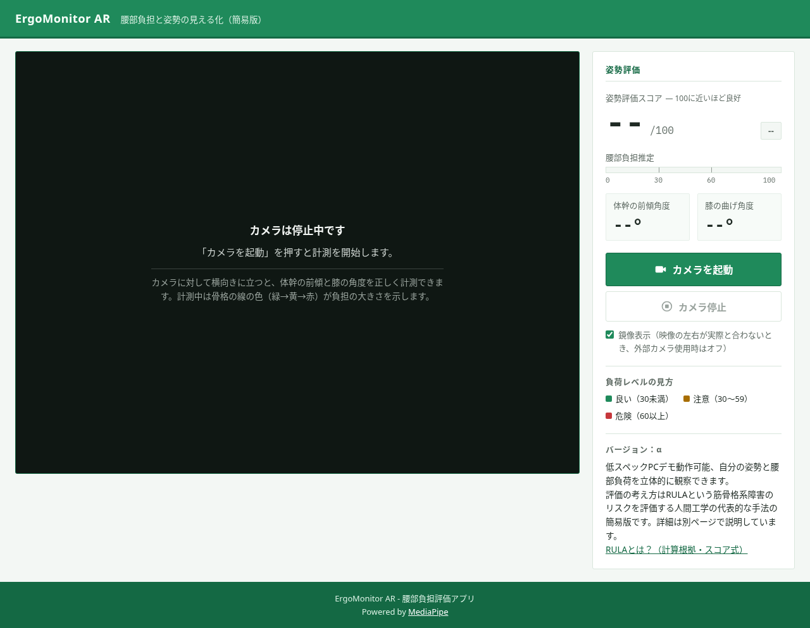
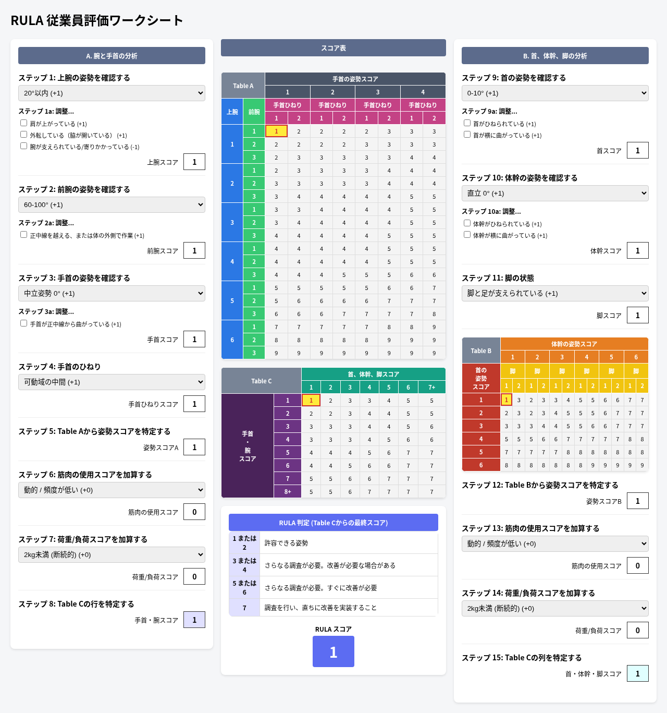
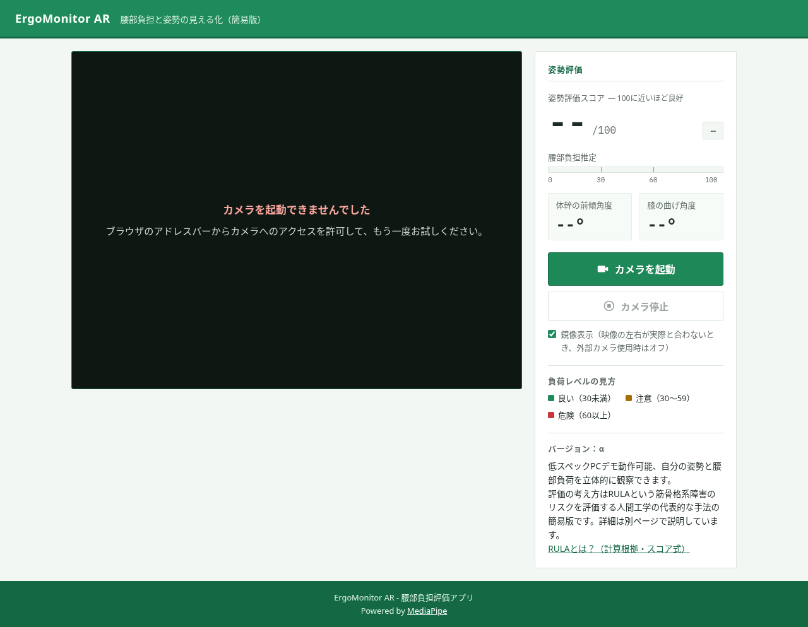

# ErgoMonitor AR 使用マニュアル

対象：開発知識がない利用者。2026-10-09作成、2026-10-10に必要なブラウザー機能とエラー案内を改訂。2026-10-13に初回起動から測定までの手順を整合しました。画面と機能はコミット `1214b9bf67b1b18fe3e33e7a3b4eeab3981ef880` を調査したものです。詳しい実装・検証結果は[仕様説明書](仕様説明書.md)にあります。

## 1. 何ができるシステムか

Webカメラの映像に骨格を重ね、体幹の傾き・左膝の角度・腰部負担の目安・姿勢評価スコアを表示するα版のデモです。作業姿勢の傾向を見る用途を想定しています。別に、観察した姿勢を手入力する「RULA 従業員評価ワークシート」があります。

主画面のスコアは独自の簡易式です。正式なRULAの点数、医療診断、実際の腰部にかかる力ではありません。実カメラでの精度は今回確認していません。高いスコアでも安全を保証せず、痛みや無理な姿勢を続けないでください。重量・作業時間・反復回数などは主画面の計算に入りません。

## 2. 始める前に必要なもの

手順の途中で準備が不足しないよう、先に確認してください。

| 必要なもの | 準備内容 |
| --- | --- |
| パソコン | Windowsの起動用ファイルが付属しています。他OSの利用は提供者に確認してください |
| ブラウザー | カメラ利用、WebAssembly、WebGLに対応するもの。まずChrome/Edgeでの利用を提供者に確認してください。今回の実行確認はLinuxのChromiumのみで、Windows版Chrome/Edgeは未確認です |
| Webカメラ | 内蔵または接続したカメラ。OSとブラウザーで利用許可が必要です。アプリ内にカメラ選択機能はありません |
| アプリ一式 | 提供者から受け取ったフォルダー全体。`index.html`、`script.js`、`style.css`、`vendor`、起動用ファイルを欠かさず展開してください |
| 撮影条件 | 肩・腰・膝・足首が映る位置、体を動かせる安全な場所。背景ぼかしが無効であることを確認してください |
| ネットワーク | 入手には提供方法に応じた通信が必要です。起動後の通常の計測は同梱ファイルを使い、外部サービスを必要としません。外部参考リンクはインターネット接続が必要です |
| アカウント・権限 | アプリのログインはありません。ファイル実行とカメラ利用が許可されている必要があります。組織のPCでは管理者へ確認してください |

**背景ぼかしについて：**「Webカメラが背景ぼかしモードになっていると精度が落ちる」はユーザー提供情報です。本調査で実カメラ検証はしていません。無効にしてから測定してください。設定場所・具体的な操作方法は利用環境で未確認のため、ここでは特定しません。カメラの提供元や管理者へ確認してください。アプリ内に背景ぼかしを設定する項目はありません。

## 3. インストールと担当者の準備

**利用者側：** 配布ファイルをフォルダーへ展開します。Windows標準のPowerShellを使う起動方法はREADME上、追加インストール・Python・管理者権限が不要とされています。ただしWindowsでの実行は今回未確認です。ブラウザー・カメラが使える状態を準備し、会社の制限を自己判断で変更せず管理者へ相談してください。

**提供者・管理者側：** `vendor`を含めた完全なファイル一式を配布し、利用PCで起動・カメラ許可・人体検出・停止を確認してください。背景ぼかしの設定場所、問い合わせ先、配布元を利用者へ伝えてください。これらの窓口はリポジトリ内に記載がありません。他OSではPython等によるローカルHTTP配信を準備します。インターネットに公開するためのサーバーや認証機能は付属しません。

## 4. 対応環境・必要スペック

| 区分 | 確認内容 |
| --- | --- |
| 今回の動作確認済み | Linux x86_64、Python 3.12.14のローカルサーバー、Chromium 151.0.7922.173。画面操作、模擬カメラによる推論処理、モデル読込、停止・初期化 |
| 資料にある利用環境 | Windows標準PowerShellの起動ファイル。READMEはChrome/EdgeでHTMLを直接開くとモデル読込が失敗する旨を説明しています |
| 最低・推奨スペック | CPU・メモリー・GPU・必要FPS・推定精度を裏付ける測定結果はありません。数値要件は未確認です |
| 未確認 | Windowsの実行、実カメラと人体、macOS、スマートフォン、Safari/Firefox/Edge等のブラウザー差、長時間利用、複数人、背景ぼかしの設定と影響の程度 |

画面に「低スペックPCデモ動作可能」とありますが、具体的な性能保証ではありません。提供者による利用PCでの確認が必要です。停止後に推論エラーが出た検証結果もあるため、12章の情報を添えて相談してください。

## 5. 初回準備と起動（Windows向け）

このWindows手順は既存READMEと起動ファイルに基づくものです。今回の環境ではWindowsの実操作を確認していません。

1. アプリ一式を展開し、`vendor`フォルダーと `start-offline.bat` が同じアプリフォルダー内にあることを確認します。圧縮ファイルの中から直接起動しないでください。**成功の目安：** 展開先にファイル一式が見えます。
2. カメラを接続し、背景ぼかしが無効になっていることを確認します。設定場所が分からなければ提供者・管理者へ相談します。**成功の目安：** カメラが認識され、提供元の設定等で背景ぼかしOFFを確認できます。設定画面の具体的な場所は未確認です。
3. `start-offline.bat` をダブルクリックします。**成功の目安：** サーバーのウィンドウに「ErgoMonitor AR オフラインサーバを起動しました」とURLが出て、ブラウザーに主画面が開きます。サーバーのウィンドウは開いたままにします。
4. 自動でブラウザーが開かなければ、サーバーのウィンドウに出たURLをブラウザーへ入力します。通常は `http://localhost:8000/`。8000が使われていれば8001～8010のいずれかになります。**成功の目安：** 「ErgoMonitor AR」「姿勢評価」「カメラは停止中です」が表示されます。
5. OS側でカメラ利用が拒否されていないことを確認し、待機画面から6節の測定手順へ進みます。ブラウザーでのカメラ許可は、6節で「カメラを起動」を押した際に行います。**成功の目安：** この時点では「カメラは停止中です」で、開始ボタンが使えます。

`index.html` のダブルクリックによる直接起動は使わないでください。アドレスが `file://` ではモデルが読み込めないことがあります。必ず起動用ファイルを使ってください。

### 実際の待機画面



LinuxのChromiumで取得した実画面です。利用PCのウィンドウやカメラ許可ダイアログを再現した画像ではありません。

### 起動用ファイルが使えないとき

まず提供者へ相談してください。PowerShellでの手動起動は[README-offline.md](README-offline.md)にあります。Python 3が既にあるPCでは、提供者がアプリフォルダーを作業場所にして次を実行する方法もあります。

```text
python3 -m http.server 8000 --bind 127.0.0.1
```

Windowsではコマンド名が `python` の場合があります。今回確認したのはLinuxの `python3` です。この代替方法はブラウザーを自動で開かず、ポートも自動で切り替えません。`http://127.0.0.1:8000/` を開いて主画面が出れば成功です。カメラの許可は6節の手順と同様に必要です。

## 6. 測定と結果確認の一連の手順

1. 5節の準備を済ませて起動します。「カメラは停止中です」が見えれば待機状態です。
2. 「カメラを起動」を押し、カメラ利用の確認が出たら許可します。**成功の目安：** 映像が出て、開始ボタンが「カメラ起動中」に変わり、「カメラ停止」が使えます。映像だけでは人体の検出成功とは限りません。
3. 映像を見ながら肩・腰・左膝・足首が収まるように距離やカメラ位置を調整し、カメラに対して横向きに立ちます。これは画面内の案内に沿った配置で、精度保証はありません。無理に画面へ合わせる姿勢を取らないでください。**成功の目安：** 必要な部位が映像の範囲に入っています。
4. 肩・腕・胴・脚に骨格の線が重なり、「姿勢評価スコア」「体幹の前傾角度」「膝の曲げ角度」に値が出ることを確認します。姿勢を安全な範囲で変えたときに値が更新することも確かめます。今回の模擬カメラ検証は人体の実測を保証しません。
5. 8節に従って値を読みます。人物が画面外へ出たり検出が途切れたりすると、前の数値が残ることがあります。骨格が消えた状態の数値を新しい測定値として使わないでください。
6. 「カメラ停止」を押します。**成功の目安：** 「カメラは停止中です」、値が `--` / `--°`、開始ボタンが再び使える状態になります。
7. 再開するなら「カメラを起動」。動かなくなった場合はページを再読み込みしてからやり直します。今回、停止時付近に推論の内部エラーが出るケースがあったため、再開の安定性は保証されていません。

## 7. 各機能の使い方

| 画面の名前・項目 | 操作 | 成功・確認する表示 |
| --- | --- | --- |
| カメラを起動 | クリックして許可 | 映像、開始表示が「カメラ起動中」、停止ボタン有効 |
| カメラ停止 | クリック | 待機案内、数値が `--`、開始ボタン有効 |
| 鏡像表示（映像の左右が実際と合わないとき、外部カメラ使用時はオフ） | チェックを切替 | 映像・骨格の左右が同時に反転。数値計算は変わりません。チェック状態は同じブラウザー・同じアドレスで保存されます |
| RULAとは？（計算根拠・スコア式） | クリック | 別タブで「RULAとは？（簡易説明）」が開きます |
| ← デモに戻る | 説明画面でクリック | そのタブで主画面が開きます。元のタブのカメラ状態とは別です。説明だけ見た場合は説明タブを閉じても戻れます |
| Powered by MediaPipe / RULAの参考リンク | 必要時にクリック | 外部サイトを開きます。ネットワークが必要です。測定には不要です |

### 手入力の「RULA 従業員評価ワークシート」

この機能はカメラ測定とは別です。主画面からのリンクがありません。提供者から案内されたワークシートURLを使うか、サーバーのURLの末尾に `RULAworkseet.html` を付けて開いてください（例：`http://localhost:8000/RULAworkseet.html`。ポートは実際の表示に合わせる）。**成功の目安：** 表題と「A. 腕と手首の分析」「B. 首、体幹、脚の分析」、Table A/B/C、RULA スコアが出ます。未変更の初期状態ではスコア1です。これは初期選択の計算結果で、実際の姿勢を評価した結果ではありません。



LinuxのChromiumで取得した実画面です。入力は観察した姿勢に合わせて選択し、該当する調整にチェックを付けます。各変更でスコア枠と3表の選択セルが更新されます。自動計測や確定ボタンはありません。

| ステップ・項目 | 選択内容（画面の点数） |
| --- | --- |
| 1 上腕 | 20°以内(+1)、20°超の伸展または20–45°の屈曲(+2)、45–90°の屈曲(+3)、90°以上の屈曲(+4) |
| 1a 調整 | 肩が上がっている(+1)、外転している(+1)、腕が支えられている/寄りかかっている(−1) |
| 2 前腕 | 60–100°(+1)、0–60°または100°以上(+2) |
| 2a 調整 | 正中線を越える、または体の外側で作業(+1) |
| 3 手首 | 中立姿勢0°(+1)、15°以内(+2)、15°以上(+3) |
| 3a 調整 | 手首が正中線から曲がっている(+1) |
| 4 手首のひねり | 可動域の中間(+1)、可動域の端に近い(+2) |
| 5・8 | 自動表示：Table Aの姿勢スコア、加算後の手首・腕スコア |
| 6 筋肉の使用 | 動的/頻度が低い(+0)、静的1分以上保持または反復4回/分以上(+1) |
| 7 荷重/負荷 | 2kg未満・断続的(+0)、2–10kg・断続的(+1)、2–10kg・静的/反復(+2)、10kg以上または繰返しの衝撃(+3) |
| 9 首 | 0–10°(+1)、10–20°(+2)、20°以上(+3)、伸展(+4) |
| 9a 調整 | 首がひねられている(+1)、首が横に曲がっている(+1) |
| 10 体幹 | 直立0°(+1)、0–20°(+2)、20–60°(+3)、60°以上(+4) |
| 10a 調整 | 体幹がひねられている(+1)、体幹が横に曲がっている(+1) |
| 11 脚 | 脚と足が支えられている(+1)、支えられていない(+2) |
| 12・15 | 自動表示：Table Bの姿勢スコア、加算後の首・体幹・脚スコア |
| 13 筋肉の使用 | ステップ6と同じ選択肢。B側へ別途入力 |
| 14 荷重/負荷 | ステップ7と同じ選択肢。B側へ別途入力 |

角度の選択文には15°等で境界が重なる箇所があります。どちらを選ぶかの補足ルールは実装・資料で未確認です。正式な評価に使う場合は提供者・評価担当者へ確認してください。画面を更新すると今回のChromiumでは入力が初期値へ戻りました。保存・履歴・出力機能はありません。

## 8. 数値・スコア・色の読み方

### 主画面

| 表示 | 意味・限界 |
| --- | --- |
| 姿勢評価スコア（/100） | `100 − 腰部負担の点数`。高いほどこの簡易式上の負担が小さい目安。正式RULA点数や安全の保証ではありません |
| 腰部負担推定バー（0～100） | 体幹の点数から膝の軽減点数を引き、0～100の範囲に収めたもの。実際の力や危険の確率ではありません |
| 良い・注意・危険 | 負担点数30未満＝良い、30～59＝注意、60以上＝危険。姿勢評価スコアそのものへこの閾値を当てはめないでください |
| 体幹の前傾角度 | 左右の肩・腰の中点から求める2Dの傾き。度、整数表示。20°未満が緑、20°以上40°未満が黄、40°以上が赤 |
| 膝の曲げ角度 | 左腰・左膝・左足首から求める膝の内角。伸びた状態は約180°、直角は約90°。値が小さいほど深く曲がった扱いです。伸展から何度曲げたかの数値ではありません |
| 骨格線・腰の円 | 体幹20°以下＝緑、20°超40°以下＝黄、40°超＝赤。膝の軽減は考慮せず、負担の判定・角度の文字色と一致しない場合があります |
| `--` / `--°` | 未測定・停止後など。人物を検出していない状態では前回の数値が残る場合もあります |

計算に使う角度は表示前の小数を含み、表示値は整数に丸めます。表示が30°でも元の値が29.6°なら30°以上の計算区分には入りません。

体幹の点数は15°未満0、15～30°未満30、30～45°未満60、45°以上100。膝の軽減は120°未満20、120～150°未満10、150°以上0です。例：体幹30°・膝119° → 負担60−20=40、姿勢評価スコア60、判定「注意」。体幹45°・膝150° → 負担100、スコア0、「危険」。これらはコードで確認した計算例で、実カメラの精度検証ではありません。

### ワークシート

観察・手入力から表を参照する別の点数です。**主画面とは逆に、点数が大きいほど強い対応を促す表示です。**

| RULA スコア | 画面に表示される判定 |
| --- | --- |
| 1または2 | 許容できる姿勢 |
| 3または4 | さらなる調査が必要。改善が必要な場合がある |
| 5または6 | さらなる調査が必要。すぐに改善が必要 |
| 7 | 調査を行い、直ちに改善を実装すること |

表の原典との完全一致や入力判断の妥当性は今回未確認です。初期1や画面の「許容できる」を実際の安全保証として扱わないでください。

## 9. 保存・出力・再表示・終了

測定結果、映像、ワークシート入力を保存・出力・後から再表示する機能はありません。カメラ停止で主画面の表示は消えます。必要な記録の方法は提供者へ相談してください。OS等でスクリーンショットを取る場合はアプリ外の機能で、映像や背景の個人情報が写る可能性があります。

鏡像チェックだけが同じブラウザーのサイトデータに保存されます。期限はアプリで設定されていません。消したい場合は、そのアドレスのサイトデータをブラウザーで削除します。ブラウザーごとの削除画面は未確認です。ホスト名・ポート・ブラウザーが変わると別の設定になります。

終了は「カメラ停止」で数値が `--` に戻ったことを確認→開いたアプリのタブを閉じる→サーバーのウィンドウを閉じる、またはCtrl+C。説明から戻った別タブでもカメラを開始した場合は、そのタブでも停止してください。サーバー停止だけで既に開いたページのカメラを停止できるとは限りません。

## 10. よくある問題と対処方法

| 症状 | 対処 | 解決の目安・情報の区分 |
| --- | --- | --- |
| 背景ぼかしモードで精度が落ちる | **背景ぼかしを無効にしてから、再度測定する。** 設定場所はカメラ提供元・管理者へ確認 | ユーザー提供情報。実機未検証。低下の程度・仕組みは未確認で、改善量を保証できません |
| 主画面が開かない | 起動ウィンドウが開いているか、表示URLとポートが一致するか確認。起動ウィンドウのエラーを提供者へ伝える | 主画面の待機案内が出る。Windows起動は今回未確認 |
| HTMLを直接開いたら動かない | タブを閉じ、`start-offline.bat` で起動し直す | アドレスが `http://localhost:…` になり主画面が出る。既存READMEの情報 |
| `Failed to acquire camera feed: …` の小さいメッセージ画面が出る | 内容を控えて閉じ、映像エリアに続けて出る案内を確認します。カメラの接続・利用許可を確認して再度開始してください | 同梱のカメラ処理が表示するダイアログです。許可拒否を模擬した検証で、閉じた後に「カメラへのアクセスを許可して…」の案内が出ることを確認しました。実機の許可拒否は未検証です |
| `Failed to create WebGL canvas context when passing video frame.` が出る | メッセージを控えて閉じ、提供者にブラウザーの対応・設定を確認してもらいます | 推定処理に必要な描画機能を利用できないというライブラリの案内です。コードで確認した分岐で、この症状の実機検証はしていません |
| 「カメラが見つかりませんでした」 | カメラ接続・OSでの認識を確認して「カメラを起動」を再度押す | 映像が出る。エラーメッセージの分岐は模擬エラーで確認 |
| 「カメラへのアクセスを許可して…」 | OSとブラウザーでカメラ利用を許可し、再度開始。許可済みなら提供者に相談 | 映像が出る。この案内はカメラ許可以外の起動エラーでも出る場合があります |
| 映像はあるが骨格・数値が出ない | 肩・腰・膝・足首が画面に入る位置を確認。背景ぼかしOFFを確認。改善しなければ提供者にモデルファイルや読込エラーを調べてもらう | 骨格と新しい値が出て姿勢に合わせて更新。実人体での精度は未確認 |
| 人が映っていないのに数値が残る | 前回値として扱い、新しい測定値と解釈しない。停止で表示を消してから、人物が映る状態で再開 | 停止後 `--`。これはコード・合成入力で確認した現状の挙動 |
| 左右の動きが合わない | 「鏡像表示」のチェックを切り替える | 映像と骨格が同時に反転。実行確認済み |
| 停止・再開後に止まる/動かない | 停止できれば止め、ページを再読み込みし、もう一度開始。改善しなければ提供者へ相談 | 新しいページの待機画面から再開。模擬カメラの停止付近でWASM内部エラーを観測。実機再現・根本原因は未解決 |
| 数値の色と骨格の色が違う | 8節の別々の基準で読む | 実装上の違い。色が同じになることを成功条件にしない |
| 鏡像設定が保存されない | 同じアドレス・ブラウザーか確認。サイトデータ保存が制限される場合は都度切替 | 切替自体は保存失敗時も動く設計。保存制限環境は未検証 |
| ワークシートが見つからない | 7節のURLと実ポートを確認。ファイル名は `RULAworkseet.html` | 表題と3表が出る。主画面のリンクは未実装 |
| ワークシート結果が1のまま | 初期選択のままか確認し、実際の観察に合わせて入力 | スコア枠とハイライトが更新される。ただし変更しても同じ最終スコアになる場合があります |

### 実際のカメラエラー表示



実アプリの画面です。検証側でカメラの権限拒否を模擬して取得しており、実OSで拒否された状況を検証した画像ではありません。

## 11. 注意事項とデータの扱い

カメラ映像・姿勢の点はブラウザー内で処理され、アプリ独自の録画・外部送信は実装されていません。今回の通常操作でも外部リクエストはありませんでした。ただし外部リンクを開く行為や、利用者が別途使う録画・画面共有・カメラ加工ソフトの動作は別です。

他人を撮影する場合は本人の了解と組織のルールを確認してください。問い合わせの画像には人の顔や背景の個人情報を不要に含めないでください。測定値が更新していることを確認し、無理な動きでスコアを上げようとしないでください。人体が隠れる、複数人が映る等の条件での信頼性は未確認です。

## 12. 問い合わせ時に共有する情報

問い合わせ先はこのリポジトリに定義されていないため、アプリを提供した担当者・管理者へ連絡してください。次をまとめると調査しやすくなります。

- アプリの入手元・入手日・版（分かればコミット）、OS、ブラウザー名と版。
- カメラ名、内蔵/外付け、背景ぼかしのON/OFF、カメラ加工ソフトの有無。
- 起動方法、使った画面名、押したボタンと順序、停止・再開前後どちらか。
- サーバーに表示されたURLとポート、エラーの全文、発生日時、再読込後の変化。
- 個人情報を隠した画面画像。映像共有が不要ならエラー部分だけ。
- 開発者が確認できる場合はブラウザーのConsoleエラーとNetworkで失敗したファイル名。秘密値や無関係なログ全体は送らない。

Windows起動・実カメラ精度・背景ぼかしの設定方法は未確認、停止時のWASM例外は未解決です。提供者による利用環境での確認を補ってから運用してください。
